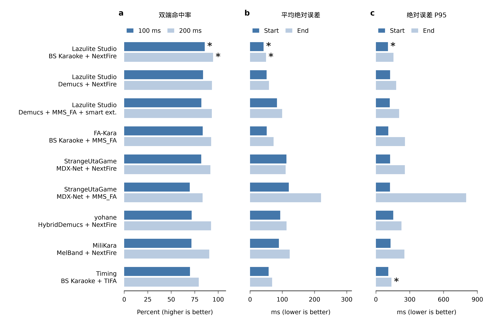
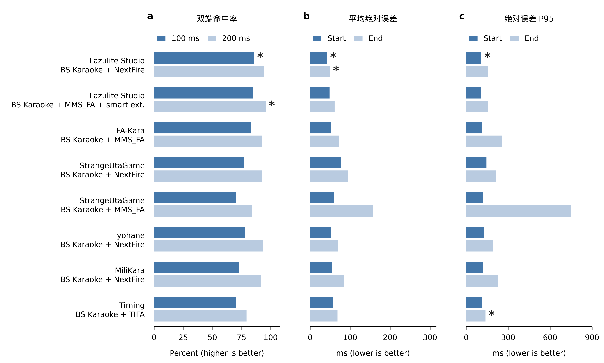
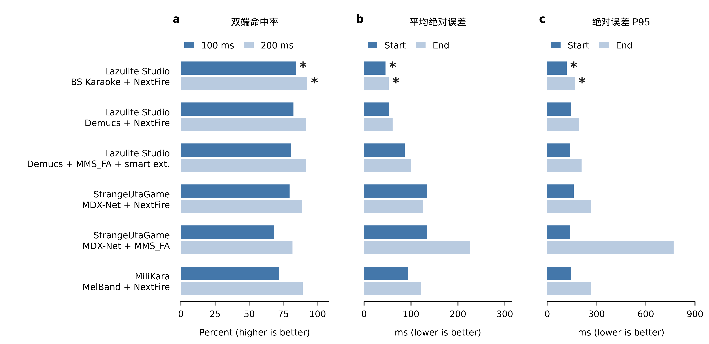

# 歌词自动对齐管线探索

本仓库记录 [Lazulite](https://github.com/wuchenyanmo/Lazulite) 与 [Lazulite Studio](https://github.com/zet-wu/Lazulite-studio) 开发过程中的歌词工作流实验，对比当前主流开源打轴工具 [MiliKara](https://github.com/BilyHurington/MiliKara)、[Timing](https://github.com/Zennmn/Timing)、[StrangeUtaGame](https://github.com/karaoke-studio/StrangeUtaGame)（简称 SUG，分别测试其 `NextFire` 与 `MMS_FA` 两条后端）、[yohane](https://github.com/Japan7/yohane) 和 [FA-Kara](https://github.com/moriwx/FA-Kara)。

测试集包含 **26 段 AAC-LC（`.m4a`）歌曲录音与 26 份人工根据声谱图精调的 TTML 歌词标注**（共 1,131 行正文、10,887 个主评估读音单元），分为两组：
- **20 首日语主组（`j01`–`j20`）**：共 875 行正文、7,066 个共同正文区间、8,912 个纯假名主评估读音单元（含英文词共 9,053 个），其中 8 首包含背景人声与主唱叠唱区间，`j14` 与 `j15` 为同一首歌《Spica》的两种编曲版本；
- **6 首跨语种与方言组（`m01`–`m02`、`y01`–`y02`、`jy01`、`t01`）**：包含国语 2 首、粤语 2 首（含 `y01` 演唱会口白与歌唱段）、日语／粤语混合 1 首（`jy01`）和潮州话 1 首（`t01`），共 256 行正文、1,957 个共同正文区间、1,975 个读音单元。

源码、配置、输入和逐条件预测随仓库发布，模型及第三方运行环境由脚本自动检出。早期使用 12 首日语歌曲作为测试集的一期实验存档在 [phase1](https://github.com/zet-wu/lyric-auto-report/tree/phase1) 分支。

## 总体结论

**日语歌曲**：在 20 首日语主组的全部三组实验（G1 人工读音 + 各自分离器、G2 人工读音 + 统一 `BS Karaoke`、G3 纯文本自动分词注音 + 各自分离器）中，综合表现最稳健的是 **Lazulite Studio** 采用的 **人声分离 + 人声活跃片段整体拼接（`core`） + `NextFire` / `MMS_FA + 智能延长`** 方案。
- 在 G1 共同正文边界（`n = 7,066`）上，`Studio (BS Karaoke + NextFire)` 的双端 100 ms 命中率达 **85.72%**（人工读音边界 `n = 8,912` 下达 **86.80%**）；轻量默认档 `Studio (Demucs + NextFire)` 在人声分离耗时仅约为 `BS Karaoke` 十六分之一的前提下达到 **83.87%**（人工读音边界 **84.78%**），与依赖 `BS Karaoke` 输入的 `FA-Kara`（**83.50%**）相当，并高于 `Studio (Demucs + MMS_FA + 智能延长)`（**82.13%**）、`SUG (NextFire)`（**81.93%**）、`yohane`（**71.74%**）、`MiliKara`（**71.53%**）、`SUG (MMS_FA)`（**69.81%**）和 `Timing`（**69.98%**，3 首失败）。
- 同为 `MMS_FA` 模型，`Studio (MMS_FA + 智能延长)` 在 G1（**82.13%**）与 G2（**85.20%**）上均大幅领先 `SUG (MMS_FA)`（**69.81%** / **70.49%**），说明先做 `core` 活跃片段拼接、再结合细粒度人声静音搜索做智能尾点延长，比整曲直传加简单尾部修正有效得多。

人工读音 + 各自分离器（G1）：共同正文边界（`n = 7,066`）的误差指标：


图中 `*` 标记各指标最佳值：双端命中率越高越好，平均绝对误差（MAE）与绝对误差 P95 越低越好，以下两图相同。

人工读音 + 统一 BS Karaoke 分离器（G2）：共同正文边界（`n = 7,066`）的误差指标：


在 G3（纯文本自动分词注音）组中，由于部分开源工具（如 `Timing`）的自动分词器会把多个汉字词拼成超长片段，全组可对齐的共同正文区间从 G1/G2 的 7,066 个缩水到 5,513 个；而真正支持细粒度假名级自动注音打轴的 6 条完整路线（Studio 三条路线、SUG 两条路线与 MiliKara）在各自词边界内的假名切分要精细得多。因此，**G3 的对比图改回采用全部 8,912 个人工读音单元边界（[九条路线对齐比较](reports/comparison.md) 中同时提供共同正文与人工读音两套完整表格）**。在 `n = 8,912` 的人工读音边界上，`Studio (BS Karaoke + NextFire)` 达到 **84.03%**（7,489/8,912，双端 200 ms 达 **92.44%**），`Studio (Demucs + NextFire)` 达 **82.29%**，`Studio (Demucs + MMS_FA + 智能延长)` 达 **80.42%**，均领先于 `SUG (NextFire)`（**79.48%**）、`MiliKara`（**71.97%**）和 `SUG (MMS_FA)`（**67.95%**）。

自动分词注音 + 各自分离器（G3）：人工读音边界（`n = 8,912`，展示内置完整自动注音的 6 条路线）的误差指标：


**跨语种与方言歌曲**：在 6 首国语、粤语、日粤混合与潮州话歌曲（共同正文边界 `n = 1,957`，细粒度读音边界 `n = 1,975`）上，**`Lazulite Studio (MMS_FA + 智能延长)` 是唯一跑通全部 6 首并保持 82% 以上命中率的路线**（`Demucs` **82.83%** / `BS Karaoke` **82.42%**）。
- 基于日语数据微调的 `NextFire` 在非日语歌曲上大幅回落（`Studio NextFire` 为 **46.40%–49.72%**，`SUG NextFire` 为 **39.24%–42.00%**，`MiliKara` 仅 **28.00%–29.43%**）。按音节类型拆开看，潮州话 `t01` 的 300 个音节全都生成了有效拉丁字母输入，掉点并非分词断链，而是因为 `NextFire` 习惯了日语“辅音 + 元音”的发音规律，遇到汉语族常见的鼻音尾（`-n/-ng/-m`，命中率仅 **44.81%** vs `MMS_FA` **86.32%**）、日语里没有的声母韵母（**42.90%** vs **82.10%**）和入声短促收尾（`-p/-t/-k/-h`，**38.24%** vs **73.53%–75.00%**）时难以准确判断音节收尾位置。
- `SUG (MMS_FA)` 在国语、粤语、日粤混合 5 首歌上能正常跑通（单曲命中率 **62.7%–78.7%**），但在潮州话 `t01` 上因输入含空格触发 `torchaudio` 分词器 `KeyError: ' '` 失败，6 首总计命中率为 **60.65%**（Demucs）/ **59.17%**（BS Karaoke），明显高于 `SUG (NextFire)`，但仍比 `Studio (MMS_FA + 智能延长)` 低 22 个百分点以上。
- 直接用 Studio 内置的国语、粤语、潮州话词典自动注音（5 首单语种汉字歌带调准确率 **94.04%**、不带调 **94.38%**），下游 `MMS_FA + 智能延长` 的双端 100 ms 命中率（Demucs **84.22%** / BS **83.64%**）与人工注音（**84.05%** / **83.64%**）基本持平。详见 [多语言与方言对齐及多语种词典评估](reports/multilingual.md)。

## 人声分离模型与音频持久化

我们在同一套 5 首代表曲目（单轮音频总长 1,411.23 秒）上实测了 10 种主流人声分离模型的 GPU / CPU 耗时与显存能耗，并在 20 首日语歌（`n = 8,912`）上固定下游 `NextFire core` 测试它们的打轴准确率：
- **为什么先切掉间奏静音（`core`）再打轴**：在对比整曲直传（`global`）与人声活跃片段拼接（`core`）的 4 种代表性分离器上，先剔除前奏、间奏、尾奏长静音段可将双端 100 ms 命中率提升 **2.65 至 9.94 个百分点**（`Demucs` 从 **74.84%** 升至 **84.78%**，`BS Karaoke` 从 **77.23%** 升至 **86.80%**）。
- **为什么提供 `Demucs` 与 `BS Karaoke` 双档配置**：开启 `core` 片段拼接后，主流分离器的下游命中率大多集中在 84.8%–86.8% 之间。`Demucs htdemucs` 跑完 5 首代表曲目 GPU 耗时仅 **13.53 s**（单曲平均 **2.71 s**，实时率 RTF **0.0096**，GPU 整卡能耗 **2.75 kJ**），下游纯假名命中率已达 **84.78%**，与慢 2.6–5.2 倍的 `MDX-Net`（**85.00%**）和 `MelBand RoFormer`（**85.13%–85.26%**）差距不到 0.5 个百分点，适合作为快速默认档；而 `BS Karaoke` 能同时剥离伴奏与背景和声，把全集纯假名命中率推高到 **86.80%**（在 8 首叠唱歌曲的 236 个叠唱区间上更把命中率从 78%–79% 提升到 **83.47%–85.17%**），代价是 GPU 耗时为 `Demucs` 的 **15.67 倍**（5 首耗时 **212.04 s**）、CPU 耗时为 **23.06 倍**，适合作为高质量与主唱伴唱重叠曲目的进阶档位。
- **为什么人声缓存可以存成 192 kbps AAC-LC（`.m4a`）**：在全部 26 首歌（`n = 10,887`）上，将分离出的人声轨压缩保存为 192 kbps AAC-LC M4A（单曲体积从 40–100 MiB 降至 4–10 MiB）与无损浮点 WAV 直传相比，下游打轴命中率几乎没有损失（20 首日语歌上 `BS Karaoke` 仅差 **-0.15% 至 -0.17%**，`Demucs` 差 **-0.59% 至 -1.03%**；6 首非日语歌上 `BS Karaoke` 甚至微增 **+0.10% 至 +1.82%**）。`BS Karaoke` 在 26 首歌中有 24 首切出的活跃片段数分毫不差，片段边界偏移中位数不到 **0.81 ms**。详见 [十种人声分离模型的配置与性能实测](reports/separation-performance.md) 和 [十种人声分离配置及 AAC-LC 持久化对下游歌词对齐的影响](reports/separation-alignment.md)。

| 分离模型 | 5 首代表曲目 GPU 耗时 (s) | GPU 相对耗时 | CPU 30s 相对耗时 | 参数量 | 5 首 GPU 整卡能耗 (kJ) | 20 首日语 `core` 纯假名 100 ms (`n=8,912`) | 20 首日语 `core` 共同正文 100 ms (`n=7,168`) |
| --- | ---: | ---: | ---: | ---: | ---: | ---: | ---: |
| **Demucs htdemucs** (`demucs`) | 13.53 | 1.00x | 1.00x | 41.984 M | 2.75 | 84.78% | 83.71% |
| **HybridDemucs MUSDB Plus** (`yohane`) | **6.97** | **0.51x** | **0.34x** | 83.639 M | **1.32** | 81.84% | 80.62% |
| **Windowed RoFormer** (`windowed`) | 18.02 | 1.33x | 4.77x | 228.387 M | 6.07 | 85.46% | 84.39% |
| **DTTNet** (`dttnet`) | 25.36 | 1.87x | 7.94x | **4.958 M** | 8.14 | 83.77% | 82.59% |
| **SCNet Small** (`scnet`) | 28.94 | 2.14x | 3.66x | 10.579 M | 6.03 | 82.17% | 80.64% |
| **MelBand RoFormer Kim** (`mel_roformer`) | 34.79 | 2.57x | 11.77x | 228.203 M | 12.35 | 85.26% | 84.50% |
| **MelBand RoFormer ep_3005** (`milikara`) | 63.34 | 4.68x | 8.83x | 251.870 M | 25.63 | 85.13% | 84.10% |
| **MDX-Net Inst HQ 3** (`sug`) | 70.51 | 5.21x | 1.67x | 16.684 M | 7.59 | 85.00% | 84.00% |
| **BS-RoFormer viperx** (`bs_roformer`) | 74.84 | 5.53x | 30.55x | 159.758 M | 28.97 | 85.85% | 84.72% |
| **BS Karaoke** (`bs`) | 212.04 | 15.67x | 23.06x | 51.049 M | 89.52 | **86.80%** | **85.62%** |

## 对齐策略、MiliKara 消融与跨模型异常行重算

围绕打轴后半程的窗口切分、解码规则、音节时长规律与二次修正，实验得出四项直接指导产品设计的结论：

1. **整曲 `core` 拼接 vs 按行切窗口与智能尾点延长（M6）**：
   - 对 `NextFire` 来说，不需要预先知道每行起止时间的整曲 `core` 片段拼接（共同正文 Demucs **83.80%** / BS **85.65%**）反而比事先给定完美人工行起止时间按行切分（**79.28%** / **83.11%**）高出 **2.53–4.52 个百分点**，因为逐行硬切音频会截断行首与行尾的声学上下文。
   - `TIFA` 即便在给定完美人工行时间窗时（**79.24%** / **79.83%**）仍低于无需行时间的 `NextFire core`，一旦换成 Timing 实际的两阶段自动粗定位切行，会因第一阶段粗定位在 3–5 首歌上报错中断而跌至 **57.99%–69.15%**。
   - 原始 `MMS_FA` 的起点定位很准（起点 MAE 仅 51.02–83.60 ms），但尾音经常提前收束（原始双端 100 ms 仅 **23.29%–23.31%**）；加上 Studio 的智能尾点延长后，纯假名双端 100 ms 命中率直接跃升至 **82.43%**（Demucs）与 **84.95%**（BS Karaoke）。详见 [对齐模型后端、行时间窗口策略与智能尾点延长](reports/alignment-backends.md)。
2. **不同音节时长与语速的表现（M4）**：
   - 在全部 26 首歌的 10,887 个读音单元上，时长在 `120–250 ms` 的常规紧凑音节命中率最高（`BS + MMS_FA + 智能延长` 双端 100 ms 达 **91.92%**，双端 200 ms 达 **97.84%**）；而 `>1,000 ms` 的超长拖音（560 个）命中率回落至 **47.14%–62.14%**，且误差主要来自渐弱尾音提前结束（起点 MAE 仅 87.07 ms，终点 MAE 达 189.01 ms）。因此整首歌语速越快、音节越紧凑，全曲双端 100 ms 命中率反而越高。详见 [语速、音节时长与对齐误差相关性分析](reports/tempo-correlation.md)。
3. **MiliKara 解码附加规则与原曲／人声重试的跨模型验证（M7）**：
   - 在 20 首日语歌（`n = 8,912`）上，无论使用 `Demucs` 还是 `BS Karaoke`、无论后端是 `NextFire` 还是 `MMS_FA`（原始或带智能延长），MiliKara 引入的三项静音与能量软代价（`line_gap`、`rest_gap`、`rest_token`）全组合对命中率的影响都极小（`NextFire` 下最大仅 **+0.27% 至 +0.36%**；`MMS_FA + 智能延长` 下反而微降 **-0.02% 至 +0.33%**）。
   - 将词间分隔符 `|` 并入空白帧（`+delimiter`）会让相邻同音字提前滑移，在 `NextFire` 下重挫 **-6.96%**（Demucs）与 **-6.56%**（BS Karaoke）；而用同一模型在原曲与人声轨之间挑高分行覆写（`+retry`）在全部 6 条测试主线上一致倒退 **-0.55% 至 -3.86%**（在最强的 `BS Karaoke + NextFire` 上倒退 344 个单元）。因此 Studio 只保留干净的 `core` 片段拼接，不引入这些启发式附加项。详见 [MiliKara 软代价解码与原曲／人声重试消融分析](reports/milikara.md)。
4. **跨模型异常行重算与替换：将双端 100 ms 命中率推至 88.32%（M8）**：
   - 首轮 `NextFire` 打轴后，如果用**同一个 `NextFire` 模型**对筛出的异常行做局部重算，在所有筛选条件下都会净亏损（`Demucs` 下亏损 32–103 个单元，`BS Karaoke` 下亏损 22–112 个单元）。
   - 反过来，利用 `NextFire` 局部失准时常把某些音节挤成 `<30 ms` / `<40 ms` 极短时长、或让同行同元音字长短严重失衡的特征筛出异常行，**换用 `MMS_FA + 智能延长` 重算或替换**，就能在两种分离器下都获得显著提升：在 `Demucs` 组中从 **84.78%** 提升至 **86.18%**（净增 **+124 单元 / +1.39%**）；在 `BS Karaoke` 组中更从 **86.80%** 一举推高至 **88.32%**（7,871/8,912，净增 **+135 单元 / +1.51%**，双端 200 ms 达 **96.31%**，综合 P95 仅 **112.82 ms**）；仅对 **9.26%**（81/875 行）的同元音失衡行做 `MMS_FA + 智能延长` 局部重算，也能在 `BS Karaoke` 下达到 **87.71%**（净增 +81 单元）。详见 [基于极短音节与同元音失衡筛选的跨模型异常行重算与替换](reports/local-refinement.md)。

## 自动注音

在 20 首日语主组的 **1,623 个含汉字共同正文片段** 与 **835 行纯日语参考行** 上，跨平台本地注音方案中 **Lazulite Studio**（`Sudachi C 模式 + JmdictFurigana`）与 **SUG（Sudachi 模式）** 并列第一梯队（含汉字片段准确率 **92.67%** vs **92.98%**，字符错误率 CER **3.81%** vs **3.77%**，整行完全匹配率 **86.11%** vs **86.71%**），明显优于 `MiliKara`（片段 **90.82%** / 整行 **75.21%**）、`OpenJTalk`（**80.84%** / **57.84%**）和 `Timing`（**77.57%** / **43.83%**）。Windows 专属的 `sug-winrt` 为 **93.96%** / **88.98%**，而结合整首歌词上下文用大语言模型复核的 `studio-llm-corrected` 达到 **95.44%** / **90.90%**（剩余 ~4.6% 为纯文本无法唯一确定的特殊唱法当て字与多音词）。结合 G3 与 M2 的打轴结果来看，如果仅仅为了自动打轴，直接采用 Studio 本地词典自动注音即可满足全自动打轴需求，进一步引入大语言模型推高准确率，在能够达到 99% 以上准确率，彻底解放人工复核之前没有太大意义。详见 [日语歌词自动注音与词典覆盖准确率比较](reports/auto-reading.md)。

## 报告目录

- [测试集说明](datasets/README.md) 与 [评价方法](reports/methods.md)
- [九条路线对齐比较](reports/comparison.md)（M1：G1 / G2 / G3 共同正文与人工读音双边界对比、叠唱区间表现）
- [多语言与方言对齐及多语种词典评估](reports/multilingual.md)（M2：6 首国语、粤语、日粤混合与潮州话歌曲对比及音节类型拆解）
- [十种人声分离模型的配置与性能实测](reports/separation-performance.md)（M5 资源：GPU / CPU 耗时、实时率、内存显存与整卡能耗）
- [十种人声分离配置及 AAC-LC 持久化对下游歌词对齐的影响](reports/separation-alignment.md)（M5 对齐 + M3：`core` vs `global` 与 192 kbps AAC-LC M4A 持久化验证）
- [语速、音节时长与对齐误差相关性分析](reports/tempo-correlation.md)（M4：5 档音节时长表现、语速相关性与《Spica》双编曲对照）
- [对齐模型后端、行时间窗口策略与智能尾点延长](reports/alignment-backends.md)（M6：`NextFire`、`TIFA`、`MMS_FA` 与行窗口对照实验）
- [MiliKara 软代价解码与原曲／人声重试消融分析](reports/milikara.md)（M7：跨分离器与对齐模型的解码规则及原曲／人声重试消融）
- [基于极短音节与同元音失衡筛选的跨模型异常行重算与替换](reports/local-refinement.md)（M8：`Demucs` 86.18% 与 `BS Karaoke` 88.32% 跨模型二次修正）
- [日语歌词自动注音与词典覆盖准确率比较](reports/auto-reading.md)（M9：7 种日语注音方案准确率与字符错误率对比）
- [实验复现说明](reports/reproduce.md)

## 快速复核

仅从仓库已保存的预测文件重新计算 M1–M9 全部汇总指标、生成 [`results/EXPERIMENT_INDEX.json`](results/EXPERIMENT_INDEX.json) 并校验仓库完整性，无需 GPU 或模型权重：

```sh
.venvs/research/bin/python scripts/score.py
python3 scripts/verify.py
```

完整的 GPU 推理环境搭建、模型下载与分阶段复现流程见 [实验复现说明](reports/reproduce.md)。

## 仓库结构

```text
datasets/       26 首 AAC-LC (.m4a) 测试音频、26 份人工 TTML 标注与文件校验清单 (files.json)
reports/        评价方法、复现指南与 M1–M9 各专题实验报告
results/        M1–M9 汇总指标 (summary.json / *.csv)、EXPERIMENT_INDEX.json、各模块压缩预测与结果图表 (figures/)
configs/        上游源码版本 (sources.json / comparison-sources.json)、模型清单与实验配置 (phase2.json)
scripts/        环境安装、数据准备、模型推理、M1–M9 统一评分、图表绘制与静态校验脚本
requirements/   研究环境、各工具适配环境与轻量评分依赖锁定清单
licenses/       代码改编对应的第三方许可
```

Git 跟踪测试音频、标注、实验脚本、汇总表和压缩预测；`.deps`、`.models`、`.cache`、`.venvs` 均被忽略。所有运行路径从仓库根目录派生，公开上游提交固定在 [`configs/sources.json`](configs/sources.json)、[`configs/comparison-sources.json`](configs/comparison-sources.json) 与 [`results/EXPERIMENT_INDEX.json`](results/EXPERIMENT_INDEX.json)。

代码采用 [AGPL-3.0](LICENSE)。第三方代码、权重、录音和歌词的归属见 [来源与许可](THIRD_PARTY.md)。
