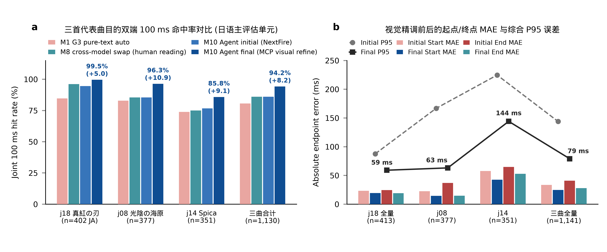

# 无音频输入的 LLM 经 MCP 全自动视觉精调实测

在 [跨模型异常行重算与替换实验](local-refinement.md)（`M8`）中，基于极短音节与同元音失衡规则将异常行换为 `MMS_FA + 智能延长`，把 20 首日语主组歌曲在 `BS Karaoke` 下的双端 100 ms 命中率推高至 **88.32%**（7,871/8,912）。拆解剩余约 11.7% 的误差可以看到，纯声学模型加启发式筛选主要卡在四处：纯文本无法从字面识别的特殊义训唱法（当て字）、慢速长拖音与呼吸气声的尾部边界、连续同元音或促音在局部窗口内仍被单侧挤压，以及与人工打轴习惯（行内短间隙闭合、长音内部切分）的偏差。

为了检验大语言模型能否通过查看频谱图与人声能量曲线补齐这部分差距，我们从 20 首日语主组中选取 3 首代表曲目（`j18`、`j08`、`j14`，合计 **1,130 个日语主评估读音单元**，含 `j18` 英文音节的全量共 **1,141 个单元**），让无音频输入能力的 `GPT-6.1 sol`（思考等级 `xhigh`）经 Lazulite Studio MCP 接口，从纯文本歌词出发自主完成全曲打轴与精调。

评价指标与边界映射算法沿用 [测试集与评价方法](methods.md)，冻结的初轴与最终轴预测、逐单元明细及基线对照保存在 [`results/M10/summary.json`](../results/M10/summary.json)、[`results/M10/metrics.csv`](../results/M10/metrics.csv) 和 [`results/M10/items.json.gz`](../results/M10/items.json.gz)。

## 核心发现

1. **三首曲目全部取得稳定正增益，两首常规与抒情曲目（`j18`、`j08`）跨过 96%–99% 双端 100 ms 线，起终点 MAE 压至 14–19 ms**：
   - 在 3 首曲目合计的 **1,130 个日语主评估单元**上，视觉精调将双端 100 ms 命中率从同次初轴的 **85.93%**（971/1,130）推高至 **94.16%**（1,064/1,130，修好 118 个、改错 25 个，净增 **+93 单元 / +8.23 pp**），双端 200 ms 从 **93.98%** 升至 **98.32%**（1,111/1,130），起 / 终点 MAE 从 **33.13 / 40.52 ms** 降至 **24.71 / 27.83 ms**，综合 P95 从 **140.00 ms** 降至 **79.00 ms**（含英语全量 **1,141 单元**下从 **85.63%** 升至 **94.13%**，净增 +97 单元）。
   - 单曲表现上，`j18`《真紅の刃》全量 413 单元双端 100 ms 从 **93.46%**（386/413）升至 **99.27%**（410/413，+5.81 pp），双端 200 ms 达 **100.00%**，起 / 终点 MAE 降至 **19.27 / 19.03 ms**，综合 P95 仅 **59.00 ms**（日语 402 单元 **94.53% → 99.50%**，英语 11 单元 **54.55% → 90.91%**）；`j08`《光陰の海原》377 单元双端 100 ms 从 **85.41%**（322/377）升至 **96.29%**（363/377，+10.88 pp），双端 200 ms 从 **92.31%** 升至 **98.67%**（372/377），起 / 终点 MAE 降至 **14.38 / 14.66 ms**，综合 P95 从 **166.70 ms** 降至 **63.00 ms**。
2. **误差压到十余毫秒量级后，已与音节间能量低谷宽度及不同打轴者的边界偏好处于同一区间**：
   - `j18` 全曲 413 单元中仅有 3 个单元超出双端 100 ms（全部在 150 ms 内）：第 24 行「優しい」的 `し／い` 内部边界（提前 112 ms）严格落在人声 RMS 局部能量极小值（103.184 s）上，属于连续元音切分偏好差异；全曲仅有一处明确听感失误，即第 27 行 `sacrifice` 尾音节 `fice` 终点误纳入了句尾换气声（延后 143 ms）。
   - `j08` 全曲 14 个未命中双端 100 ms 的单元中，有 10 个来自 5 处连续长元音（第 1/16 行 `い／い`、第 12/23 行 `ろ／う` 等）的内部能量低谷切分位置差异，外包络与真实起音均吻合。
3. **`j14`《Spica》净增 9.12 个百分点且促音全命中，同时暴露出纯视觉路线的明确边界**：
   - 在含 62 个 `>1 s` 长音的极端慢板曲目 `j14`（351 单元）上，双端 100 ms 从 **76.64%**（269/351）升至 **85.75%**（301/351，净增 **+32 单元**），双端 200 ms 从 **89.17%** 升至 **96.01%**（337/351），起 / 终点 MAE 降至 **42.38 / 52.65 ms**，综合 P95 从 **224.60 ms** 降至 **144.00 ms**，9 个促音双端 100 ms 从 **7/9（77.78%）** 升至 **9/9（100.00%）**。
   - 但 `j14` 的 `>1 s` 误差单元从 6 增至 8：面对原唱将句尾「るひ」「る」极度压缩在百余毫秒内的反常识唱腔，无听觉 Agent 否决了底层对齐模型原本接近正确的结果（如第 13 行初轴 0 ms 误差），手动将边界前推了 1.09–1.21 秒。

---

## 1. 实验设置与 MCP 工作流

### 1.1 测试曲目与分母

| 曲目 | 曲风与难点特征 | 行数 | 日语主评估单元 (`reading_units`) | 补充单元 | 全量单元 (`all_reading_units`) |
| --- | --- | ---: | ---: | --- | ---: |
| `j18`《真紅の刃》 | 节奏清晰，含义训与 3 处英文词 | 40 | 402 | 11 个英文音节 | 413 |
| `j08`《光陰の海原》 | 抒情慢歌，长拖音与连续同元音多 | 23 | 377 | 无 | 377 |
| `j14`《Spica》（原编曲） | 极端慢板，62 个 `>1 s` 长音、9 个独立促音 | 35 | 351 | 无 | 351 |
| **三曲合计** | — | **98** | **1,130** | **11** | **1,141** |

### 1.2 实验条件与执行流程

- **输入与隔离**：无时间、无分词、无注音的纯文本歌词 + 剥离歌词轨的音频。执行模型为 Codex 环境下的 `GPT-6.1 sol`（思考等级 `xhigh`，无音频输入能力），使用统一归档的执行提示词模板 [`configs/agent-mcp-prompt.md`](../configs/agent-mcp-prompt.md)（已将本机运行目录脱敏为 `{PROJECT_NAME}`、`{SONG_ID} / {SONG_TITLE}` 与 `{LYRICS_FILE}.txt` 占位符）。独立项目盲测，不接触人工参考轴；所有读取、模型调度、图像查看、时间修改与导出均经 Lazulite Studio MCP 完成。
- **四步工作流与三项定界习惯**：
  1. **分词注音与唱法核对**：纯文本导入并自动分词注音后，联网检索非计时歌词与罗马字资料，逐行核对并修正义训唱法（如 `j18`「静寂→Silence」「覚悟→ぶき」「輪廻→くりかえし」「栄光→はな」「犠牲→sacrifice」，`j08`「瞬き→またたき」「宝物→たからもの」，`j14`「風車→ふうしゃ」），实现参考读音零缺失映射。
  2. **初轴与互补候选生成**：运行 `BS Karaoke` 主唱分离，以 `NextFire` 生成全曲初轴并冻结导出；在同一保存修订上生成 `MMS_FA + 智能延长` 互补候选。
  3. **多尺度看图与局部重算**：逐行查看叠加人声 RMS 能量曲线的频谱对比图（行级上下文 3–8 s，疑点缩至 0.4–2 s 窄窗并读取 RMS 数列），对可疑区间触发局部 `MMS_FA + 智能延长` 重算，逐边界采纳或手调。
  4. **三项定界习惯与二轮复查**：① 强制闭合 `<100 ms` 行内正向短间隙（`≥100 ms` 真实停顿保留）；② 连续合并长音在共同发声区中部附近取 RMS 局部能量低谷切分，兼顾前后时长均衡；③ 短停顿型促音占前元音核结束至后辅音起始过程（后音起点置于元音核），独立重复元音型促音保留完整发声时长。首轮修改保存后，全曲逐行复看第二轮频谱图并导出最终 TTML。

---

## 2. 三曲实测总表与纯模型对照

### 2.1 同次初轴 vs 最终视觉精调（主增益）

下表对比同一纯文本输入、完成 Agent 读音核对后产出的 `BS Karaoke + NextFire` 初轴与最终精调轴，直接衡量视觉精调的净收益：

| 曲目与评估范围 | 阶段 | 有效 / 缺失 | 修改单元 | 修好 / 改错 (净增) | 双端 100 ms 命中率 | 双端 200 ms 命中率 | 起点 / 终点 MAE (ms) | 综合 P95 (ms) | >1 s 大误差 |
| --- | --- | ---: | ---: | ---: | ---: | ---: | ---: | ---: | ---: |
| **`j18` 全量** (`n=413`) | 同次初轴 | 413 / 0 | 0 | — | 386/413 (93.46%) | 411/413 (99.52%) | 23.12 / 24.35 | 87.50 | 0 |
| **`j18` 全量** (`n=413`) | **最终精调** | **413 / 0** | **127** | **26 / 2 (+24)** | **410/413 (99.27%)** | **413/413 (100.00%)** | **19.27 / 19.03** | **59.00** | **0** |
| `j18` 日语主评估 (`n=402`) | 同次初轴 | 402 / 0 | 0 | — | 380/402 (94.53%) | 401/402 (99.75%) | 21.85 / 22.87 | 79.85 | 0 |
| `j18` 日语主评估 (`n=402`) | **最终精调** | **402 / 0** | **117** | **22 / 2 (+20)** | **400/402 (99.50%)** | **402/402 (100.00%)** | **18.98 / 18.52** | **59.00** | **0** |
| **`j08` 日语主评估** (`n=377`) | 同次初轴 | 377 / 0 | 0 | — | 322/377 (85.41%) | 348/377 (92.31%) | 22.44 / 36.79 | 166.70 | 1 |
| **`j08` 日语主评估** (`n=377`) | **最终精调** | **377 / 0** | **100** | **44 / 3 (+41)** | **363/377 (96.29%)** | **372/377 (98.67%)** | **14.38 / 14.66** | **63.00** | **2** |
| **`j14` 日语主评估** (`n=351`) | 同次初轴 | 351 / 0 | 0 | — | 269/351 (76.64%) | 313/351 (89.17%) | 57.54 / 64.74 | 224.60 | 6 |
| **`j14` 日语主评估** (`n=351`) | **最终精调** | **351 / 0** | **194** | **52 / 20 (+32)** | **301/351 (85.75%)** | **337/351 (96.01%)** | **42.38 / 52.65** | **144.00** | **8** |
| **三曲日语主评估合计** (`n=1,130`) | 同次初轴 | 1,130 / 0 | 0 | — | 971/1,130 (85.93%) | 1,062/1,130 (93.98%) | 33.13 / 40.52 | 140.00 | 7 |
| **三曲日语主评估合计** (`n=1,130`) | **最终精调** | **1,130 / 0** | **411** | **118 / 25 (+93)** | **1,064/1,130 (94.16%)** | **1,111/1,130 (98.32%)** | **24.71 / 27.83** | **79.00** | **10** |
| **三曲全量合计** (`n=1,141`) | 同次初轴 | 1,141 / 0 | 0 | — | 977/1,141 (85.63%) | 1,072/1,141 (93.95%) | 33.48 / 40.88 | 143.80 | 7 |
| **三曲全量合计** (`n=1,141`) | **最终精调** | **1,141 / 0** | **421** | **122 / 25 (+97)** | **1,074/1,141 (94.13%)** | **1,122/1,141 (98.33%)** | **24.76 / 27.93** | **79.00** | **10** |

### 2.2 与仓库纯模型管线（`M1`、`M8`）的横向对照

在统一 **1,130 个日语主评估读音单元**分母下，将本次结果与 `M1 G3`（同为纯文本输入）及 `M1 G1`、`M8`（输入人工精调读音）同曲结果并列对比：

| 路线与输入条件 | `j18` (`n=402`) 100 ms | `j08` (`n=377`) 100 ms | `j14` (`n=351`) 100 ms | 三曲合计 (`n=1,130`) 100 ms | 三曲合计 200 ms | 三曲起 / 终点 MAE (ms) | 三曲综合 P95 (ms) | 缺失单元 |
| --- | ---: | ---: | ---: | ---: | ---: | ---: | ---: | ---: |
| `M1 G3` 纯文本 + `BS Karaoke + NextFire` | 340 (84.58%) | 312 (82.76%) | 259 (73.79%) | 911/1,130 (80.62%) | 1,019 (90.18%) | 39.79 / 50.20 | 160.85 | 39 |
| `M1 G1` 人工读音 + `BS Karaoke + NextFire` | 380 (94.53%) | 316 (83.82%) | 260 (74.07%) | 956/1,130 (84.60%) | 1,067 (94.42%) | 35.66 / 45.88 | 139.30 | 0 |
| `M8` 人工读音 + `BS Karaoke` 跨模型行替换 (`combined_40ms`) | 386 (96.02%) | 322 (85.41%) | 263 (74.93%) | 971/1,130 (85.93%) | 1,089 (96.37%) | 31.06 / 40.34 | 115.00 | 0 |
| `M8` 人工读音 + `BS Karaoke` 跨模型行替换 (`same_vowel`) | 382 (95.02%) | 325 (86.21%) | 267 (76.07%) | 974/1,130 (86.19%) | 1,093 (96.73%) | 30.02 / 37.34 | 115.02 | 0 |
| **`M10` 纯文本 + Agent 读音核对 + 初轴 (`NextFire`)** | **380 (94.53%)** | **322 (85.41%)** | **269 (76.64%)** | **971/1,130 (85.93%)** | **1,062 (93.98%)** | **33.13 / 40.52** | **140.00** | **0** |
| **`M10` 纯文本 + Agent 读音核对 + MCP 视觉精调** | **400 (99.50%)** | **363 (96.29%)** | **301 (85.75%)** | **1,064/1,130 (94.16%)** | **1,111 (98.32%)** | **24.71 / 27.83** | **79.00** | **0** |

横向对比呈现出清晰的两级阶梯：第一，Agent 联网核对义训唱法并开启 `<100 ms` 短缝合并后，纯文本初轴消除了 `M1 G3` 的 39 个读音缺失，命中率从 **80.62%** 升至 **85.93%**，直接追平了使用人工读音的 `M8` 跨模型行替换（85.93%–86.19%）；第二，MCP 视觉精调突破了 `M8` 整行二选一的天花板，在三曲上再推高 **8.23 个百分点**至 **94.16%**。

### 2.3 专题子集：`j18` 英文音节与 `j14` 长时值 / 促音

| 专题子集 | 单元数 `n` | 阶段 | 修改单元 | 修好 / 改错 (净增) | 双端 100 ms 命中率 | 双端 200 ms 命中率 | 起点 / 终点 MAE (ms) | 综合 P95 (ms) | >1 s 大误差 |
| --- | ---: | --- | ---: | ---: | ---: | ---: | ---: | ---: | ---: |
| `j18` 英语音节 (`english_units`) | 11 | 同次初轴 | 0 | — | 6/11 (54.55%) | 10/11 (90.91%) | 69.73 / 78.45 | 189.00 | 0 |
| `j18` 英语音节 (`english_units`) | 11 | **最终精调** | **10** | **4 / 0 (+4)** | **10/11 (90.91%)** | **11/11 (100.00%)** | **29.82 / 37.82** | **77.45** | **0** |
| `j14` 独立促音 (`sokuon`) | 9 | 同次初轴 | 0 | — | 7/9 (77.78%) | 9/9 (100.00%) | 25.22 / 64.78 | 165.75 | 0 |
| `j14` 独立促音 (`sokuon`) | 9 | **最终精调** | **9** | **2 / 0 (+2)** | **9/9 (100.00%)** | **9/9 (100.00%)** | **22.00 / 30.67** | **62.90** | **0** |
| `j14` 参考时长 `>1 s` 长音 (`over1s_ref`) | 62 | 同次初轴 | 0 | — | 40/62 (64.52%) | 49/62 (79.03%) | 77.52 / 99.53 | 298.35 | 3 |
| `j14` 参考时长 `>1 s` 长音 (`over1s_ref`) | 62 | **最终精调** | **55** | **14 / 13 (+1)** | **41/62 (66.13%)** | **55/62 (88.71%)** | **36.08 / 151.90** | **348.75** | **4** |

---

## 3. 主要改进机制与典型实例

1. **恢复被压缩的极短音节并还原词间停顿（`j08` 第 1 行「ここに居ても」）**：
   - 初轴中 `NextFire` 将「に」拉长至 9.205–9.905 s，把「居（い）」挤成 `9.905–9.925 s`（仅 20 ms），并让「て」（9.925–10.325 s）吞掉后续停顿，三个单元全部失分（误差 180–400 ms）。Agent 对比局部 `MMS_FA` 候选并查看窄窗频谱，确认 `/i/` 谐波在 9.505–9.820 s 持续发声，其后有 285 ms 真静音，至 10.105 s「て」才重新起音。据此将三单元改为 `9.205–9.505 s`、`9.505–9.820 s`、`10.105–10.325 s`，修改后与人工参考起止时间**误差均为 0 ms**。
2. **依据 RMS 能量低谷切分连续长音（`j08` 第 6 行「との思い出」与第 4 行「そう」）**：
   - `j08` 第 6 行「の／お」（52.950–53.810 s）为连续 `/o/` 发声，无二次起音；Agent 读取 RMS 能量序列，取中部局部极小值 **53.383 s** 作为内部边界（分为 433 / 427 ms），与参考边界 `53.375 s` 仅差 **8 ms**。同理，第 4 行「そ／う」在初轴被切为 480 / 20 ms（偏后 144 ms），Agent 取 RMS 中部低谷 **34.186 s** 切分为 336 / 164 ms，与参考边界误差为 **0 ms**。
3. **短停顿促音卡点（`j18` 第 36 行与第 13 行「であって」）**：
   - `j18` 第 36 行「であって」初轴将「で」「あ」整体前移（误差 162 / 98 ms，双双失分）。Agent 放大 0.4–2 s 频谱窄窗，把促音「っ」起点放在「あ」稳定元音核结束处 `174.125 s`，覆盖闭塞与 `/t/` 除阻过程至「て」元音核起点 `174.195 s`（时长 70 ms；第 13 行同词设为 `51.615–51.680 s`，时长 65 ms），使前后相连的「で／あ／っ／て」全部落入参考边界 12–45 ms 内。
4. **句尾大截尾补齐与英文音节对齐（`j08` 第 23 行末音与 `j18` 英文词）**：
   - `j08` 全曲末行末尾长音「う」在初轴于 `240.150 s` 提前截断（参考终点 `241.620 s`，早 1,470 ms）；Agent 扩大行包络并对照局部 `MMS_FA` 与尾部谐波衰减图，将终点延至 **241.620 s**（终点误差 **0 ms**）。在 `j18` 第 12/35 行 `my patience` 中，初轴将 `pa` 拉长至 540–560 ms 导致 `tience` 起点偏晚 135–189 ms；Agent 结合 `MMS_FA` 候选与擦音起音将分界前移至 `50.670 s` 与 `173.180 s`，两处共 6 个英文音节全部双端命中。

---

## 4. 剩余误差、适用边界与成本

### 4.1 反常识唱腔下的纯视觉误判（`j14` 四处 `>1 s` 内部边界偏差）

`j14` 最终的 8 个 `>1 s` 误差单元全部来自 **4 处相邻假名共享的内部边界**（每处边界同时影响前后两个单元）：

| 行号与歌词 | 内部边界 | 人工参考 (s) | 后音真实时长 | 初轴 (s) / 误差 | 最终 (s) / 误差 | 误判机制 |
| --- | --- | ---: | ---: | ---: | ---: | --- |
| 第 13 行「終わる日は」 | `わ → る` | 115.495 | `る` 120 ms | 115.495 (**0 ms**) | 114.335 (**−1,160 ms**) | 原唱将 `わ` 拖长 1.52 s、把 `るひ` 压在句尾一瞬；Agent 误将 `わ` 中段共振峰微变当作 `る` 起音 |
| 第 23 行「終わる日は」 | `わ → る` | 185.588 | `る` 102 ms | 185.415 (−173 ms) | 184.375 (**−1,213 ms**) | 同上，`わ` 真实持续 1.49 s，Agent 手动将分界前推 1.04 s |
| 第 27 行「終わる日は」 | `わ → る` | 241.656 | `る` 98 ms | 241.581 (**−75 ms**) | 240.540 (**−1,116 ms**) | 初轴与局部 `MMS_FA` 均已定位在 241.58 s 附近，被 Agent 否决并手动前推 |
| 第 31 行「ゆけるのか」 | `け → る` | 269.657 | `る` 119 ms | 269.481 (−176 ms) | 268.570 (**−1,087 ms**) | 原唱将 `け` 拖长 1.54 s、尾音 `る` 极短带过；Agent 同样按“恢复 `る` 时长”前推 1.09 s |

原唱在这四处采用了特殊的慢歌咬字：词中的「わ」「け」拖长约 1.5 秒，收尾的「るひ」「るの」则压缩在百余毫秒内一笔带过。底层声学模型直接计算音频帧特征，已经给出了接近真实的边界（第 13 行初轴 0 ms 误差，第 27 行仅差 75 ms）；但听不见声音的 Agent 看到常规假名只有百余毫秒、前一个字却长达 1.5 秒，便将其当成模型常见的“音节挤压故障”，在长元音中段找共振峰微变强行前推了一秒多。同理，`j08` 第 12、23 行句尾「切ろう」中原唱早早从 `ろ` 转入 `う` 拖音，Agent 按中部低谷均衡切分也分别带来 +708 ms 与 +1,046 ms 的内部偏移。

### 4.2 换气声与清摩擦音的视觉混淆

`j18` 第 27 行 `sacrifice` 末音节 `fice`（参考 `111.938–112.252 s`）最终终点停在 `112.395 s`（延后 **143 ms**）。英语词尾 `/s/` 清擦音与紧随其后的句末吸气声在频谱高频段均为宽带摩擦噪声，缺乏音频试听时仅凭图像难以精确剥离。

### 4.3 适用范围与运行成本

本实验覆盖 3 首日语独唱曲目（1,141 个全量读音单元），强背景叠唱曲目与非日语多语种全集尚未纳入测试。在运行成本上，使用 `GPT-6.1 sol`（`xhigh`）经 MCP 完成 `j14` 全曲两轮看图精调约消耗 Codex Plus 账户 5 小时额度的 **28%**，耗时与额度开销显著高于秒级完成的纯本地模型管线（`M1`、`M8`），适合用于重点曲目的无人值守精修或仅对 `M8` 筛出的少数疑难行做局部看图复核。
