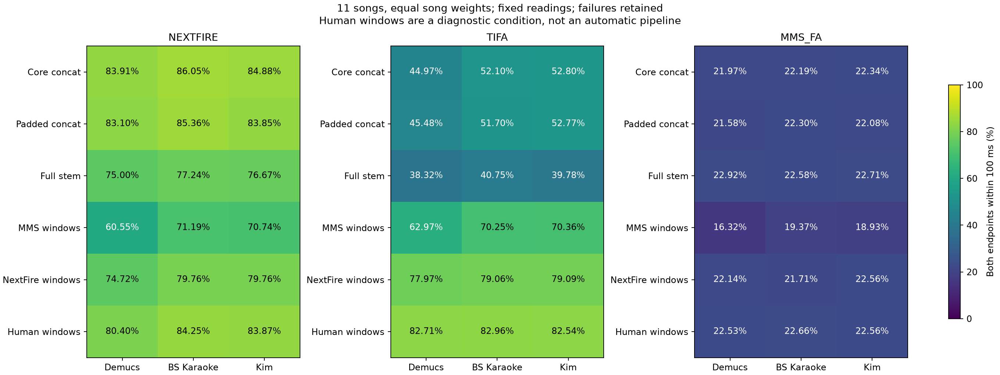

# 对齐模型后端、音频窗口策略与空隙填补

本报告固定人工读音，在 12 首日语主组歌曲的 **5,021 个可配对纯假名单元**（独立长音符并入前一单元以兼容 TIFA 音素编译）上，交叉对比三大声学对齐模型（**NextFire**、**TIFA**、**MMS_FA**）、三种代表性分离器（**Demucs**、**BS Karaoke**、**Kim Vocals**）以及 **8 种音频组织与行窗口策略**，并对 `MMS_FA` 的尾音过早结束问题开展后处理消融实验。

注：本报告测试的是**不含智能延长后处理的原始声学模型输出**；开启智能延长后的 Lazulite Studio `MMS_FA` 路线表现见 [八条路线对齐比较](comparison.md)。全部细分条件与重复元音探针数据保存在 [`results/ablation/`](../results/ablation/) 与 [`results/mms-gap-fill/`](../results/mms-gap-fill/)。

## 核心发现

1. **对 NextFire 而言，“整曲人声片段拼接”显著优于任何逐行切分策略（包括人工提供的真实行窗口）**：
   - 在 Demucs、BS Karaoke、Kim Vocals 三种人声下，NextFire 采用**片段拼接**的双端 100 ms 命中率分别达到 **84.11%**、**86.18%** 和 **85.16%**。
   - 反直觉的是，即便预先提供由人工精调的真实行起止时间（**人工行窗口**），按行裁剪音频分别对齐的命中率也只有 **79.98%**、**83.99%** 和 **83.53%**，全面低于整曲片段拼接；若使用自动粗分窗口（如 **自动 NextFire 窗口** 或 **自动 MMS 粗定位窗口**），命中率更会进一步掉到 **74%–79%** 乃至 **54%–72%**。
   - 原因在于：整曲片段拼接让 CTC 解码器在全局上下文中统一分配帧路径，避免了逐行硬裁剪在行首尾边界造成的局部截断与锚定偏差，同时也完全免去了事先获取行级时间的依赖。
2. **TIFA 受限于上下文窗口，无法直接处理整曲，且高度依赖高质量的行窗口与重型分离器**：
   - 将完整人声或片段拼接后的长音频直接送入 TIFA，模型会彻底崩溃（命中率仅 38%–52%，MAE 高达 4.6–11.9 秒）。
   - 只有在提供**人工行窗口**时，TIFA 的双端 100 ms 命中率才能达到 **83.03%–83.61%**；一旦改用实际的 **自动 MMS 粗定位窗口**（Timing 的默认路线），受粗定位漏行与截断拖累，命中率立刻回落至 **56.56%**（Demucs）–**72.16%**（BS Karaoke）。
3. **原始 `MMS_FA` 的核心症结是“起点准、终点普遍过早”，通过后处理可大幅修复**：
   - 未经后处理的原始 `MMS_FA` 双端 100 ms 命中率仅有 **23%–24%**。但拆开起点与终点可以发现：其**起点 MAE 非常低**（仅 38–77 ms，P95 约 112–129 ms），而**终点 MAE 高达 255–334 ms**（终点 P95 达 775–941 ms）。这是因为多语言说话模型将歌唱中的延音尾段判为了空白帧（blank）。
   - 仅在行内将前词终点向后词起点做简单的空隙填补（见第 4 节），就能将 `MMS_FA` 的双端 100 ms 命中率从 **24.62% 直接拉升至 72.04%–75.48%**；在此基础上再结合静音搜索（避免跨越真实换气停顿）与人声片段终点约束（处理行末词），即构成了 Lazulite Studio 与 FA-Kara 中达到 80%+ 命中率的智能延长方案。

---

## 1. NextFire：整曲拼接 vs 逐行窗口（固定分母：5,021）

| 分离器／音频与窗口策略 | 双端 100 ms 命中率 | 双端 200 ms 命中率 | 起点 / 终点 MAE (ms) | 起点 / 终点 P95 (ms) | 缺失 | >1 s 大误差 |
| --- | ---: | ---: | ---: | ---: | ---: | ---: |
| **BS Karaoke／片段拼接** | **4327（86.18%）** | 4765（94.90%） | 40.07 / 50.35 | 102.91 / 161.01 | 18 | 13 |
| BS Karaoke／带缓冲拼接 | 4314（85.92%） | 4782（95.24%） | 39.84 / 49.34 | 105.94 / 165.44 | 4 | 18 |
| BS Karaoke／固定 Demucs 片段边界 | 4283（85.30%） | 4742（94.44%） | 49.20 / 58.75 | 111.44 / 162.61 | 37 | 19 |
| BS Karaoke／人工行窗口 | 4217（83.99%） | 4745（94.50%） | 38.65 / 49.94 | 119.02 / 179.00 | 0 | 8 |
| BS Karaoke／自动 NextFire 窗口 | 4005（79.76%） | 4550（90.62%） | 43.68 / 55.70 | 125.24 / 203.38 | 128 | 17 |
| BS Karaoke／完整人声 | 3901（77.69%） | 4741（94.42%） | 55.18 / 70.63 | 138.00 / 185.00 | 0 | 14 |
| BS Karaoke／自动 MMS 窗口＋尾点搜索 | 3704（73.77%） | 4229（84.23%） | 61.64 / 79.78 | 148.70 / 303.70 | 374 | 36 |
| BS Karaoke／自动 MMS 窗口 | 3607（71.84%） | 4146（82.57%） | 54.08 / 103.49 | 135.71 / 361.40 | 374 | 92 |
| **Demucs／片段拼接** | **4223（84.11%）** | 4687（93.35%） | 55.91 / 65.17 | 124.29 / 183.91 | 33 | 43 |
| Demucs／带缓冲拼接 | 4176（83.17%） | 4692（93.45%） | 65.63 / 75.83 | 131.03 / 200.43 | 6 | 41 |
| Demucs／人工行窗口 | 4016（79.98%） | 4658（92.77%） | 50.23 / 62.64 | 146.00 / 211.00 | 0 | 25 |
| Demucs／完整人声 | 3751（74.71%） | 4631（92.23%） | 84.06 / 101.89 | 168.00 / 231.00 | 0 | 60 |
| Demucs／自动 NextFire 窗口 | 3739（74.47%） | 4422（88.07%） | 75.15 / 88.10 | 176.57 / 258.18 | 170 | 61 |
| Demucs／自动 MMS 窗口＋尾点搜索 | 2857（56.90%） | 3312（65.96%） | 78.48 / 97.06 | 171.95 / 359.85 | 1339 | 53 |
| Demucs／自动 MMS 窗口 | 2747（54.71%） | 3239（64.51%） | 70.60 / 118.90 | 149.00 / 463.00 | 1339 | 88 |
| **Kim Vocals／固定 Demucs 片段边界** | **4281（85.26%）** | 4706（93.73%） | 52.23 / 62.15 | 114.86 / 179.08 | 36 | 39 |
| **Kim Vocals／片段拼接** | **4276（85.16%）** | 4717（93.95%） | 45.50 / 56.37 | 113.01 / 186.04 | 7 | 48 |
| Kim Vocals／带缓冲拼接 | 4228（84.21%） | 4698（93.57%） | 76.54 / 86.38 | 126.82 / 201.46 | 2 | 57 |
| Kim Vocals／人工行窗口 | 4194（83.53%） | 4703（93.67%） | 42.05 / 53.57 | 131.00 / 193.00 | 0 | 10 |
| Kim Vocals／自动 NextFire 窗口 | 4003（79.73%） | 4545（90.52%） | 57.76 / 69.55 | 156.26 / 241.84 | 69 | 58 |
| Kim Vocals／完整人声 | 3874（77.16%） | 4665（92.91%） | 64.48 / 79.53 | 150.00 / 217.00 | 0 | 48 |
| Kim Vocals／自动 MMS 窗口＋尾点搜索 | 3610（71.90%） | 4059（80.84%） | 58.79 / 80.84 | 169.30 / 379.91 | 506 | 52 |
| Kim Vocals／自动 MMS 窗口 | 3500（69.71%） | 4019（80.04%） | 45.79 / 99.34 | 133.00 / 427.01 | 506 | 88 |

注：“固定 Demucs 片段边界”指在 BS Karaoke 或 Kim Vocals 人声上直接复用 Demucs 检测出的人声核心区间，其命中率（85.30% / 85.26%）与各自重新检测核心区间（86.18% / 85.16%）非常接近，说明 RoFormer 相比 Demucs 的小幅优势主要来自声学信噪比提升，而非改变了活动检测边界。

---

## 2. TIFA：对行级定位窗口的强依赖（固定分母：5,021）

| 分离器／音频与窗口策略 | 双端 100 ms 命中率 | 双端 200 ms 命中率 | 起点 / 终点 MAE (ms) | 起点 / 终点 P95 (ms) | 缺失 | >1 s 大误差 |
| --- | ---: | ---: | ---: | ---: | ---: | ---: |
| **BS Karaoke／人工行窗口** | **4198（83.61%）** | 4826（96.12%） | 46.37 / 55.42 | 109.00 / 148.00 | 0 | 11 |
| BS Karaoke／自动 NextFire 窗口 | 3992（79.51%） | 4632（92.25%） | 56.40 / 65.99 | 117.43 / 177.73 | 128 | 20 |
| BS Karaoke／自动 MMS 窗口＋尾点搜索 | 3689（73.47%） | 4332（86.28%） | 64.82 / 77.02 | 126.00 / 228.00 | 374 | 46 |
| BS Karaoke／自动 MMS 窗口 | 3623（72.16%） | 4250（84.64%） | 53.33 / 103.16 | 116.00 / 326.71 | 374 | 87 |
| BS Karaoke／片段拼接（整曲无切行） | 2599（51.76%） | 3159（62.92%） | 5526.90 / 5539.22 | 32987.99 / 32768.06 | 244 | 1201 |
| BS Karaoke／完整人声（整曲无切行） | 2046（40.75%） | 2538（50.55%） | 11955.73 / 11889.91 | 66599.55 / 66438.50 | 173 | 1943 |
| **Demucs／人工行窗口** | **4186（83.37%）** | 4807（95.74%） | 49.13 / 58.29 | 113.00 / 155.00 | 0 | 15 |
| Demucs／自动 NextFire 窗口 | 3957（78.81%） | 4564（90.90%） | 64.33 / 73.36 | 124.03 / 194.29 | 170 | 39 |
| Demucs／自动 MMS 窗口＋尾点搜索 | 2884（57.44%） | 3418（68.07%） | 67.45 / 81.68 | 135.00 / 240.00 | 1339 | 35 |
| Demucs／自动 MMS 窗口 | 2840（56.56%） | 3356（66.84%） | 55.55 / 104.85 | 120.00 / 345.82 | 1339 | 67 |
| Demucs／片段拼接（整曲无切行） | 2174（43.30%） | 2705（53.87%） | 9291.70 / 9307.74 | 58984.97 / 58885.12 | 302 | 1613 |
| **Kim Vocals／人工行窗口** | **4169（83.03%）** | 4797（95.54%） | 51.11 / 58.67 | 114.00 / 155.00 | 0 | 26 |
| Kim Vocals／自动 NextFire 窗口 | 4007（79.80%） | 4646（92.53%） | 59.47 / 68.96 | 124.69 / 197.68 | 69 | 39 |
| Kim Vocals／自动 MMS 窗口＋尾点搜索 | 3564（70.98%） | 4189（83.43%） | 66.89 / 77.47 | 134.30 / 239.30 | 506 | 51 |
| Kim Vocals／自动 MMS 窗口 | 3513（69.97%） | 4102（81.70%） | 52.30 / 102.20 | 118.00 / 367.30 | 506 | 80 |

可以看到，即使将 TIFA 的前置粗定位模型从 Timing 自带的通用 MMS 换成更准的 NextFire（**自动 NextFire 窗口**），由于经过了“整曲推理 → 行首尾截断外扩 0.3 s → TIFA 二次推理”两道环节，最终命中率（78.81%–79.80%）依然明显低于直接采用第一轮 NextFire 片段拼接的结果（84.11%–86.18%）。

---

## 3. 原始 `MMS_FA`（未加词尾延长后处理，固定分母：5,021）

| 分离器／音频与窗口策略 | 双端 100 ms 命中率 | 双端 200 ms 命中率 | 起点 / 终点 MAE (ms) | 起点 / 终点 P95 (ms) | 缺失 | >1 s 大误差 |
| --- | ---: | ---: | ---: | ---: | ---: | ---: |
| BS Karaoke／完整人声 | 1218（24.26%） | 2725（54.27%） | 49.22 / 265.92 | 112.00 / 779.00 | 0 | 167 |
| BS Karaoke／人工行窗口 | 1215（24.20%） | 2735（54.47%） | 38.04 / 255.03 | 117.00 / 775.00 | 0 | 163 |
| BS Karaoke／片段拼接 | 1201（23.92%） | 2688（53.54%） | 62.93 / 279.04 | 116.48 / 861.48 | 2 | 208 |
| Demucs／完整人声 | 1236（24.62%） | 2729（54.35%） | 76.74 / 289.15 | 127.00 / 805.00 | 0 | 188 |
| Demucs／人工行窗口 | 1211（24.12%） | 2737（54.51%） | 42.82 / 256.10 | 129.00 / 781.00 | 0 | 167 |
| Demucs／片段拼接 | 1176（23.42%） | 2655（52.88%） | 124.78 / 333.58 | 151.31 / 941.27 | 3 | 250 |
| Kim Vocals／完整人声 | 1229（24.48%） | 2727（54.31%） | 81.35 / 301.60 | 116.00 / 782.00 | 0 | 178 |
| Kim Vocals／人工行窗口 | 1211（24.12%） | 2736（54.49%） | 39.29 / 254.91 | 117.00 / 776.00 | 0 | 163 |
| Kim Vocals／片段拼接 | 1197（23.84%） | 2677（53.32%） | 92.27 / 309.70 | 123.89 / 884.44 | 2 | 228 |

表中清晰呈现了 `MMS_FA` 的不对称误差结构：无论换什么分离器或窗口策略，**起点 MAE 始终稳定在 38–125 ms**，而**终点 MAE 全部在 254–334 ms**，说明词尾过早结束是该声学模型在歌唱语音上的固有特性。

---

## 4. `MMS_FA` 行内空隙填补诊断（固定分母：5,021）

既然 `MMS_FA` 的每个词起点很准、终点偏早，最直接的几何校正思路就是：**在同一行内，若前一个词的预测终点早于后一个词的预测起点，且两者之间的空隙不超过设定上限，则直接把前一个词的终点延长到后一个词的起点**。

下表在 `Demucs／完整人声` 的原始 `MMS_FA` 预测上测试不同空隙填补上限（`cap100`–`cap500` 表示仅填补不超过 100–500 ms 的空隙，`fill_all` 表示填补行内一切空隙）：

| 空隙填补上限 | 双端 100 ms 命中率 | 双端 200 ms 命中率 | 起点 / 终点 MAE (ms) | 起点 / 终点 P95 (ms) | 缺失 | >1 s 大误差 |
| --- | ---: | ---: | ---: | ---: | ---: | ---: |
| 原始输出（不填补） | 1236（24.62%） | 2729（54.35%） | 76.74 / 289.15 | 127.00 / 805.00 | 0 | 188 |
| 填补 ≤ 100 ms 空隙 (`cap100`) | 1561（31.09%） | 2736（54.49%） | 76.74 / 270.01 | 127.00 / 803.00 | 0 | 188 |
| 填补 ≤ 200 ms 空隙 (`cap200`) | 2395（47.70%） | 2895（57.66%） | 76.74 / 245.47 | 127.00 / 803.00 | 0 | 188 |
| 填补 ≤ 300 ms 空隙 (`cap300`) | 3308（65.88%） | 3732（74.33%） | 76.74 / 202.90 | 127.00 / 802.00 | 0 | 188 |
| 填补 ≤ 500 ms 空隙 (`cap500`) | 3617（72.04%） | 4137（82.39%） | 76.74 / 179.54 | 127.00 / 802.00 | 0 | 188 |
| **填补行内全部空隙 (`fill_all`)** | **3790（75.48%）** | **4346（86.56%）** | **76.74 / 151.30** | **127.00 / 619.00** | **0** | **166** |

这组对比直接揭示了两点：
1. **利用下一词起点校正前词终点是极其有效的**：仅靠无声学参与的 `fill_all`，命中率就从 24.62% 跃升了 **50.86 个百分点**至 75.48%，终点 MAE 砍半。
2. **单纯连到下一词起点仍有两处盲区**（终点 P95 仍高达 619–802 ms）：一是每行的**最后一个词**后面没有同行的下一词，完全无法被行内填补修复；二是当歌手在行内存在**真实的换气停顿**时，无脑拉到下一词起点会把静音段也包进前词，导致终点偏晚。

正因如此，Lazulite Studio 在正式的 `MMS_FA + 智能延长` 路线中结合了 FA-Kara 的人声静音搜索与人声片段核心区终点（`core_end`）：当延长途中遇到明显静音谷底或片段终点时提前截断，同时让行末词也能沿着人声能量延长到发声结束，从而在 [八条路线对齐比较](comparison.md) 中将 `MMS_FA` 的双端 100 ms 命中率进一步推高到 **80.17%（Demucs）–82.83%（BS Karaoke）**，终点 P95 压低至 178–258 ms。
