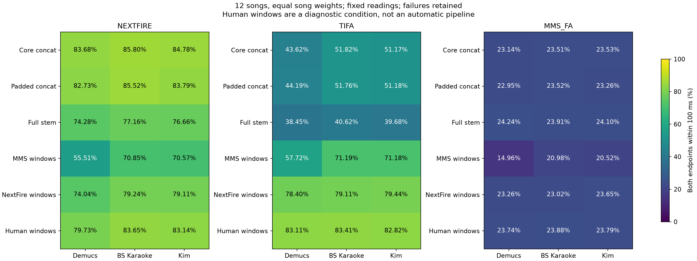

# 对齐后端、窗口和人声输入

本轮使用固定人工读音，对 12 首日语歌曲重跑模型、输入窗口和分离器组合。本报告评价模块条件；当前 Lazulite Studio 的固定路线与 MMS_FA 智能延长输出见[八路线比较](comparison.md)。模块原始 MMS_FA 与产品智能延长分别计分。

core 指人声活动检测保留的核心区间，拼接时删去区间之间的音频，对齐后映射回原曲；带缓冲拼接在保留区间两侧增加上下文。CTC（Connectionist Temporal Classification，连接时序分类）在本实验中用于从逐帧发音标签概率解码已知读音的时间边界。

双端命中要求起点和终点同时在阈值内。MAE（Mean Absolute Error，平均绝对误差）为有效端点与参考之差的绝对值均值；P95 是绝对误差的第 95 百分位数。缺失或无效单元保留在命中率分母，MAE 与 P95 只计算有效端点。任一端点绝对误差超过 1 秒即记为大误差项。

主组使用可配对的纯假名单元，独立长音符并入前一个单元。宏平均表示先逐曲求命中率，再对歌曲等权平均；下面计数表按所有单元汇总。人工窗口用于诊断，不代表无人工时间输入的自动化成绩。

## nextfire

| 条件 | 分母 | 100 ms 命中 | 200 ms 命中 | 起／止 MAE ms | 起／止绝对误差 P95 ms | 缺失 | >1 秒 |
| --- | --- | --- | --- | --- | --- | --- | --- |
| bs／自动 MMS 窗口 | 5021 | 3607（71.84%） | 4146（82.57%） | 54.08 / 103.49 | 135.71 / 361.40 | 374 | 92 |
| bs／MMS 窗口＋尾点搜索 | 5021 | 3704（73.77%） | 4229（84.23%） | 61.64 / 79.78 | 148.70 / 303.70 | 374 | 36 |
| bs／自动 NextFire 窗口 | 5021 | 4005（79.76%） | 4550（90.62%） | 43.68 / 55.70 | 125.24 / 203.38 | 128 | 17 |
| bs／core 拼接 | 5021 | 4327（86.18%） | 4765（94.90%） | 40.07 / 50.35 | 102.91 / 161.01 | 18 | 13 |
| bs／固定 Demucs core | 5021 | 4283（85.30%） | 4742（94.44%） | 49.20 / 58.75 | 111.44 / 162.61 | 37 | 19 |
| bs／完整人声 | 5021 | 3901（77.69%） | 4741（94.42%） | 55.18 / 70.63 | 138.00 / 185.00 | 0 | 14 |
| bs／人工行窗口 | 5021 | 4217（83.99%） | 4745（94.50%） | 38.65 / 49.94 | 119.02 / 179.00 | 0 | 8 |
| bs／带缓冲拼接 | 5021 | 4314（85.92%） | 4782（95.24%） | 39.84 / 49.34 | 105.94 / 165.44 | 4 | 18 |
| demucs／自动 MMS 窗口 | 5021 | 2747（54.71%） | 3239（64.51%） | 70.60 / 118.90 | 149.00 / 463.00 | 1339 | 88 |
| demucs／MMS 窗口＋尾点搜索 | 5021 | 2857（56.90%） | 3312（65.96%） | 78.48 / 97.06 | 171.95 / 359.85 | 1339 | 53 |
| demucs／自动 NextFire 窗口 | 5021 | 3739（74.47%） | 4422（88.07%） | 75.15 / 88.10 | 176.57 / 258.18 | 170 | 61 |
| demucs／core 拼接 | 5021 | 4223（84.11%） | 4687（93.35%） | 55.91 / 65.17 | 124.29 / 183.91 | 33 | 43 |
| demucs／完整人声 | 5021 | 3751（74.71%） | 4631（92.23%） | 84.06 / 101.89 | 168.00 / 231.00 | 0 | 60 |
| demucs／人工行窗口 | 5021 | 4016（79.98%） | 4658（92.77%） | 50.23 / 62.64 | 146.00 / 211.00 | 0 | 25 |
| demucs／带缓冲拼接 | 5021 | 4176（83.17%） | 4692（93.45%） | 65.63 / 75.83 | 131.03 / 200.43 | 6 | 41 |
| kim／自动 MMS 窗口 | 5021 | 3500（69.71%） | 4019（80.04%） | 45.79 / 99.34 | 133.00 / 427.01 | 506 | 88 |
| kim／MMS 窗口＋尾点搜索 | 5021 | 3610（71.90%） | 4059（80.84%） | 58.79 / 80.84 | 169.30 / 379.91 | 506 | 52 |
| kim／自动 NextFire 窗口 | 5021 | 4003（79.73%） | 4545（90.52%） | 57.76 / 69.55 | 156.26 / 241.84 | 69 | 58 |
| kim／core 拼接 | 5021 | 4276（85.16%） | 4717（93.95%） | 45.50 / 56.37 | 113.01 / 186.04 | 7 | 48 |
| kim／固定 Demucs core | 5021 | 4281（85.26%） | 4706（93.73%） | 52.23 / 62.15 | 114.86 / 179.08 | 36 | 39 |
| kim／完整人声 | 5021 | 3874（77.16%） | 4665（92.91%） | 64.48 / 79.53 | 150.00 / 217.00 | 0 | 48 |
| kim／人工行窗口 | 5021 | 4194（83.53%） | 4703（93.67%） | 42.05 / 53.57 | 131.00 / 193.00 | 0 | 10 |
| kim／带缓冲拼接 | 5021 | 4228（84.21%） | 4698（93.57%） | 76.54 / 86.38 | 126.82 / 201.46 | 2 | 57 |

## tifa

| 条件 | 分母 | 100 ms 命中 | 200 ms 命中 | 起／止 MAE ms | 起／止绝对误差 P95 ms | 缺失 | >1 秒 |
| --- | --- | --- | --- | --- | --- | --- | --- |
| bs／自动 MMS 窗口 | 5021 | 3623（72.16%） | 4250（84.64%） | 53.33 / 103.16 | 116.00 / 326.71 | 374 | 87 |
| bs／MMS 窗口＋尾点搜索 | 5021 | 3689（73.47%） | 4332（86.28%） | 64.82 / 77.02 | 126.00 / 228.00 | 374 | 46 |
| bs／自动 NextFire 窗口 | 5021 | 3992（79.51%） | 4632（92.25%） | 56.40 / 65.99 | 117.43 / 177.73 | 128 | 20 |
| bs／core 拼接 | 5021 | 2599（51.76%） | 3159（62.92%） | 5526.90 / 5539.22 | 32987.99 / 32768.06 | 244 | 1201 |
| bs／固定 Demucs core | 5021 | 2655（52.88%） | 3225（64.23%） | 4646.21 / 4648.88 | 28449.17 / 28369.88 | 204 | 1166 |
| bs／完整人声 | 5021 | 2046（40.75%） | 2538（50.55%） | 11955.73 / 11889.91 | 66599.55 / 66438.50 | 173 | 1943 |
| bs／人工行窗口 | 5021 | 4198（83.61%） | 4826（96.12%） | 46.37 / 55.42 | 109.00 / 148.00 | 0 | 11 |
| bs／带缓冲拼接 | 5021 | 2599（51.76%） | 3175（63.23%） | 5606.43 / 5591.06 | 33903.99 / 33509.14 | 185 | 1255 |
| demucs／自动 MMS 窗口 | 5021 | 2840（56.56%） | 3356（66.84%） | 55.55 / 104.85 | 120.00 / 345.82 | 1339 | 67 |
| demucs／MMS 窗口＋尾点搜索 | 5021 | 2884（57.44%） | 3418（68.07%） | 67.45 / 81.68 | 135.00 / 240.00 | 1339 | 35 |
| demucs／自动 NextFire 窗口 | 5021 | 3957（78.81%） | 4564（90.90%） | 64.33 / 73.36 | 124.03 / 194.29 | 170 | 39 |
| demucs／core 拼接 | 5021 | 2174（43.30%） | 2705（53.87%） | 9291.70 / 9307.74 | 58984.97 / 58885.12 | 302 | 1613 |
| demucs／完整人声 | 5021 | 1934（38.52%） | 2403（47.86%） | 9132.33 / 9070.84 | 50418.40 / 50295.69 | 187 | 1980 |
| demucs／人工行窗口 | 5021 | 4186（83.37%） | 4807（95.74%） | 49.13 / 58.29 | 113.00 / 155.00 | 0 | 15 |
| demucs／带缓冲拼接 | 5021 | 2203（43.88%） | 2728（54.33%） | 9721.90 / 9721.41 | 59907.61 / 60302.01 | 256 | 1609 |
| kim／自动 MMS 窗口 | 5021 | 3513（69.97%） | 4102（81.70%） | 52.30 / 102.20 | 118.00 / 367.30 | 506 | 80 |
| kim／MMS 窗口＋尾点搜索 | 5021 | 3564（70.98%） | 4189（83.43%） | 66.89 / 77.47 | 134.30 / 239.30 | 506 | 51 |
| kim／自动 NextFire 窗口 | 5021 | 4007（79.80%） | 4646（92.53%） | 59.47 / 68.96 | 124.69 / 197.68 | 69 | 39 |
| kim／core 拼接 | 5021 | 2558（50.95%） | 3117（62.08%） | 7582.80 / 7583.32 | 48016.67 / 48141.02 | 166 | 1347 |
| kim／固定 Demucs core | 5021 | 2606（51.90%） | 3184（63.41%） | 6420.96 / 6422.17 | 45270.48 / 45519.05 | 209 | 1237 |
| kim／完整人声 | 5021 | 1994（39.71%） | 2484（49.47%） | 9550.73 / 9486.38 | 49720.30 / 49543.34 | 179 | 1922 |
| kim／人工行窗口 | 5021 | 4169（83.03%） | 4797（95.54%） | 51.11 / 58.67 | 114.00 / 155.00 | 0 | 26 |
| kim／带缓冲拼接 | 5021 | 2560（50.99%） | 3120（62.14%） | 7285.23 / 7282.49 | 44197.93 / 44197.93 | 144 | 1340 |

## mms_fa

| 条件 | 分母 | 100 ms 命中 | 200 ms 命中 | 起／止 MAE ms | 起／止绝对误差 P95 ms | 缺失 | >1 秒 |
| --- | --- | --- | --- | --- | --- | --- | --- |
| bs／自动 MMS 窗口 | 5021 | 1087（21.65%） | 2499（49.77%） | 38.84 / 261.45 | 115.00 / 795.01 | 374 | 159 |
| bs／MMS 窗口＋尾点搜索 | 5021 | 1080（21.51%） | 2498（49.75%） | 43.61 / 262.09 | 122.70 / 780.00 | 374 | 163 |
| bs／自动 NextFire 窗口 | 5021 | 1176（23.42%） | 2686（53.50%） | 38.59 / 252.38 | 117.05 / 763.51 | 128 | 157 |
| bs／core 拼接 | 5021 | 1201（23.92%） | 2688（53.54%） | 62.93 / 279.04 | 116.48 / 861.48 | 2 | 208 |
| bs／固定 Demucs core | 5021 | 1187（23.64%） | 2689（53.56%） | 62.25 / 277.90 | 116.93 / 828.17 | 3 | 196 |
| bs／完整人声 | 5021 | 1218（24.26%） | 2725（54.27%） | 49.22 / 265.92 | 112.00 / 779.00 | 0 | 167 |
| bs／人工行窗口 | 5021 | 1215（24.20%） | 2735（54.47%） | 38.04 / 255.03 | 117.00 / 775.00 | 0 | 163 |
| bs／带缓冲拼接 | 5021 | 1204（23.98%） | 2695（53.67%） | 70.43 / 286.66 | 120.01 / 865.04 | 1 | 211 |
| demucs／自动 MMS 窗口 | 5021 | 736（14.66%） | 1914（38.12%） | 40.52 / 267.70 | 122.00 / 795.95 | 1339 | 122 |
| demucs／MMS 窗口＋尾点搜索 | 5021 | 734（14.62%） | 1905（37.94%） | 44.32 / 267.70 | 126.93 / 794.95 | 1339 | 124 |
| demucs／自动 NextFire 窗口 | 5021 | 1189（23.68%） | 2663（53.04%） | 44.97 / 257.75 | 127.26 / 777.77 | 170 | 161 |
| demucs／core 拼接 | 5021 | 1176（23.42%） | 2655（52.88%） | 124.78 / 333.58 | 151.31 / 941.27 | 3 | 250 |
| demucs／完整人声 | 5021 | 1236（24.62%） | 2729（54.35%） | 76.74 / 289.15 | 127.00 / 805.00 | 0 | 188 |
| demucs／人工行窗口 | 5021 | 1211（24.12%） | 2737（54.51%） | 42.82 / 256.10 | 129.00 / 781.00 | 0 | 167 |
| demucs／带缓冲拼接 | 5021 | 1169（23.28%） | 2659（52.96%） | 141.62 / 348.14 | 160.46 / 938.82 | 4 | 256 |
| kim／自动 MMS 窗口 | 5021 | 1012（20.16%） | 2410（48.00%） | 37.16 / 263.98 | 111.99 / 799.30 | 506 | 156 |
| kim／MMS 窗口＋尾点搜索 | 5021 | 1008（20.08%） | 2424（48.28%） | 40.86 / 262.18 | 115.00 / 782.90 | 506 | 162 |
| kim／自动 NextFire 窗口 | 5021 | 1206（24.02%） | 2720（54.17%） | 40.02 / 256.13 | 117.00 / 781.22 | 69 | 169 |
| kim／core 拼接 | 5021 | 1197（23.84%） | 2677（53.32%） | 92.27 / 309.70 | 123.89 / 884.44 | 2 | 228 |
| kim／固定 Demucs core | 5021 | 1178（23.46%） | 2660（52.98%） | 97.97 / 312.56 | 126.88 / 877.30 | 3 | 221 |
| kim／完整人声 | 5021 | 1229（24.48%） | 2727（54.31%） | 81.35 / 301.60 | 116.00 / 782.00 | 0 | 178 |
| kim／人工行窗口 | 5021 | 1211（24.12%） | 2736（54.49%） | 39.29 / 254.91 | 117.00 / 776.00 | 0 | 163 |
| kim／带缓冲拼接 | 5021 | 1184（23.58%） | 2688（53.54%） | 75.44 / 294.55 | 122.29 / 868.48 | 1 | 212 |

## 补充分离器

固定 NextFire，补充 SCNet、DTTNet、BS-RoFormer Viperx、MelBand 和 Windowed。BS-RoFormer Viperx 与 BS Karaoke 使用不同权重。

| 条件 | 分母 | 100 ms 命中 | 200 ms 命中 | 起／止 MAE ms | 起／止绝对误差 P95 ms | 缺失 | >1 秒 |
| --- | --- | --- | --- | --- | --- | --- | --- |
| bs_roformer／core 拼接 | 5021 | 4282（85.28%） | 4721（94.03%） | 47.42 / 57.15 | 117.96 / 185.22 | 8 | 45 |
| bs_roformer／完整人声 | 5021 | 3846（76.60%） | 4647（92.55%） | 68.16 / 84.73 | 154.00 / 222.00 | 0 | 50 |
| bs_roformer／带缓冲拼接 | 5021 | 4246（84.56%） | 4708（93.77%） | 48.45 / 58.90 | 122.02 / 194.31 | 1 | 41 |
| dttnet／core 拼接 | 5021 | 4229（84.23%） | 4694（93.49%） | 58.49 / 66.22 | 129.32 / 201.11 | 9 | 52 |
| dttnet／完整人声 | 5021 | 3954（78.75%） | 4642（92.45%） | 83.79 / 99.02 | 151.00 / 239.00 | 0 | 62 |
| dttnet／带缓冲拼接 | 5021 | 4225（84.15%） | 4703（93.67%） | 87.96 / 93.73 | 129.26 / 206.37 | 1 | 61 |
| mel_roformer／core 拼接 | 5021 | 4276（85.16%） | 4722（94.05%） | 45.19 / 55.81 | 113.02 / 180.87 | 8 | 41 |
| mel_roformer／完整人声 | 5021 | 3874（77.16%） | 4663（92.87%） | 64.02 / 78.60 | 150.00 / 217.00 | 0 | 48 |
| mel_roformer／带缓冲拼接 | 5021 | 4228（84.21%） | 4702（93.65%） | 75.97 / 85.86 | 123.96 / 200.27 | 2 | 53 |
| scnet／core 拼接 | 5021 | 4110（81.86%） | 4639（92.39%） | 81.06 / 92.52 | 140.56 / 213.18 | 46 | 63 |
| scnet／完整人声 | 5021 | 3935（78.37%） | 4654（92.69%） | 82.19 / 89.19 | 155.00 / 224.00 | 0 | 57 |
| scnet／带缓冲拼接 | 5021 | 4160（82.85%） | 4687（93.35%） | 118.46 / 125.12 | 138.45 / 205.74 | 7 | 70 |
| windowed／core 拼接 | 5021 | 4282（85.28%） | 4712（93.85%） | 48.47 / 58.38 | 120.03 / 187.46 | 7 | 51 |
| windowed／完整人声 | 5021 | 3840（76.48%） | 4648（92.57%） | 66.09 / 81.19 | 149.00 / 223.00 | 0 | 45 |
| windowed／带缓冲拼接 | 5021 | 4224（84.13%） | 4702（93.65%） | 78.07 / 88.64 | 125.84 / 203.72 | 2 | 57 |

## 行内空隙填补诊断

对同一行中相邻的两个有效单元，若前一个结束早于后一个开始，则按统一空隙上限延长前一单元至后一单元起点。不改变起点、重叠、缺失与行末端点。此规则不等同于 Lazulite Studio 的智能延长；阈值不按歌曲成绩选择。

| 条件 | 分母 | 100 ms 命中 | 200 ms 命中 | 起／止 MAE ms | 起／止绝对误差 P95 ms | 缺失 | >1 秒 |
| --- | --- | --- | --- | --- | --- | --- | --- |
| baseline | 5021 | 1236（24.62%） | 2729（54.35%） | 76.74 / 289.15 | 127.00 / 805.00 | 0 | 188 |
| fill_all | 5021 | 3790（75.48%） | 4346（86.56%） | 76.74 / 151.30 | 127.00 / 619.00 | 0 | 166 |
| cap100 | 5021 | 1561（31.09%） | 2736（54.49%） | 76.74 / 270.01 | 127.00 / 803.00 | 0 | 188 |
| cap200 | 5021 | 2395（47.70%） | 2895（57.66%） | 76.74 / 245.47 | 127.00 / 803.00 | 0 | 188 |
| cap300 | 5021 | 3308（65.88%） | 3732（74.33%） | 76.74 / 202.90 | 127.00 / 802.00 | 0 | 188 |
| cap500 | 5021 | 3617（72.04%） | 4137（82.39%） | 76.74 / 179.54 | 127.00 / 802.00 | 0 | 188 |

[全部阈值、输入策略及停顿子集](../results/mms-gap-fill/metrics.json)和[逐项修改](../results/mms-gap-fill/edits.json.gz)保留填补收益与尾点偏晚的代价。

## 复核材料

[协议](../results/ablation/protocol.json)、[完整表](../results/ablation/tables.md)、[汇总指标](../results/ablation/metrics.json)、[窗口审计](../results/ablation/window-audit.json)、[独立长音符边界](../results/ablation/standalone-hold-boundaries.json)和[重复元音探针](../results/ablation/duplicate-vowel-probe.json)保存本轮全部输出。原始叶级单元与保存路径对照见[分离与对齐](separation-alignment.md)。
