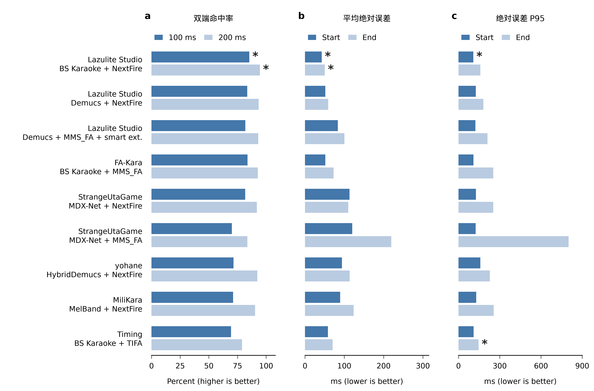
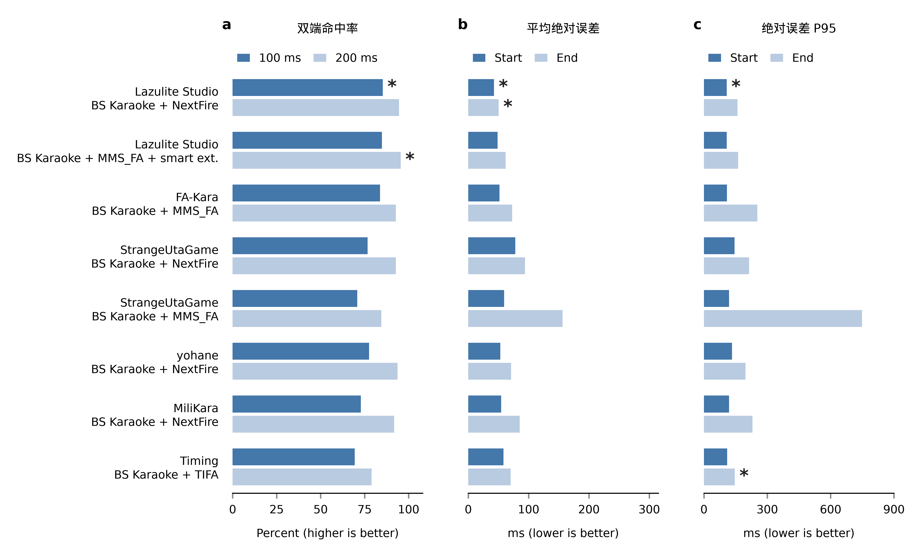

# 九条路线的歌词对齐准确率比较

在开发歌词自动打轴功能时，我们不仅关心单个对齐模型的理论上限，更关心整条工作流在实际曲目上的表现：从人声分离、静音裁剪、自动分词注音，一直到最终导出的时间轴。为了客观定位 Lazulite Studio 各套配置的实际水平，我们在 20 首日语主组歌曲（`j01`–`j20`，共 875 行正文）上，将 Studio 的三条路线与当前主流开源打轴工具进行了完整对比。

实验分为三组输入条件，均不提供任何人工起止时间或人工行窗口：
- **G1（人工读音 + 各自分离器）**：输入带人工注音的歌词，各工具使用默认人声分离器。Lazulite Studio 同时列出 `Demucs htdemucs`（默认轻量档）与 `BS Karaoke`（高质量主唱分离档）两条 `NextFire` 路线，以及 `Demucs + MMS_FA + 智能延长` 路线；StrangeUtaGame（简称 SUG）同时测试 `NextFire` 与 `MMS_FA` 两条路线，合计 9 条路线。
- **G2（人工读音 + 统一 BS Karaoke）**：输入带人工注音的歌词，所有人声统一换用表现最好的主唱提取模型 `BS Karaoke`。Studio 的两条 `NextFire` 路线在统一换用 `BS Karaoke` 后合并为同一条配置，合计 8 条独立路线。
- **G3（自动分词注音 + 各自分离器）**：仅输入无分词、无注音的纯文本歌词，由各工具完成分词、注音、人声分离与对齐全流程。

每组均同时展示**共同正文边界**（取各路线与参考标注的公共正文区间交集，消除长音、促音合并造成的分母差异）和**人工读音边界**（固定以参考标注的 8,909 个纯假名读音单元为分母，合并或漏掉的内部边界直接记为缺失）两张表。两种边界的构造与指标定义见 [测试集与评价方法](methods.md)，逐曲与逐单元结果保存在 [`results/M1/summary.json`](../results/M1/summary.json)、[`results/M1/metrics.csv`](../results/M1/metrics.csv)、[`results/M1/items.json.gz`](../results/M1/items.json.gz) 和 [`results/M1/reading-items.json.gz`](../results/M1/reading-items.json.gz)。

## 核心发现

1. **Lazulite Studio（`NextFire` + 人声片段拼接）在全部三组、两种边界下均取得最高命中率**：
   - 在 G1 中，高质量档 `Studio (BS Karaoke + NextFire)` 的共同正文边界双端 100 ms 命中率达 **85.32%**，人工读音边界达 **86.59%**，起点 / 终点平均绝对误差（MAE）仅 **40.59 / 46.58 ms**。默认轻量档 `Studio (Demucs + NextFire)` 在人声分离耗时仅约为 `BS Karaoke` 十六分之一的前提下，依然达到 **83.59%**（共同正文）和 **84.51%**（人工读音），在人工读音边界下超越了使用 `BS Karaoke` 的 FA-Kara（**81.86%**）。
   - 在 G3 纯文本全自动流程下，依托 `Sudachi + JmdictFurigana` 的分词注音质量，Studio 两条 `NextFire` 路线在人工读音边界下分别达到 **83.70%**（BS Karaoke）与 **81.93%**（Demucs），在共同正文边界下达到 **85.56%** 与 **83.48%**，相比人工注音输入几乎没有精度损失。
2. **同样使用 `MMS_FA` 模型，人声片段拼接与细粒度静音搜索延长带来的提升远大于简单的尾部修正**：
   - SUG 的 `MMS_FA` 路线受模型固有的尾音过早结束困扰，终点 MAE 高达 140–270 ms，终点 P95 达 630–1,120 ms，在 G1、G2、G3 共同正文边界下的双端 100 ms 命中率仅为 **70.10%**、**70.78%** 和 **66.99%**（人工读音边界为 **71.83%**、**72.05%** 和 **68.23%**）。
   - FA-Kara 通过静音搜索与首尾修正将 `MMS_FA` 提升至 **83.83%**（共同正文）；Lazulite Studio 综合静音谷底搜索、人声片段终点与下一单元起点进行**智能延长**，在 G1 搭配轻量 Demucs 时即达到 **81.84%**（共同正文）/ **82.19%**（人工读音），在 G2 搭配 `BS Karaoke` 时更达到 **84.82%** / **84.64%**，双端 200 ms 命中率达全场最高的 **95.50%** / **95.27%**，大幅领先 `SUG (MMS_FA)` 超过 12–14 个百分点。
3. **人声片段拼接能有效防止 `BS Karaoke` 长静音区引起的整曲对齐漂移**：
   - 在 G2 统一换用 `BS Karaoke` 后，Studio、yohane（71.50% → **77.59%**）和 MiliKara（71.22% → **72.86%**）的命中率均有提升；唯独不对人声做片段裁剪、直接整曲送入 `NextFire` 的 `SUG (NextFire)` 从 G1 的 **81.74%** 掉到了 **76.77%**（人工读音边界从 **82.92%** 掉到 **78.28%**）。这是因为 `BS Karaoke` 把间奏和弱声部压得接近绝对静音，整曲不裁剪的 CTC 解码更容易在长空白段发生局部滑移。
4. **主唱分离模型（`BS Karaoke`）对副歌叠唱区间的提升非常明显**：
   - 在含背景和声叠唱的歌曲中，G1 使用普通伴奏分离器（如 Demucs、MDX-Net）时，叠唱区主唱歌词的双端 100 ms 命中率普遍在 **53%–67%**；而在 G2 统一换用能剥离背景和声的 `BS Karaoke` 后，`Studio (MMS_FA + 智能延长)` 在叠唱区的命中率从 66.95% 跃升至 **85.17%**，`>1 s` 大误差从 22 个降为 **2** 个。
5. **颗粒度合并与整曲异常中断是 Timing、FA-Kara 与 yohane 在全自动打轴中的主要短板**：
   - Timing 在人工读音边界下因为将大量长音、连音合并（合并了 1,408 个内部边界、涉及 2,622 个单元），加上 3 首歌报错中断，G1/G2 人工读音边界命中率降至 **43.45%**；在 G3 纯文本输入下更有 8 首歌因未登录字符或长句阻断，人工读音边界命中率跌至 **28.06%**。FA-Kara 与 yohane 缺少内置汉字分词注音模块，在 G3 下分别跌至 **17.02%** 与 **0.00%**。

---

## 1. G1：人工读音 + 各工具默认人声分离

### 1.1 共同正文边界（分母：7,064 个公共正文区间）

| 项目与路线 | 人声分离模型 | 对齐模型 | 完成曲数 | 双端 100 ms 命中率 | 双端 200 ms 命中率 | 起点 / 终点 MAE (ms) | 起点 / 终点 P95 (ms) | 综合 P95 (ms) | 缺失 | >1 s 大误差 |
| --- | --- | --- | ---: | ---: | ---: | ---: | ---: | ---: | ---: | ---: |
| Lazulite Studio (BS) | BS Karaoke | NextFire | 20/20 | **6,027/7,064 (85.32%)** | **6,681/7,064 (94.58%)** | **42.66 / 50.27** | **107.83** / 158.64 | 131.94 | 14 | 51 |
| FA-Kara | BS Karaoke | MMS_FA + 原生静音修正 | 20/20 | 5,922/7,064 (83.83%) | 6,551/7,064 (92.74%) | 51.74 / 72.72 | 109.00 / 252.85 | 180.00 | **0** | 64 |
| Lazulite Studio (Demucs) | Demucs htdemucs | NextFire | 20/20 | 5,905/7,064 (83.59%) | 6,605/7,064 (93.50%) | 51.71 / 59.21 | 125.94 / 181.42 | 155.75 | 15 | 69 |
| Lazulite Studio (MMS_FA) | Demucs htdemucs | MMS_FA + 智能延长 | 20/20 | 5,781/7,064 (81.84%) | 6,577/7,064 (93.11%) | 83.56 / 100.45 | 123.25 / 211.57 | 170.19 | 6 | 130 |
| SUG (NextFire) | MDX-Net Inst HQ 3 | NextFire | 20/20 | 5,774/7,064 (81.74%) | 6,494/7,064 (91.93%) | 113.46 / 110.21 | 127.00 / 253.00 | 184.00 | **0** | 107 |
| yohane | HybridDemucs MUSDB Plus | NextFire | 20/20 | 5,051/7,064 (71.50%) | 6,519/7,064 (92.28%) | 94.08 / 113.66 | 159.00 / 227.95 | 188.00 | 2 | 97 |
| MiliKara | MelBand RoFormer ep_3005 | NextFire | 20/20 | 5,031/7,064 (71.22%) | 6,385/7,064 (90.39%) | 89.46 / 123.78 | 129.00 / 255.90 | 211.00 | 1 | 92 |
| SUG (MMS_FA) | MDX-Net Inst HQ 3 | MMS_FA | 20/20 | 4,952/7,064 (70.10%) | 5,911/7,064 (83.68%) | 120.41 / 219.67 | 125.00 / 801.00 | 425.00 | 2 | 310 |
| Timing | BS Karaoke | TIFA | 17/20 | 4,902/7,064 (69.39%) | 5,580/7,064 (78.99%) | 58.28 / 70.16 | 110.45 / **146.00** | **126.00** | 1,232 | **40** |

### 1.2 人工读音边界（固定分母：8,909 个纯假名读音单元）

| 项目与路线 | 人声分离模型 | 对齐模型 | 双端 100 ms 命中率 | 双端 200 ms 命中率 | 起点 / 终点 MAE (ms) | 起点 / 终点 P95 (ms) | 综合 P95 (ms) | 缺失 | >1 s 大误差 | 合并边界 / 涉及单元 |
| --- | --- | --- | ---: | ---: | ---: | ---: | ---: | ---: | ---: | ---: |
| Lazulite Studio (BS) | BS Karaoke | NextFire | **7,714/8,909 (86.59%)** | **8,484/8,909 (95.23%)** | **40.59 / 46.58** | **106.08 / 147.00** | **123.56** | 14 | 58 | 0 / 0 |
| Lazulite Studio (Demucs) | Demucs htdemucs | NextFire | 7,529/8,909 (84.51%) | 8,364/8,909 (93.88%) | 49.51 / 56.33 | 126.35 / 173.65 | 152.05 | 16 | 80 | 0 / 0 |
| SUG (NextFire) | MDX-Net Inst HQ 3 | NextFire | 7,387/8,909 (82.92%) | 8,233/8,909 (92.41%) | 114.77 / 112.60 | 131.00 / 237.75 | 177.00 | **3** | 129 | 0 / 0 |
| Lazulite Studio (MMS_FA) | Demucs htdemucs | MMS_FA + 智能延长 | 7,322/8,909 (82.19%) | 8,308/8,909 (93.25%) | 83.50 / 97.26 | 131.66 / 205.51 | 171.02 | 6 | 151 | 0 / 0 |
| FA-Kara | BS Karaoke | MMS_FA + 原生静音修正 | 7,293/8,909 (81.86%) | 8,082/8,909 (90.72%) | 52.06 / 69.43 | 113.00 / 239.00 | 173.00 | 235 | 77 | 116 / 232 |
| MiliKara | MelBand RoFormer ep_3005 | NextFire | 6,555/8,909 (73.58%) | 8,138/8,909 (91.35%) | 88.65 / 117.17 | 133.00 / 243.80 | 203.00 | 4 | 105 | 0 / 0 |
| yohane | HybridDemucs MUSDB Plus | NextFire | 6,548/8,909 (73.50%) | 8,281/8,909 (92.95%) | 88.10 / 104.03 | 155.00 / 212.00 | 179.00 | 5 | 113 | 0 / 0 |
| SUG (MMS_FA) | MDX-Net Inst HQ 3 | MMS_FA | 6,399/8,909 (71.83%) | 7,653/8,909 (85.90%) | 121.08 / 200.12 | 129.00 / 688.00 | 355.00 | 5 | 329 | 0 / 0 |
| Timing | BS Karaoke | TIFA | 3,871/8,909 (43.45%) | 4,435/8,909 (49.78%) | 57.88 / 74.69 | 118.00 / 165.00 | 137.00 | 4,220 | **35** | 1,408 / 2,622 |

注：在包含曲内穿插英文词的全量读音单元（`n = 9,050`）上，Studio 三条路线的双端 100 ms 命中率分别为 **85.82%**（7,767/9,050，BS + NextFire）、**83.78%**（7,582/9,050，Demucs + NextFire）和 **81.44%**（7,370/9,050，Demucs + MMS_FA + 智能延长）。

---

## 2. G2：人工读音 + 统一 BS Karaoke 人声分离

本组消除前端人声分离器的差异，所有路线统一使用 `BS Karaoke` 提取的主唱干声。Studio 的两条 `NextFire` 路线在统一换用 `BS Karaoke` 后完全一致，合并为一行展示；Timing 与 FA-Kara 在 G1 中本就使用 `BS Karaoke`，因此这两条路线在 G1、G2 中结果相同。

### 2.1 共同正文边界（分母：7,064 个公共正文区间）

| 项目与路线 | 人声分离模型 | 对齐模型 | 完成曲数 | 双端 100 ms 命中率 | 双端 200 ms 命中率 | 起点 / 终点 MAE (ms) | 起点 / 终点 P95 (ms) | 综合 P95 (ms) | 缺失 | >1 s 大误差 |
| --- | --- | --- | ---: | ---: | ---: | ---: | ---: | ---: | ---: | ---: |
| Lazulite Studio (NextFire) | BS Karaoke | NextFire | 20/20 | **6,027/7,064 (85.32%)** | 6,681/7,064 (94.58%) | **42.66 / 50.27** | **107.83** / 158.64 | 131.94 | 14 | 51 |
| Lazulite Studio (MMS_FA) | BS Karaoke | MMS_FA + 智能延长 | 20/20 | 5,992/7,064 (84.82%) | **6,746/7,064 (95.50%)** | 48.74 / 62.02 | 108.19 / 162.00 | 130.00 | 3 | 65 |
| FA-Kara | BS Karaoke | MMS_FA + 原生静音修正 | 20/20 | 5,922/7,064 (83.83%) | 6,551/7,064 (92.74%) | 51.74 / 72.72 | 109.00 / 252.85 | 180.00 | **0** | 64 |
| yohane | BS Karaoke | NextFire | 20/20 | 5,481/7,064 (77.59%) | 6,622/7,064 (93.74%) | 53.01 / 70.88 | 133.00 / 196.95 | 160.00 | 2 | 49 |
| SUG (NextFire) | BS Karaoke | NextFire | 20/20 | 5,423/7,064 (76.77%) | 6,552/7,064 (92.75%) | 78.00 / 94.13 | 145.00 / 214.00 | 173.00 | **0** | 62 |
| MiliKara | BS Karaoke | NextFire | 20/20 | 5,147/7,064 (72.86%) | 6,486/7,064 (91.82%) | 54.38 / 85.43 | 119.00 / 230.00 | 189.75 | 1 | **38** |
| SUG (MMS_FA) | BS Karaoke | MMS_FA | 20/20 | 5,000/7,064 (70.78%) | 5,970/7,064 (84.51%) | 59.46 / 156.44 | 119.00 / 748.70 | 379.65 | **0** | 285 |
| Timing | BS Karaoke | TIFA | 17/20 | 4,902/7,064 (69.39%) | 5,580/7,064 (78.99%) | 58.28 / 70.16 | 110.45 / **146.00** | **126.00** | 1,232 | 40 |

### 2.2 人工读音边界（固定分母：8,909 个纯假名读音单元）

| 项目与路线 | 人声分离模型 | 对齐模型 | 双端 100 ms 命中率 | 双端 200 ms 命中率 | 起点 / 终点 MAE (ms) | 起点 / 终点 P95 (ms) | 综合 P95 (ms) | 缺失 | >1 s 大误差 | 合并边界 / 涉及单元 |
| --- | --- | --- | ---: | ---: | ---: | ---: | ---: | ---: | ---: | ---: |
| Lazulite Studio (NextFire) | BS Karaoke | NextFire | **7,714/8,909 (86.59%)** | 8,484/8,909 (95.23%) | **40.59 / 46.58** | **106.08 / 147.00** | **123.56** | 14 | 58 | 0 / 0 |
| Lazulite Studio (MMS_FA) | BS Karaoke | MMS_FA + 智能延长 | 7,541/8,909 (84.64%) | **8,488/8,909 (95.27%)** | 51.01 / 62.10 | 112.11 / 159.63 | 132.03 | **3** | 82 | 0 / 0 |
| FA-Kara | BS Karaoke | MMS_FA + 原生静音修正 | 7,293/8,909 (81.86%) | 8,082/8,909 (90.72%) | 52.06 / 69.43 | 113.00 / 239.00 | 173.00 | 235 | 77 | 116 / 232 |
| yohane | BS Karaoke | NextFire | 7,086/8,909 (79.54%) | 8,419/8,909 (94.50%) | 50.45 / 65.25 | 131.00 / 180.00 | 152.00 | 5 | 58 | 0 / 0 |
| SUG (NextFire) | BS Karaoke | NextFire | 6,974/8,909 (78.28%) | 8,321/8,909 (93.40%) | 75.81 / 88.98 | 145.00 / 195.00 | 167.00 | **3** | 74 | 0 / 0 |
| MiliKara | BS Karaoke | NextFire | 6,721/8,909 (75.44%) | 8,266/8,909 (92.78%) | 52.42 / 77.47 | 121.00 / 214.80 | 177.00 | 4 | 39 | 0 / 0 |
| SUG (MMS_FA) | BS Karaoke | MMS_FA | 6,419/8,909 (72.05%) | 7,709/8,909 (86.53%) | 62.05 / 139.50 | 123.00 / 632.25 | 315.45 | **3** | 299 | 0 / 0 |
| Timing | BS Karaoke | TIFA | 3,871/8,909 (43.45%) | 4,435/8,909 (49.78%) | 57.88 / 74.69 | 118.00 / 165.00 | 137.00 | 4,220 | **35** | 1,408 / 2,622 |

注：在全量读音单元（`n = 9,050`）上，`G2 Studio (BS Karaoke + MMS_FA + 智能延长)` 的双端 100 ms 命中率为 **83.99%**（7,601/9,050）。

---

## 3. G3：自动分词注音 + 各工具默认人声分离

本组从无分词、无注音的纯文本歌词开始，测试各工具全自动完成分词、注音与对齐的最终效果。下图展示内置完整分词注音且 20/20 首全量跑通的 6 条路线在**人工读音边界（`n = 8,909`）**下的表现；下方两张表完整列出全部 9 条路线在共同正文边界与人工读音边界下的评分结果。

### 3.1 共同正文边界（分母：5,513 个公共正文区间）

| 项目与路线 | 人声分离模型 | 自动注音前端 + 对齐模型 | 完成曲数 | 双端 100 ms 命中率 | 双端 200 ms 命中率 | 起点 / 终点 MAE (ms) | 起点 / 终点 P95 (ms) | 综合 P95 (ms) | 缺失 | >1 s 大误差 |
| --- | --- | --- | ---: | ---: | ---: | ---: | ---: | ---: | ---: | ---: |
| Lazulite Studio (BS) | BS Karaoke | Sudachi + 词典 + NextFire | 20/20 | **4,717/5,513 (85.56%)** | **5,195/5,513 (94.23%)** | **45.83 / 52.73** | 111.09 / 161.36 | 137.00 | 17 | 48 |
| Lazulite Studio (Demucs) | Demucs htdemucs | Sudachi + 词典 + NextFire | 20/20 | 4,602/5,513 (83.48%) | 5,134/5,513 (93.13%) | 54.95 / 60.14 | 132.57 / 182.02 | 159.25 | 18 | 63 |
| Lazulite Studio (MMS_FA) | Demucs htdemucs | Sudachi + 词典 + MMS_FA + 智能延长 | 20/20 | 4,500/5,513 (81.63%) | 5,115/5,513 (92.78%) | 90.20 / 106.65 | 126.28 / 216.27 | 178.76 | 7 | 114 |
| SUG (NextFire) | MDX-Net Inst HQ 3 | Sudachi + NextFire | 20/20 | 4,488/5,513 (81.41%) | 5,013/5,513 (90.93%) | 137.26 / 117.66 | 147.00 / 219.00 | 178.85 | 81 | 102 |
| MiliKara | MelBand RoFormer ep_3005 | UniDic Lite + NextFire | 20/20 | 3,946/5,513 (71.58%) | 4,980/5,513 (90.33%) | 90.66 / 120.88 | 137.00 / 256.45 | 213.00 | **1** | 87 |
| SUG (MMS_FA) | MDX-Net Inst HQ 3 | Sudachi + MMS_FA | 20/20 | 3,693/5,513 (66.99%) | 4,401/5,513 (79.83%) | 141.94 / 268.86 | 126.55 / 1,122.85 | 617.05 | 83 | 321 |
| Timing | BS Karaoke | g2pflow + TIFA | 12/20 | 2,729/5,513 (49.50%) | 3,042/5,513 (55.18%) | 70.98 / 65.18 | **107.00 / 140.00** | **123.00** | 2,334 | **25** |
| FA-Kara | BS Karaoke | 无内置汉字注音 + MMS_FA | 16/20 | 1,793/5,513 (32.52%) | 2,005/5,513 (36.37%) | 1,087.96 / 1,185.84 | 2,275.50 / 2,488.65 | 2,355.00 | 1,925 | 584 |
| yohane | HybridDemucs MUSDB Plus | 无内置汉字注音 + NextFire | 0/20 | 0/5,513 (0.00%) | 0/5,513 (0.00%) | — | — | — | 5,513 | 0 |

### 3.2 人工读音边界（固定分母：8,909 个纯假名读音单元）

| 项目与路线 | 人声分离模型 | 自动注音前端 + 对齐模型 | 双端 100 ms 命中率 | 双端 200 ms 命中率 | 起点 / 终点 MAE (ms) | 起点 / 终点 P95 (ms) | 综合 P95 (ms) | 缺失 | >1 s 大误差 | 合并边界 / 涉及单元 |
| --- | --- | --- | ---: | ---: | ---: | ---: | ---: | ---: | ---: | ---: |
| Lazulite Studio (BS) | BS Karaoke | Sudachi + 词典 + NextFire | **7,457/8,909 (83.70%)** | **8,232/8,909 (92.40%)** | **46.65 / 53.30** | **119.90 / 170.69** | **149.07** | 152 | 73 | 15 / 24 |
| Lazulite Studio (Demucs) | Demucs htdemucs | Sudachi + 词典 + NextFire | 7,299/8,909 (81.93%) | 8,135/8,909 (91.31%) | 53.94 / 61.49 | 145.31 / 198.78 | 172.38 | 153 | 89 | 15 / 24 |
| Lazulite Studio (MMS_FA) | Demucs htdemucs | Sudachi + 词典 + MMS_FA + 智能延长 | 7,140/8,909 (80.14%) | 8,130/8,909 (91.26%) | 86.70 / 100.37 | 139.92 / 217.09 | 186.00 | **143** | 156 | 15 / 24 |
| SUG (NextFire) | MDX-Net Inst HQ 3 | Sudachi + NextFire | 7,068/8,909 (79.34%) | 7,901/8,909 (88.69%) | 134.91 / 126.41 | 161.00 / 259.80 | 209.55 | 284 | 150 | 87 / 147 |
| MiliKara | MelBand RoFormer ep_3005 | UniDic Lite + NextFire | 6,377/8,909 (71.58%) | 7,918/8,909 (88.88%) | 93.67 / 122.34 | 145.00 / 270.50 | 221.95 | 158 | 121 | 16 / 26 |
| SUG (MMS_FA) | MDX-Net Inst HQ 3 | Sudachi + MMS_FA | 6,079/8,909 (68.23%) | 7,303/8,909 (81.97%) | 134.64 / 225.82 | 137.90 / 771.80 | 418.00 | 286 | 371 | 87 / 147 |
| Timing | BS Karaoke | g2pflow + TIFA | 2,500/8,909 (28.06%) | 2,812/8,909 (31.56%) | 53.44 / 66.45 | 113.00 / 140.00 | 127.75 | 5,946 | **16** | 1,434 / 2,409 |
| FA-Kara | BS Karaoke | 无内置汉字注音 + MMS_FA | 1,516/8,909 (17.02%) | 1,701/8,909 (19.09%) | 1,019.69 / 1,082.18 | 2,207.50 / 2,293.50 | 2,261.65 | 6,095 | 418 | 2,506 / 3,988 |
| yohane | HybridDemucs MUSDB Plus | 无内置汉字注音 + NextFire | 0/8,909 (0.00%) | 0/8,909 (0.00%) | — | — | — | 8,909 | 0 | 0 / 0 |

---

## 4. 叠唱区间表现（共同正文边界）

测试集中共有 8 首日语歌（`j03`、`j06`、`j07`、`j12`、`j15`、`j16`、`j17`、`j19`）包含背景人声标注（`ttm:role="x-bg"`），其中 `j03`（54 区间）、`j06`（2 区间）、`j07`（57 区间）、`j12`（72 区间）、`j17`（51 区间）在主唱歌词与背景和声之间存在直接时间交集（G1、G2 共 **236** 个共同正文叠唱区间，G3 共 **191** 个）：

- 在 **G1** 和 **G3** 中，由于 `Demucs`、`MDX-Net`、`MelBand RoFormer` 和 `HybridDemucs` 提取的是包含背景和声在内的全部人声，当背景声部与主唱交错发声时，模型容易被背景人声带偏，导致双端 100 ms 命中率停留在 **53%–68%**（使用 `BS Karaoke` 的 FA-Kara 在 G1 达到 **79.66%**）。
- 在 **G2** 统一换用能抑制和声、专门提取主唱的 `BS Karaoke` 后，`Studio (BS Karaoke + MMS_FA + 智能延长)` 在叠唱区的 100 ms 命中率从 66.95% 跃升至 **85.17%**（201/236，起点 / 终点 MAE 降至 **54.70 / 48.78 ms**，`>1 s` 大误差从 22 个降为 **2** 个），MiliKara 从 55.93% 升至 **72.46%**，`SUG (MMS_FA)` 从 56.36% 升至 **66.10%**，`SUG (NextFire)` 从 53.39% 升至 **63.14%**。这说明针对有大量副歌叠唱或伴唱的曲目，换用 `BS Karaoke` 主唱分离模型是减少叠唱段大误差最直接的手段。

| 实验组与路线 | 人声分离模型 | 对齐模型 | 分母 `n` | 双端 100 ms 命中率 | 双端 200 ms 命中率 | 起点 / 终点 MAE (ms) | 起点 / 终点 P95 (ms) | 缺失 | >1 s 大误差 |
| --- | --- | --- | ---: | ---: | ---: | ---: | ---: | ---: | ---: |
| `G1 FA-Kara` | BS Karaoke | MMS_FA + 原生静音修正 | 236 | **188/236 (79.66%)** | **205/236 (86.86%)** | **62.88 / 95.73** | **126.50 / 608.50** | 0 | **6** |
| `G1 Studio (MMS_FA)` | Demucs htdemucs | MMS_FA + 智能延长 | 236 | 158/236 (66.95%) | 175/236 (74.15%) | 332.69 / 374.30 | 1,726.31 / 1,581.00 | 0 | 22 |
| `G1 Studio (BS)` | BS Karaoke | NextFire | 236 | 149/236 (63.14%) | 182/236 (77.12%) | 164.89 / 139.64 | 1,364.50 / 630.56 | 5 | 16 |
| `G1 yohane` | HybridDemucs MUSDB Plus | NextFire | 236 | 145/236 (61.44%) | 164/236 (69.49%) | 180.24 / 176.04 | 1,044.50 / 744.75 | 0 | 16 |
| `G1 SUG (MMS_FA)` | MDX-Net Inst HQ 3 | MMS_FA | 236 | 133/236 (56.36%) | 163/236 (69.07%) | 234.36 / 346.93 | 1,200.25 / 1,562.25 | 0 | 30 |
| `G1 Studio (Demucs)` | Demucs htdemucs | NextFire | 236 | 132/236 (55.93%) | 154/236 (65.25%) | 236.37 / 211.42 | 1,254.42 / 1,212.86 | 0 | 22 |
| `G1 MiliKara` | MelBand RoFormer ep_3005 | NextFire | 236 | 132/236 (55.93%) | 171/236 (72.46%) | 213.46 / 227.86 | 1,357.75 / 1,320.50 | 0 | 25 |
| `G1 Timing` | BS Karaoke | TIFA | 236 | 132/236 (55.93%) | 151/236 (63.98%) | 141.20 / 149.19 | 772.75 / 610.10 | 54 | 8 |
| `G1 SUG (NextFire)` | MDX-Net Inst HQ 3 | NextFire | 236 | 126/236 (53.39%) | 157/236 (66.53%) | 227.35 / 226.45 | 1,244.00 / 1,134.50 | 0 | 24 |
| `G2 Studio (MMS_FA)` | BS Karaoke | MMS_FA + 智能延长 | 236 | **201/236 (85.17%)** | **217/236 (91.95%)** | **54.70 / 48.78** | **103.63 / 189.00** | 0 | **2** |
| `G2 FA-Kara` | BS Karaoke | MMS_FA + 原生静音修正 | 236 | 188/236 (79.66%) | 205/236 (86.86%) | 62.88 / 95.73 | 126.50 / 608.50 | 0 | 6 |
| `G2 MiliKara` | BS Karaoke | NextFire | 236 | 171/236 (72.46%) | 204/236 (86.44%) | 122.15 / 110.29 | 632.50 / 482.00 | 0 | 7 |
| `G2 yohane` | BS Karaoke | NextFire | 236 | 157/236 (66.53%) | 185/236 (78.39%) | 127.14 / 124.84 | 1,033.25 / 585.50 | 0 | 14 |
| `G2 SUG (MMS_FA)` | BS Karaoke | MMS_FA | 236 | 156/236 (66.10%) | 185/236 (78.39%) | 66.06 / 205.70 | 134.50 / 1,156.00 | 0 | 18 |
| `G2 Studio (NextFire)` | BS Karaoke | NextFire | 236 | 149/236 (63.14%) | 182/236 (77.12%) | 164.89 / 139.64 | 1,364.50 / 630.56 | 5 | 16 |
| `G2 SUG (NextFire)` | BS Karaoke | NextFire | 236 | 149/236 (63.14%) | 181/236 (76.69%) | 142.35 / 127.24 | 982.00 / 562.25 | 0 | 12 |
| `G2 Timing` | BS Karaoke | TIFA | 236 | 132/236 (55.93%) | 151/236 (63.98%) | 141.20 / 149.19 | 772.75 / 610.10 | 54 | 8 |
| `G3 Studio (MMS_FA)` | Demucs htdemucs | MMS_FA + 智能延长 | 191 | **131/191 (68.59%)** | **144/191 (75.39%)** | 386.79 / 407.92 | 2,217.62 / 2,749.42 | 0 | **20** |
| `G3 Studio (BS)` | BS Karaoke | NextFire | 191 | 119/191 (62.30%) | **144/191 (75.39%)** | **237.01 / 197.57** | 1,746.75 / 1,653.94 | 5 | **20** |
| `G3 Studio (Demucs)` | Demucs htdemucs | NextFire | 191 | 105/191 (54.97%) | 126/191 (65.97%) | 262.64 / 205.56 | 1,373.25 / 1,149.97 | 0 | 23 |
| `G3 SUG (MMS_FA)` | MDX-Net Inst HQ 3 | MMS_FA | 191 | 103/191 (53.93%) | 134/191 (70.16%) | 278.13 / 396.19 | 1,600.05 / 1,713.35 | 3 | 30 |
| `G3 SUG (NextFire)` | MDX-Net Inst HQ 3 | NextFire | 191 | 103/191 (53.93%) | 121/191 (63.35%) | 291.95 / 252.88 | 1,692.10 / 1,334.95 | 3 | 29 |
| `G3 MiliKara` | MelBand RoFormer ep_3005 | NextFire | 191 | 102/191 (53.40%) | 132/191 (69.11%) | 286.17 / 257.48 | 1,736.50 / 1,564.00 | 0 | 30 |

---

## 5. 运行完成度与失败原因汇总

在 20 首日语主组的三组实验中，Lazulite Studio（3 条路线）、`SUG (NextFire)`、`SUG (MMS_FA)` 和 `MiliKara` 在 G1、G2、G3 下均 **20/20 首全部跑通**。其余工具的整曲阻断失败汇总如下（详细调用栈记录在 [`results/M1/summary.json`](../results/M1/summary.json) 的 `completion` 字段）：

| 实验条件与工具 | 完成曲数 | 失败曲目 | 失败环节 | 报错原因说明 |
| --- | ---: | --- | --- | --- |
| `G1 / G2 Timing` | 17/20 | `j03`、`j16` | 粗定位与对齐 | 报 `ValueError: 第 1 行（或第 13 行）未找到可用的歌词发音证据，请检查歌词或提供逐句时间。` 第一阶段 MMS 粗定位未能给该行分配非空时间窗，直接中断整曲导出。 |
| `G1 / G2 Timing` | 17/20 | `j20` | 文本转音素前端 | 报 `ValueError: 分段文字、语言无效；标点和空格请附在有发音的分段。` 显式分段接口拒绝了含特殊符号的分段。 |
| `G3 Timing` | 12/20 | `j01`、`j03`、`j05`、`j09` | 文本转音素前端 | 报 `ValueError: 无法转换日语读音：サァ / * / 隱`。内置词典遇到罕见片假名感叹词、星号或异体字时直接抛错退出。 |
| `G3 Timing` | 12/20 | `j04`、`j07`、`j02`、`j16` | 粗定位与对齐 | `j04`、`j07` 在 `g2pflow` 转换混合文本时无可用路径抛错；`j02` 报 `第 40 行有无法安全分段的过长单元`；`j16` 报 `第 13 行未找到可用的歌词发音证据`。关于 `TIFA` 在给定真实人工行窗口下的表现，见 [对齐后端与窗口](alignment-backends.md)。 |
| `G3 FA-Kara` | 16/20 | `j07`、`j09`、`j10`、`j16` | 字幕导出 | 无注音纯汉字行在未命中音素时被整行丢弃，导致导出的 ASS 行数少于源歌词行数；其余 16 首虽导出文件，但未注音汉字无法转为假名，人工读音边界总体命中率仅 17.02%。 |
| `G3 yohane` | 0/20 | `j01`–`j20`（全部 20 首） | 对齐推理 / 导出 | 无内置汉字转罗马字模块：不含英文词的 14 首歌因输入音素为空报 `RuntimeError: max(): Expected reduction dim...`；含少量英文词的 6 首歌在回填 ASS 音节时触发 `IndexError: list index out of range`。 |

---

## 6. 各工具调用方式与测试 고정版本

为保证对比公平，各路线均通过源码接口调用其原生对齐、采用与导出逻辑：
- **Lazulite Studio**：均使用人声活跃片段拼接（`core`），关闭间隙合并，仅 `MMS_FA` 开启智能延长，读取前端采用后的项目文档进行评分。
- **SUG**：分别测试 `NextFire` 与 `MMS_FA` 两条路线。人工组通过原生领域对象传入正文与 Ruby 注音；自动组调用其原生 `AutoCheckService`（Linux 下使用 `SudachiAnalyzer` 及内置词典）生成读音与节奏点；对齐后保存并重新加载 `.sug` 工程文件读取时间戳。
- **MiliKara**：开启默认异常行原曲重试与 `energy` 能量尾点调整，自动组使用 `UniDic Lite` 分词注音，读取原生导出结果评分。
- **Timing**：人工组调用其显式读音接口，先经整曲 MMS 粗定位生成行窗口，再调用 TIFA 细对齐；自动组直接运行其无时间正文管线。
- **yohane 与 FA-Kara**：yohane 接收罗马字，FA-Kara 接收原生假名与整词注音语法，两者均读取最终导出的 ASS 卡拉 OK 字幕累计时间进行评分。

| 项目 / 模型库 | 用途 | 固定提交 SHA |
| --- | --- | --- |
| [Lazulite Studio](https://github.com/zet-wu/Lazulite-studio) | 主工作台、前端分词注音与导出链路 | `ff32f07206188fe1c2d80b4d8f5b5e40ebcedbbd` |
| [Lazulite](https://github.com/wuchenyanmo/Lazulite) | 后端人声分离、片段拼接、NextFire / MMS_FA 对齐与智能延长 | `1c5c4f13f796a512ec6568881b49ecceeea8bc05` |
| [Timing](https://github.com/Zennmn/Timing) | MMS 粗定位 + TIFA 音素对齐对比基线 | `1666d6a5b03907493cc8a5c997605e16b40a8a71` |
| [MiliKara](https://github.com/BilyHurington/MiliKara) | MelBand RoFormer + NextFire + 软代价与原曲重试对比基线 | `80c062ba280941b8957236cf37e3e0506ee293a0` |
| [StrangeUtaGame (SUG)](https://github.com/karaoke-studio/StrangeUtaGame) | MDX-Net + Sudachi / WinRT + NextFire / MMS_FA 对比基线 | `6b1cc2db7ea455ef683aedf2f083fc3d2c864e60` |
| [yohane](https://github.com/Japan7/yohane) | HybridDemucs MUSDB Plus + NextFire 对比基线 | `f185dd2d375929d3b521382f1ca33d72cf618b9a` |
| [FA-Kara](https://github.com/moriwx/FA-Kara) | MMS_FA + 原生首尾静音修正对比基线 | `168ca5f01cecaa1290e31c0ce8dc44af8c7451bb` |
| [Music-Source-Separation-Training (MSST)](https://github.com/ZFTurbo/Music-Source-Separation-Training) | RoFormer / SCNet / MDX 架构推理依赖 | `1523206d12a521bdb20673726562524cf0f9635b` |
| [Windowed-Roformer](https://github.com/smulelabs/windowed-roformer) | Windowed RoFormer 分离模型推理依赖 | `cc43c280518ee5ebab7826d8efe3b5a342df8857` |
