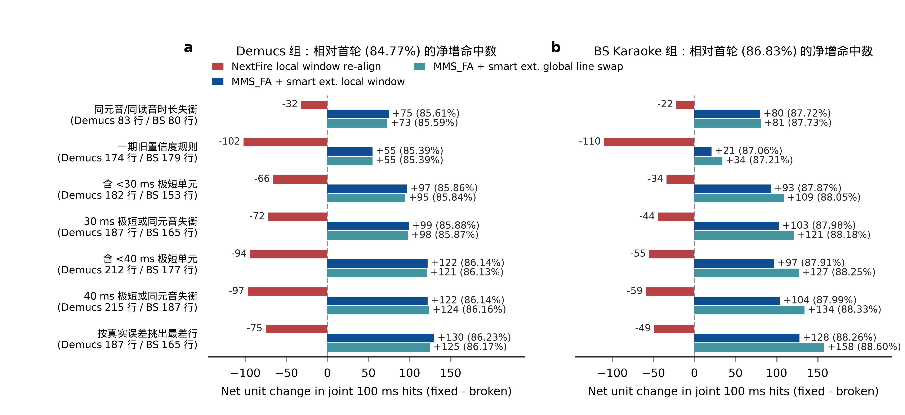

# 跨模型异常行局部重算与替换实验

在一期实验中我们发现，如果首轮已经用 `NextFire` + 人声片段拼接拿到了 ~84.5% 的准确率，再把疑似有问题的行截出来、继续用**同一个 `NextFire` 模型**重跑一遍，基本没有任何正收益。那么问题来了：首轮 `NextFire` 出错的那些行到底错在哪里？如果筛出这些异常行之后，**换用另一个特性互补的模型（`MMS_FA + 智能延长`）**来重算或替换，能不能突破单一模型的准确率天花板？

观察首轮 `NextFire` 的典型错例可以看到，它最容易在一种情况下翻车：**当同一行里连续出现相同元音或相同假名读音（比如长拖音、叠词、连续元音过渡）时，`NextFire` 经常把其中一个音节挤成不到 30 ms 或 40 ms 的极短时长，而把旁边同元音的另一个字拉得过长**。相反，多语言音素模型 `MMS_FA` 配合智能延长后，很少发生这种同元音挤压。

为了验证“用 `NextFire` 首轮结果筛出极短音节和同元音失衡行，再换用 `MMS_FA + 智能延长` 重算或替换”的实际效果，我们在 **20 首日语主组歌曲（875 行正文，8,911 个纯假名读音单元）** 上，同时在 **`Demucs`（默认轻量档，首轮基线 84.77%）** 和 **`BS Karaoke`（高质量主唱分离档，首轮基线 86.83%）** 两组人声下，测试了 **7 种异常行筛选规则** 与 **3 种处理方式**：
- **同模型局部重算（`nextfire_local`）**：截取被筛出行的首轮预测时间窗口（首尾外扩缓冲），继续用 `NextFire` 重新计算局部声学概率并解码；
- **换 `MMS_FA + 智能延长` 局部重算（`mms_fa_local`）**：截取被筛出行的局部音频窗口，改用 `MMS_FA + 智能延长` 做局部对齐；
- **换整曲 `MMS_FA + 智能延长` 直接行替换（`mms_fa_global_swap`）**：不裁剪局部音频窗口，直接从整曲 `MMS_FA + 智能延长` 的预测结果中取出对应行，替换掉 `NextFire` 的异常行。

评价指标定义见 [测试集与评价方法](methods.md)，完整数据保存在 [`results/M8/summary.json`](../results/M8/summary.json) 和 [`results/M8/metrics.csv`](../results/M8/metrics.csv)。

## 核心发现

1. **无论在 `Demucs` 还是 `BS Karaoke` 下，继续用同一个 `NextFire` 模型做局部窗口重算，在所有 7 种筛选规则下全部是负收益（净损失 22 到 110 个命中单元）**：
   - 就算假设我们能未卜先知、直接按真实参考时间挑出首轮错得最多的前 ~20% 行（表中的“按真实误差挑出最差行”），用 `NextFire` 做局部重算在 `Demucs` 下虽然修好了 126 个单元，却改错了 201 个原本对准的单元，**净亏 75 个单元**（准确率从 84.77% 掉到 **83.93%**）；在 `BS Karaoke` 下同样修好 121 个、改错 170 个，**净亏 49 个单元**（从 86.83% 掉到 **86.28%**）。
   - 在仅看首轮预测结果的 6 种自动筛选规则下，同模型局部重算同样全线倒退（`Demucs` 下净亏 32–102 个单元，`BS Karaoke` 下净亏 22–110 个单元）。因为同元音挤压是 `NextFire` 模型本身的习性，把音频截短成单行小窗口再跑一遍同一个模型，不但改不掉这个毛病，反而会因为行首尾边界截断引入新的错位。
2. **把筛选出的异常行换成 `MMS_FA + 智能延长`，在 `Demucs` 和 `BS Karaoke` 两组下都能把整体准确率再往上推高约 1.4 个百分点，在 `BS Karaoke` 下更是将 20 首日语歌整体准确率推上 88.33%**：
   - **在 `Demucs` 轻量档下**（首轮基线 **84.77%**）：采用“40 ms 极短或同元音失衡”规则（筛出 215/875 行，占 24.57%），换用 `MMS_FA + 智能延长` 局部重算净增 **+122 个单元**（升至 **86.14%**），整曲直接行替换净增 **+124 个单元**（修好 404 个、改错 280 个，准确率升至 **86.16%**，双端 200 ms 命中率达 **95.22%**，综合 P95 从 152.03 ms 降到 **130.76 ms**），完全追平了按真实误差挑出最差行时的理想上限（**86.23%** / **86.17%**）。
   - **在 `BS Karaoke` 高质量档下**（首轮基线 **86.83%**，双端 200 ms **95.21%**，综合 P95 **121.54 ms**）：采用“40 ms 极短或同元音失衡”规则（筛出 187/875 行，占 21.37%），换用 `MMS_FA + 智能延长` 局部重算净增 **+104 个单元**（升至 **87.99%**，双端 200 ms 达 **96.41%**，`>1 s` 大误差从 58 个腰斩至 **30** 个）；整曲直接行替换更是净增 **+134 个单元**（修好 328 个、改错 194 个），将整体双端 100 ms 命中率推高至 **88.33%**（7,871/8,911，双端 200 ms 达 **96.31%**，综合 P95 降至 **112.63 ms**），紧贴按真实误差挑出最差行的理想上限 **88.60%**（+158 单元，双端 200 ms 97.15%，综合 P95 109.01 ms）。
3. **只看“同元音／同读音时长失衡”能以不到 10% 的重算行数拿到最高性价比的提升**：
   - 如果不想替换二十多行的结果，只筛选“同元音／同读音时长失衡”这一类最典型的错误：在 `Demucs` 下仅筛出 **83/875 行（9.49%）**，即可净增 **+73 至 +75 个单元**（准确率升至 **85.59%–85.61%**）；在 `BS Karaoke` 下仅筛出 **80/875 行（9.14%）**，局部重算即可净增 **+80 个单元**（修好 159 个、仅改错 79 个，修好与改错比达到 **2 : 1**，准确率升至 **87.72%**）。

---

## 1. 七种异常行筛选规则说明

在 20 首日语主组共 **875 行正文**上，我们对比了 6 种仅看首轮 `NextFire` 预测时间几何特征的自动筛选规则，以及 1 种按真实参考时间挑出最差行的理想上限对照：

| 筛选规则名称 | 筛选条件说明 | Demucs 筛出行数 (占比) | BS Karaoke 筛出行数 (占比) |
| --- | --- | ---: | ---: |
| **同元音/同读音时长失衡** | 行内相邻两个主元音相同（或假名相同）的音节时长差距悬殊（一个被拉长、一个被挤短） | 83 / 875 (**9.49%**) | 80 / 875 (**9.14%**) |
| **一期旧置信度规则** | 一期沿用的旧规则：发音置信度 `<0.60`、人声活跃区覆盖率 `<70%`、存在超长单元或跨静音删段 | 174 / 875 (19.89%) | 179 / 875 (20.46%) |
| **含 `<30 ms` 极短单元** | 行内出现预测时长不足 30 ms（不到 1.5 个 CTC 帧）的读音单元 | 182 / 875 (20.80%) | 153 / 875 (17.49%) |
| **30 ms 极短或同元音失衡** | 满足“含 `<30 ms` 极短单元” **或** “同元音/同读音时长失衡” | 187 / 875 (21.37%) | 165 / 875 (18.86%) |
| **含 `<40 ms` 极短单元** | 行内出现预测时长不足 40 ms（不到 2 个 CTC 帧）的读音单元 | 212 / 875 (24.23%) | 177 / 875 (20.23%) |
| **40 ms 极短或同元音失衡** | 满足“含 `<40 ms` 极短单元” **或** “同元音/同读音时长失衡” | 215 / 875 (24.57%) | 187 / 875 (21.37%) |
| **按真实误差挑出最差行（理想上限）** | 假设能直接对照真实参考时间，挑出首轮未命中单元最多的前 $K$ 行（行数对齐 30 ms 组合规则） | 187 / 875 (21.37%) | 165 / 875 (18.86%) |

---

## 2. `Demucs` 组（默认轻量档）重算与替换结果（`n = 8,911`）

本组以 `Demucs + NextFire` 首轮结果（双端 100 ms 命中 **7,554/8,911 = 84.77%**，双端 200 ms **8,360/8,911 = 93.82%**，起点 / 终点 MAE **49.07 / 55.87 ms**，综合 P95 **152.03 ms**，`>1 s` 大误差 **80** 个）为基准：

| 筛选规则 | 筛出行数 (占比) | 处理方式 | 修好单元 | 改错单元 | 净增命中 | 双端 100 ms 命中率 (`n=8,911`) | 双端 200 ms 命中率 | 起点 / 终点 MAE (ms) | 综合 P95 (ms) | >1 s 大误差 |
| --- | ---: | --- | ---: | ---: | ---: | ---: | ---: | ---: | ---: | ---: |
| 首轮基线（不重算） | 0 (0.00%) | 保留 `NextFire` 首轮 | 0 | 0 | **0** | 7,554 (84.77%) | 8,360 (93.82%) | 49.07 / 55.87 | 152.03 | 80 |
| 同元音/同读音时长失衡 | 83 (9.49%) | `NextFire` 同模型局部重算 | 54 | 86 | **-32** | 7,522 (84.41%) | 8,344 (93.64%) | 50.38 / 57.49 | 156.38 | 83 |
| 同元音/同读音时长失衡 | 83 (9.49%) | 换 `MMS_FA + 智能延长` 局部重算 | 168 | 93 | **+75** | 7,629 (85.61%) | 8,416 (94.45%) | **44.88** / 53.67 | 142.07 | 69 |
| 同元音/同读音时长失衡 | 83 (9.49%) | 换整曲 `MMS_FA + 智能延长` 行替换 | 165 | 92 | **+73** | **7,627 (85.59%)** | **8,444 (94.76%)** | 45.22 / **52.79** | **137.51** | **68** |
| 一期旧置信度规则 | 174 (19.89%) | `NextFire` 同模型局部重算 | 121 | 223 | **-102** | 7,452 (83.63%) | 8,341 (93.60%) | 50.74 / 58.49 | 161.88 | 84 |
| 一期旧置信度规则 | 174 (19.89%) | 换 `MMS_FA + 智能延长` 局部重算 | 250 | 195 | **+55** | **7,609 (85.39%)** | **8,390 (94.15%)** | **44.04 / 55.06** | **145.58** | **75** |
| 一期旧置信度规则 | 174 (19.89%) | 换整曲 `MMS_FA + 智能延长` 行替换 | 258 | 203 | **+55** | **7,609 (85.39%)** | 8,384 (94.09%) | 60.57 / 69.99 | 148.90 | 100 |
| 含 `<30 ms` 极短单元 | 182 (20.80%) | `NextFire` 同模型局部重算 | 127 | 193 | **-66** | 7,488 (84.03%) | 8,336 (93.55%) | 50.77 / 58.52 | 161.76 | 86 |
| 含 `<30 ms` 极短单元 | 182 (20.80%) | 换 `MMS_FA + 智能延长` 局部重算 | 338 | 241 | **+97** | 7,651 (85.86%) | 8,457 (94.91%) | **42.81 / 55.05** | 136.88 | **75** |
| 含 `<30 ms` 极短单元 | 182 (20.80%) | 换整曲 `MMS_FA + 智能延长` 行替换 | 336 | 241 | **+95** | **7,649 (85.84%)** | **8,469 (95.04%)** | 46.38 / 55.32 | **132.94** | 78 |
| 30 ms 极短或同元音失衡 | 187 (21.37%) | `NextFire` 同模型局部重算 | 128 | 200 | **-72** | 7,482 (83.96%) | 8,330 (93.48%) | 51.23 / 58.93 | 162.63 | 87 |
| 30 ms 极短或同元音失衡 | 187 (21.37%) | 换 `MMS_FA + 智能延长` 局部重算 | 350 | 251 | **+99** | 7,653 (85.88%) | 8,456 (94.89%) | **42.88 / 55.00** | 136.76 | **74** |
| 30 ms 极短或同元音失衡 | 187 (21.37%) | 换整曲 `MMS_FA + 智能延长` 行替换 | 346 | 248 | **+98** | **7,652 (85.87%)** | **8,472 (95.07%)** | 46.43 / 55.30 | **132.42** | 77 |
| 含 `<40 ms` 极短单元 | 212 (24.23%) | `NextFire` 同模型局部重算 | 143 | 237 | **-94** | 7,460 (83.72%) | 8,325 (93.42%) | 51.12 / 58.97 | 165.00 | 85 |
| 含 `<40 ms` 极短单元 | 212 (24.23%) | 换 `MMS_FA + 智能延长` 局部重算 | 397 | 275 | **+122** | 7,676 (86.14%) | 8,477 (95.13%) | **40.49 / 53.68** | 134.00 | **65** |
| 含 `<40 ms` 极短单元 | 212 (24.23%) | 换整曲 `MMS_FA + 智能延长` 行替换 | 398 | 277 | **+121** | **7,675 (86.13%)** | **8,485 (95.22%)** | 46.58 / 56.30 | **131.65** | 81 |
| 40 ms 极短或同元音失衡 | 215 (24.57%) | `NextFire` 同模型局部重算 | 144 | 241 | **-97** | 7,457 (83.68%) | 8,320 (93.37%) | 51.55 / 59.34 | 166.52 | 86 |
| 40 ms 极短或同元音失衡 | 215 (24.57%) | 换 `MMS_FA + 智能延长` 局部重算 | 403 | 281 | **+122** | 7,676 (86.14%) | 8,473 (95.08%) | **40.60 / 53.62** | 134.00 | **64** |
| 40 ms 极短或同元音失衡 | 215 (24.57%) | 换整曲 `MMS_FA + 智能延长` 行替换 | 404 | 280 | **+124** | **7,678 (86.16%)** | **8,485 (95.22%)** | 46.67 / 56.26 | **130.76** | 80 |
| 按真实误差挑出最差行 | 187 (21.37%) | `NextFire` 同模型局部重算 | 126 | 201 | **-75** | 7,479 (83.93%) | 8,350 (93.70%) | 51.52 / 59.46 | 158.56 | 83 |
| 按真实误差挑出最差行 | 187 (21.37%) | 换 `MMS_FA + 智能延长` 局部重算 | 351 | 221 | **+130** | **7,684 (86.23%)** | 8,519 (95.60%) | **39.29 / 49.58** | 131.44 | **40** |
| 按真实误差挑出最差行 | 187 (21.37%) | 换整曲 `MMS_FA + 智能延长` 行替换 | 360 | 235 | **+125** | 7,679 (86.17%) | **8,524 (95.66%)** | 60.17 / 68.57 | **128.44** | 76 |

---

## 3. `BS Karaoke` 组（高质量主唱分离档）重算与替换结果（`n = 8,911`）

本组以 `BS Karaoke + NextFire` 首轮结果（双端 100 ms 命中 **7,737/8,911 = 86.83%**，双端 200 ms **8,484/8,911 = 95.21%**，起点 / 终点 MAE **39.98 / 45.89 ms**，综合 P95 **121.54 ms**，`>1 s` 大误差 **58** 个）为基准，检验在更强的分离器基线上这套跨模型替换方法是否依然有效：

| 筛选规则 | 筛出行数 (占比) | 处理方式 | 修好单元 | 改错单元 | 净增命中 | 双端 100 ms 命中率 (`n=8,911`) | 双端 200 ms 命中率 | 起点 / 终点 MAE (ms) | 综合 P95 (ms) | >1 s 大误差 |
| --- | ---: | --- | ---: | ---: | ---: | ---: | ---: | ---: | ---: | ---: |
| 首轮基线（不重算） | 0 (0.00%) | 保留 `NextFire` 首轮 | 0 | 0 | **0** | 7,737 (86.83%) | 8,484 (95.21%) | 39.98 / 45.89 | 121.54 | 58 |
| 同元音/同读音时长失衡 | 80 (9.14%) | `NextFire` 同模型局部重算 | 55 | 77 | **-22** | 7,715 (86.58%) | 8,460 (94.94%) | 40.71 / 46.71 | 127.81 | 54 |
| 同元音/同读音时长失衡 | 80 (9.14%) | 换 `MMS_FA + 智能延长` 局部重算 | 159 | 79 | **+80** | **7,817 (87.72%)** | **8,562 (96.08%)** | **37.13 / 43.29** | 114.87 | **39** |
| 同元音/同读音时长失衡 | 80 (9.14%) | 换整曲 `MMS_FA + 智能延长` 行替换 | 162 | 81 | **+81** | 7,818 (87.73%) | 8,560 (96.06%) | 38.24 / 44.27 | **114.00** | 44 |
| 一期旧置信度规则 | 179 (20.46%) | `NextFire` 同模型局部重算 | 97 | 207 | **-110** | 7,627 (85.59%) | 8,405 (94.32%) | 42.88 / 49.63 | 139.01 | 63 |
| 一期旧置信度规则 | 179 (20.46%) | 换 `MMS_FA + 智能延长` 局部重算 | 230 | 209 | **+21** | 7,758 (87.06%) | 8,526 (95.68%) | **38.03 / 45.82** | 117.94 | **51** |
| 一期旧置信度规则 | 179 (20.46%) | 换整曲 `MMS_FA + 智能延长` 行替换 | 233 | 199 | **+34** | **7,771 (87.21%)** | **8,530 (95.72%)** | 41.95 / 48.53 | **117.00** | 56 |
| 含 `<30 ms` 极短单元 | 153 (17.49%) | `NextFire` 同模型局部重算 | 122 | 156 | **-34** | 7,703 (86.44%) | 8,452 (94.85%) | 41.44 / 47.30 | 130.69 | 59 |
| 含 `<30 ms` 极短单元 | 153 (17.49%) | 换 `MMS_FA + 智能延长` 局部重算 | 266 | 173 | **+93** | 7,830 (87.87%) | **8,570 (96.17%)** | **37.11 / 43.91** | **115.00** | **43** |
| 含 `<30 ms` 极短单元 | 153 (17.49%) | 换整曲 `MMS_FA + 智能延长` 行替换 | 268 | 159 | **+109** | **7,846 (88.05%)** | 8,561 (96.07%) | 40.71 / 46.36 | 114.57 | 56 |
| 30 ms 极短或同元音失衡 | 165 (18.86%) | `NextFire` 同模型局部重算 | 130 | 174 | **-44** | 7,693 (86.33%) | 8,438 (94.69%) | 41.48 / 47.41 | 133.00 | 55 |
| 30 ms 极短或同元音失衡 | 165 (18.86%) | 换 `MMS_FA + 智能延长` 局部重算 | 293 | 190 | **+103** | 7,840 (87.98%) | **8,578 (96.26%)** | **36.62 / 43.35** | 114.32 | **37** |
| 30 ms 极短或同元音失衡 | 165 (18.86%) | 换整曲 `MMS_FA + 智能延长` 行替换 | 296 | 175 | **+121** | **7,858 (88.18%)** | 8,566 (96.13%) | 40.31 / 45.97 | **113.63** | 51 |
| 含 `<40 ms` 极短单元 | 177 (20.23%) | `NextFire` 同模型局部重算 | 137 | 192 | **-55** | 7,682 (86.21%) | 8,443 (94.75%) | 41.85 / 47.77 | 133.62 | 59 |
| 含 `<40 ms` 极短单元 | 177 (20.23%) | 换 `MMS_FA + 智能延长` 局部重算 | 298 | 201 | **+97** | 7,834 (87.91%) | **8,581 (96.30%)** | **35.93 / 43.19** | 114.38 | **36** |
| 含 `<40 ms` 极短单元 | 177 (20.23%) | 换整曲 `MMS_FA + 智能延长` 行替换 | 307 | 180 | **+127** | **7,864 (88.25%)** | 8,575 (96.23%) | 39.45 / 45.54 | **113.02** | 50 |
| 40 ms 极短或同元音失衡 | 187 (21.37%) | `NextFire` 同模型局部重算 | 142 | 201 | **-59** | 7,678 (86.16%) | 8,437 (94.68%) | 41.77 / 47.72 | 135.00 | 55 |
| 40 ms 极短或同元音失衡 | 187 (21.37%) | 换 `MMS_FA + 智能延长` 局部重算 | 320 | 216 | **+104** | 7,841 (87.99%) | **8,591 (96.41%)** | **35.43 / 42.66** | 113.37 | **30** |
| 40 ms 极短或同元音失衡 | 187 (21.37%) | 换整曲 `MMS_FA + 智能延长` 行替换 | 328 | 194 | **+134** | **7,871 (88.33%)** | 8,582 (96.31%) | 39.09 / 45.19 | **112.63** | 45 |
| 按真实误差挑出最差行 | 165 (18.86%) | `NextFire` 同模型局部重算 | 121 | 170 | **-49** | 7,688 (86.28%) | 8,461 (94.95%) | 42.39 / 48.20 | 131.81 | 60 |
| 按真实误差挑出最差行 | 165 (18.86%) | 换 `MMS_FA + 智能延长` 局部重算 | 295 | 167 | **+128** | 7,865 (88.26%) | **8,662 (97.21%)** | **32.87 / 39.39** | 110.69 | **16** |
| 按真实误差挑出最差行 | 165 (18.86%) | 换整曲 `MMS_FA + 智能延长` 行替换 | 312 | 154 | **+158** | **7,895 (88.60%)** | 8,657 (97.15%) | 36.39 / 41.81 | **109.01** | 34 |

---

## 4. 工程落地建议

对比 `Demucs` 和 `BS Karaoke` 两组实验可以看到一个非常稳定的规律：
- **单看模型自身置信度（`legacy_conf`）不够准，看“极短音节”和“同元音时长失衡”才抓到了 `NextFire` 的真正痛点**：在 `BS Karaoke` 下，旧置信度规则筛出 179 行只能净增 +21 到 +34 个单元；而改看“含 `<40 ms` 极短单元或同元音时长失衡”，筛出相近的 187 行却能净增 **+104 到 +134 个单元**。
- **产品设计上既可以做轻量局部补救，也可以做双模型融合**：
  - 如果只想在单模型主流程后对少数明显错位行做低成本修补，可以用**“同元音/同读音时长失衡 + 换 `MMS_FA + 智能延长` 局部重算”**：只对 9% 的歌词行截取局部音频跑一次 `MMS_FA`，在 `Demucs` 和 `BS Karaoke` 下分别把准确率推到 **85.61%** 和 **87.72%**。
  - 如果追求最高打轴质量，可以用**“40 ms 极短或同元音失衡 + 换 `MMS_FA + 智能延长`”**，把 `Demucs` 轻量档从 **84.77% 推高到 86.16%**，把 `BS Karaoke` 高质量档从 **86.83% 推高到 88.33%**（双端 200 ms 命中率超过 96%）。
