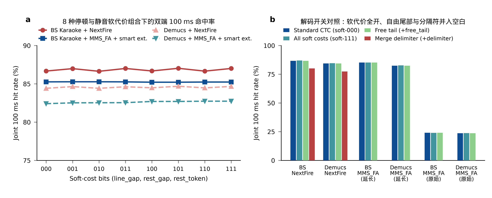

# MiliKara 解码机制与模块消融分析

[MiliKara](https://github.com/BilyHurington/MiliKara) 在声学对齐模型之上设计了一套相当复杂的自定义 CTC 解码与重试管线，包括：将词间分隔符 `|` 并入空白标签（blank）、根据人声能量包络在递推中施加行间停顿代价／静音区停顿代价／静音区发音惩罚、允许解码路径在尾音结束后自由跳入尾部状态（自由尾部），以及对异常行切换回未分离的原曲混音重新对齐。

然而在 [九条路线对齐比较](comparison.md) 中，MiliKara 原生管线的双端 100 ms 命中率（71.53%–75.76%）明显低于采用标准 CTC + 人声片段拼接的 Lazulite Studio（84.78%–86.80%）。为了弄清 MiliKara 中哪些模块真正有用、哪些模块反而拖累了准确率，并且验证这些解码规则在不同分离器和不同对齐模型上是否普遍适用，我们在 **20 首日语主组歌曲（固定人工读音，8,912 个纯假名读音单元与 9,053 个全量读音单元）** 上，统一采用人声片段拼接音频，对以下六套模型组合开展了完整的 $2^3 = 8$ 停顿／静音软代价全因子实验及单项对照实验：
1. **`Demucs + NextFire`（`concat_core/*`）**
2. **`BS Karaoke + NextFire`（`bs_nextfire/*`）**
3. **`Demucs + MMS_FA 原始输出`（`demucs_mms_fa_raw/*`）**
4. **`Demucs + MMS_FA + 智能延长`（`demucs_mms_fa_smart/*`）**
5. **`BS Karaoke + MMS_FA 原始输出`（`bs_mms_fa_raw/*`）**
6. **`BS Karaoke + MMS_FA + 智能延长`（`bs_mms_fa_smart/*`）**

评价指标定义见 [测试集与评价方法](methods.md)，全部汇总与逐曲数据保存在 [`results/M7/summary.json`](../results/M7/summary.json) 和 [`results/M7/metrics.csv`](../results/M7/metrics.csv)。

## 核心发现

1. **无论换用更强的分离器（`BS Karaoke`）还是换用通用多语言模型（`MMS_FA`，不论是否叠加智能延长），三项停顿与静音软代价最多只带来 0%–0.36% 的微弱变化**：
   - 在 `Demucs + NextFire` 上，8 种软代价组合的双端 100 ms 命中率全部落在 **84.41%–84.68%**（无软代价基线 `soft-000` 为 **84.41%**，全开 `soft-111` 为 **84.66%**，最高组合 `soft-101` 也只多对准 24 个单元 / **+0.27%**）。
   - 换用更干净的 `BS Karaoke + NextFire` 后，8 种组合全部落在 **86.64%–87.03%**（`soft-000` **86.67%** → `soft-111` **87.01%**，最大变化仅 **+0.34%**）。
   - 换用 `MMS_FA` 模型时，未经后处理的原始输出在 `Demucs` 下为 **23.65% → 23.80%**（+0.15%），在 `BS Karaoke` 下为 **24.01% → 24.00%**（-0.01%），说明在解码递推里加静音惩罚根本解决不了 `MMS_FA` 尾音偏早的问题；叠加 Studio 智能延长后，`Demucs + MMS_FA` 为 **82.41% → 82.73%**（+0.33%），`BS Karaoke + MMS_FA` 全部 8 组更是收窄在 **85.21%–85.27%**（`soft-000` **85.26%** vs `soft-111` **85.23%**，几乎是一条水平线）。
   - 这直接证明：**只要前置通过人声片段拼接切掉了间奏和长静音，最简单的标准 CTC 解码就已经能发挥出声学模型的全部水平**，不需要在 Viterbi 递推中堆砌复杂的能量惩罚超参数。
2. **在所有模型组合上，自由尾部（`free_tail`）完全不起作用，而将分隔符并入空白标签（`delimiter`）则会稳定造成 6.6–7.0 个百分点的大幅掉分**：
   - **自由尾部（`free_tail`）**：在全部六套模型组合中，开启 `free_tail` 后的命中数、MAE 与 P95 和标准 CTC（`soft-000`）分毫不差（净变化恒为 **0**）。
   - **分隔符并入空白（`delimiter`）**：MiliKara 默认将词间分隔符 `|` 的概率并入 blank 标签并将分隔符自身概率置零。在 `Demucs + NextFire` 上，开启这一项让命中率从 **84.41% 暴跌至 77.46%**（**-6.96%**，少对准 620 个单元）；在 `BS Karaoke + NextFire` 上同样从 **86.67% 暴跌至 80.11%**（**-6.56%**，少对准 585 个单元）。原因在于 `NextFire` 训练时本来就依靠分隔符与空白标签的配合来界定词尾，人为抹掉分隔符通道直接破坏了模型的词尾判别力。
3. **在原曲混音与分离人声之间做局部重试，提升不到 1 个百分点，但需要跑两遍声学推理**：
   - 在 `Demucs + NextFire` 片段拼接基线（84.41%）上，允许异常行切到原曲混音重试（`retry-original`）或以原曲起步切人声重试（`retry-vocals`），只能把命中率微升至 **84.74%**（+0.33%）和 **85.27%**（+0.85%），却要同时维护原曲和人声两套音频并做两遍声学模型推理。相比之下，直接换用 `BS Karaoke` 单遍标准 CTC 就能达到 **86.67%–86.80%**。

---

## 1. 六套模型组合下的解码开关总览（纯假名读音单元 `n = 8,912`）

MiliKara 的五项解码开关分别为：
- **行间停顿代价**（`line_gap`，编码第 1 位）：偏好在换行处经过静音停顿；
- **静音区停顿代价**（`rest_gap`，编码第 2 位）：在低能量帧奖励停留在空白标签；
- **静音区发音惩罚**（`rest_token`，编码第 3 位）：在低能量帧惩罚输出发音字符；
- **自由尾部**（`free_tail`）：允许整曲最后一个词结束后自由跳入尾部状态；
- **分隔符并入空白标签**（`delimiter`）：将 `|` 标签的概率合并到 blank 标签（仅适用于词表含 `|` 分隔符的 `NextFire`）。

下表汇总六套模型组合在标准 CTC（`soft-000`）、软代价全开（`soft-111`）、8 种软代价组合极值范围、开启自由尾部（`free_tail`）以及开启分隔符并入（`delimiter`）时的双端 100 ms 命中率：

| 模型组合 | 标准 CTC (`soft-000`) | 软代价全开 (`soft-111`) | 8 种软代价组合范围 (`min`–`max`) | 软代价全开变化 (`111 - 000`) | 开启自由尾部 (`free_tail`) | 开启分隔符并入 (`delimiter`) | 分隔符并入变化 (`delim - 000`) |
| --- | ---: | ---: | ---: | ---: | ---: | ---: | ---: |
| **BS Karaoke + NextFire** | 7,724 (86.67%) | **7,754 (87.01%)** | 86.64%–87.03% | **+0.34%** (+30) | 7,723 (86.66%) | 7,139 (80.11%) | **-6.56%** (-585) |
| **Demucs + NextFire** | 7,523 (84.41%) | 7,545 (84.66%) | 84.41%–84.68% | **+0.25%** (+22) | 7,523 (84.41%) | 6,903 (77.46%) | **-6.96%** (-620) |
| **BS Karaoke + MMS_FA + 智能延长** | **7,598 (85.26%)** | 7,596 (85.23%) | 85.21%–85.27% | **-0.02%** (-2) | 7,598 (85.26%) | — | — |
| **Demucs + MMS_FA + 智能延长** | 7,344 (82.41%) | **7,373 (82.73%)** | 82.41%–82.73% | **+0.33%** (+29) | 7,344 (82.41%) | — | — |
| **BS Karaoke + MMS_FA 原始输出** | 2,140 (24.01%) | 2,139 (24.00%) | 24.00%–24.02% | **-0.01%** (-1) | 2,140 (24.01%) | — | — |
| **Demucs + MMS_FA 原始输出** | 2,108 (23.65%) | 2,121 (23.80%) | 23.65%–23.81% | **+0.15%** (+13) | 2,108 (23.65%) | — | — |

---

## 2. `NextFire` 两组分离器下的详细消融表（`n = 8,912`）

### 2.1 `Demucs + NextFire`（含原曲与人声双轨重试对照）

| 解码与重试配置 | `line_gap` | `rest_gap` | `rest_token` | 双端 100 ms 命中率 | 相比 `soft-000` 变化 | 双端 200 ms 命中率 | 起点 / 终点 MAE (ms) | 起点 / 终点 P95 (ms) | 综合 P95 (ms) | 缺失 | >1 s 大误差 |
| --- | :---: | :---: | :---: | ---: | ---: | ---: | ---: | ---: | ---: | ---: | ---: |
| 标准 CTC (`soft-000`) | 0 | 0 | 0 | 7,523 (84.41%) | 基线 (+0) | 8,351 (93.71%) | 54.37 / 60.86 | 124.39 / 167.19 | 146.26 | 63 | 76 |
| 仅静音发音惩罚 (`soft-001`) | 0 | 0 | 1 | 7,543 (84.64%) | +20 (+0.22%) | 8,359 (93.79%) | **53.79** / 61.05 | 122.76 / 167.87 | 147.03 | 52 | 74 |
| 仅静音停顿代价 (`soft-010`) | 0 | 1 | 0 | 7,523 (84.41%) | +0 (+0.00%) | 8,352 (93.72%) | 54.34 / 60.87 | 124.29 / 167.19 | 146.26 | 63 | 76 |
| 静音停顿 + 发音惩罚 (`soft-011`) | 0 | 1 | 1 | 7,541 (84.62%) | +18 (+0.20%) | 8,360 (93.81%) | 54.05 / 60.95 | 122.77 / 167.87 | 147.08 | 53 | 74 |
| 仅行间停顿代价 (`soft-100`) | 1 | 0 | 0 | 7,529 (84.48%) | +6 (+0.07%) | 8,355 (93.75%) | 54.02 / **60.67** | 123.92 / **166.73** | **145.63** | 63 | 75 |
| 行间停顿 + 发音惩罚 (`soft-101`) | 1 | 0 | 1 | **7,547 (84.68%)** | **+24 (+0.27%)** | 8,361 (93.82%) | 53.95 / 60.85 | **122.57** / 167.70 | 146.50 | 52 | 75 |
| 行间 + 静音停顿 (`soft-110`) | 1 | 1 | 0 | 7,528 (84.47%) | +5 (+0.06%) | 8,356 (93.76%) | 54.07 / 60.75 | 123.36 / 167.19 | 145.72 | 63 | 74 |
| 三项软代价全开 (`soft-111`) | 1 | 1 | 1 | 7,545 (84.66%) | +22 (+0.25%) | **8,362 (93.83%)** | 53.88 / 60.89 | 122.75 / 167.71 | 146.31 | 53 | 74 |
| 仅开自由尾部 (`free_tail`) | 0 | 0 | 0 | 7,523 (84.41%) | +0 (0.00%) | 8,351 (93.71%) | 54.37 / 60.87 | 124.39 / 167.19 | 146.26 | 63 | 76 |
| 仅开分隔符并入 (`delimiter`) | 0 | 0 | 0 | 6,903 (77.46%) | **-620 (-6.96%)** | 8,184 (91.83%) | 51.57 / 78.80 | 113.93 / 227.48 | 185.17 | **44** | 71 |
| 人声起步 + 切原曲重试 (`retry-original`) | 0 | 0 | 0 | 7,552 (84.74%) | +29 (+0.33%) | 8,380 (94.03%) | 48.71 / 57.36 | 114.52 / 166.05 | 142.96 | 66 | 65 |
| 原曲起步 + 切人声重试 (`retry-vocals`) | 0 | 0 | 0 | **7,599 (85.27%)** | **+76 (+0.85%)** | **8,405 (94.31%)** | **45.78 / 53.05** | 115.34 / **157.28** | **136.19** | 62 | **59** |

### 2.2 `BS Karaoke + NextFire`

| 解码配置 | `line_gap` | `rest_gap` | `rest_token` | 双端 100 ms 命中率 | 相比 `soft-000` 变化 | 双端 200 ms 命中率 | 起点 / 终点 MAE (ms) | 起点 / 终点 P95 (ms) | 综合 P95 (ms) | 缺失 | >1 s 大误差 |
| --- | :---: | :---: | :---: | ---: | ---: | ---: | ---: | ---: | ---: | ---: | ---: |
| 标准 CTC (`soft-000`) | 0 | 0 | 0 | 7,724 (86.67%) | 基线 (+0) | 8,486 (95.22%) | 41.15 / 46.85 | 105.27 / 139.66 | 119.38 | 37 | 54 |
| 仅静音发音惩罚 (`soft-001`) | 0 | 0 | 1 | 7,752 (86.98%) | +28 (+0.31%) | 8,490 (95.26%) | 41.07 / 46.64 | 104.62 / 139.26 | 119.00 | 32 | 54 |
| 仅静音停顿代价 (`soft-010`) | 0 | 1 | 0 | 7,721 (86.64%) | -3 (-0.03%) | 8,486 (95.22%) | 40.98 / 46.85 | 105.27 / 139.66 | 119.32 | 37 | 53 |
| 静音停顿 + 发音惩罚 (`soft-011`) | 0 | 1 | 1 | 7,754 (87.01%) | +30 (+0.34%) | 8,492 (95.29%) | 40.85 / 46.58 | 104.45 / 139.19 | 118.31 | 32 | 53 |
| 仅行间停顿代价 (`soft-100`) | 1 | 0 | 0 | 7,725 (86.68%) | +1 (+0.01%) | 8,488 (95.24%) | 40.97 / 46.88 | 105.21 / 139.25 | 119.14 | 37 | 53 |
| 行间停顿 + 发音惩罚 (`soft-101`) | 1 | 0 | 1 | 7,756 (87.03%) | +32 (+0.36%) | 8,492 (95.29%) | 40.85 / 46.63 | 104.45 / 138.70 | 118.31 | 32 | 53 |
| 行间 + 静音停顿 (`soft-110`) | 1 | 1 | 0 | 7,723 (86.66%) | -1 (-0.01%) | 8,486 (95.22%) | 40.98 / 46.91 | 105.27 / 139.66 | 119.25 | 37 | 53 |
| 三项软代价全开 (`soft-111`) | 1 | 1 | 1 | **7,754 (87.01%)** | **+30 (+0.34%)** | **8,492 (95.29%)** | **40.76 / 46.54** | **104.45 / 138.95** | **118.25** | 32 | **53** |
| 仅开自由尾部 (`free_tail`) | 0 | 0 | 0 | 7,723 (86.66%) | -1 (-0.01%) | 8,486 (95.22%) | 41.13 / 46.90 | 105.27 / 139.66 | 119.37 | 37 | 54 |
| 仅开分隔符并入 (`delimiter`) | 0 | 0 | 0 | 7,139 (80.11%) | **-585 (-6.56%)** | 8,357 (93.77%) | 37.69 / 62.57 | 94.57 / 194.37 | 155.75 | **23** | 55 |

---

## 3. `MMS_FA` 四组配置下的软代价消融表（`n = 8,912`）

在 `MMS_FA` 模型上，无论是否叠加智能延长，8 种软代价组合与 `free_tail` 的结果都高度一致：

| 解码配置 | `Demucs + MMS_FA 原始` 100 ms (MAE ms) | `Demucs + MMS_FA + 智能延长` 100 ms (MAE ms) | `BS + MMS_FA 原始` 100 ms (MAE ms) | `BS + MMS_FA + 智能延长` 100 ms (MAE ms) |
| --- | ---: | ---: | ---: | ---: |
| 标准 CTC (`soft-000`) | 2,108 (23.65%) (97.2 / 319.7) | 7,344 (82.41%) (97.2 / 111.1) | 2,140 (24.01%) (52.6 / 282.4) | 7,598 (85.26%) (52.6 / 64.7) |
| 仅静音发音惩罚 (`soft-001`) | 2,112 (23.70%) (93.9 / 317.2) | 7,354 (82.52%) (93.9 / 107.9) | **2,141 (24.02%)** (52.6 / 282.4) | **7,599 (85.27%)** (52.6 / 64.7) |
| 仅静音停顿代价 (`soft-010`) | 2,114 (23.72%) (96.6 / 319.0) | 7,355 (82.53%) (96.6 / 110.1) | **2,141 (24.02%)** (52.4 / 282.5) | **7,599 (85.27%)** (52.4 / 64.5) |
| 静音停顿 + 发音惩罚 (`soft-011`) | 2,113 (23.71%) (94.4 / 317.7) | 7,356 (82.54%) (94.4 / 108.1) | **2,141 (24.02%)** (52.4 / 282.6) | 7,598 (85.26%) (52.4 / 64.6) |
| 仅行间停顿代价 (`soft-100`) | 2,120 (23.79%) (90.9 / 318.0) | 7,370 (82.70%) (90.9 / 106.1) | 2,139 (24.00%) (52.5 / 283.3) | 7,594 (85.21%) (52.5 / 64.2) |
| 行间停顿 + 发音惩罚 (`soft-101`) | 2,119 (23.78%) (90.8 / 318.0) | 7,370 (82.70%) (90.8 / 106.1) | 2,139 (24.00%) (52.5 / 283.3) | 7,594 (85.21%) (52.5 / 64.2) |
| 行间 + 静音停顿 (`soft-110`) | **2,122 (23.81%)** (93.3 / 320.1) | **7,373 (82.73%)** (93.3 / 108.9) | 2,139 (24.00%) (52.7 / 283.2) | 7,596 (85.23%) (52.7 / 64.1) |
| 三项软代价全开 (`soft-111`) | 2,121 (23.80%) (91.4 / 318.3) | **7,373 (82.73%)** (91.4 / 106.6) | 2,139 (24.00%) (52.6 / 283.3) | 7,596 (85.23%) (52.6 / 64.1) |
| 仅开自由尾部 (`free_tail`) | 2,108 (23.65%) (97.2 / 319.7) | 7,344 (82.41%) (97.2 / 111.1) | 2,140 (24.01%) (52.6 / 282.4) | 7,598 (85.26%) (52.6 / 64.7) |

（含英文词的全量读音单元 `n = 9,053` 上的规律与纯假名完全一致，完整数据可查阅 [`results/M7/metrics.csv`](../results/M7/metrics.csv)。）
