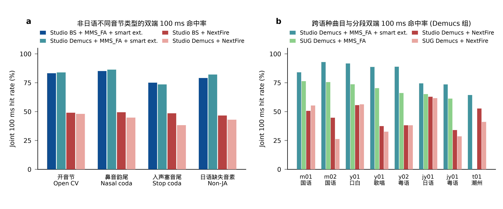

# 多语言与方言歌词对齐及多语种词典评估

日语歌打轴中表现最好的 `NextFire` 模型，本质上是在多语言模型基础上专门用日语卡拉 OK 数据做过微调的。当用户拿它去对国语、粤语或闽南语／潮州话歌曲时，效果会掉多少？换用未针对单一语种缩窄的 `MMS_FA` 模型，配合 Lazulite Studio 的智能延长和内置多语种词典，能不能直接把非日语歌的自动打轴做到可用水平？

为了回答这些问题，我们在 6 首非日语及跨语种歌曲（国语 `m01`、`m02`；粤语 `y01`、`y02`；日粤混合 `jy01`；潮州话 `t01`，共 256 行正文、1,957 个共同正文区间、1,975 个读音单元）上，测试了 Studio 与各主流开源工具的表现，并按音节类型拆解了模型掉分的原因。指标定义见 [测试集与评价方法](methods.md)，逐曲结果与词典数据保存在 [`results/M2/summary.json`](../results/M2/summary.json)、[`results/M2/metrics.csv`](../results/M2/metrics.csv)、[`results/M2/phonetic-groups.csv`](../results/M2/phonetic-groups.csv) 及 [`results/M2/dictionary/`](../results/M2/dictionary/)。

## 核心发现

1. **Lazulite Studio（`MMS_FA + 智能延长`）在 6 首跨语种与方言歌曲上取得 82.42%–82.83% 的双端 100 ms 命中率，和日语歌表现处于同一水平**：
   - 在 1,957 个共同正文区间上，`Studio (Demucs + MMS_FA + 智能延长)` 的双端 100 ms 命中率达 **82.83%**（1,621/1,957），双端 200 ms 命中率达 **92.44%**；换用 `BS Karaoke` 后分别为 **82.42%**（1,613/1,957）与 **91.98%**。在 1,975 个细粒度读音单元上，两条配置分别达到 **82.99%** 与 **82.58%**。
   - 相比之下，只用日语微调过的 `NextFire` 在这 6 首歌上的共同正文双端 100 ms 命中率跌到了 **46.40%**（Demucs）和 **49.72%**（BS Karaoke），综合 P95 误差高达 777–1,014 ms。
2. **`NextFire` 在非日语歌上掉分，不是因为输入字符被清空，而是因为它不擅长识别汉语里的鼻音韵尾、入声塞音尾和日语没有的音素**：
   - 检查模型实际收到的拉丁字符序列（[`results/M2/t01-input-tokens.json.gz`](../results/M2/t01-input-tokens.json.gz)）可以看到，潮州话 `t01` 的 300 个读音单元全部转成了非空拉丁字母（空字符数为 0）。
   - 按音节类型拆开看，`MMS_FA + 智能延长` 在开音节（**83.15%–83.89%**）、鼻音韵尾 `-n/-ng/-m`（**85.06%–86.32%**）、日语缺失音素（**79.01%–82.10%**）和入声塞音尾 `-p/-t/-k/-h`（**73.53%–75.00%**）上都很稳；而 `NextFire` 在四类音节上全面掉到 **38.24%–49.37%**，其中入声塞音尾在 Demucs 下只有 **38.24%**（52/136）。日语绝大多数音拍都是“辅音 + 单纯元音”的开音节，模型经过日语微调后，遇到粤语、潮州话里短促闭塞的入声收尾和复杂鼻韵母时找不准词尾，进而把整行后面的字连带拽偏。
3. **对比同样使用 `MMS_FA` 的路线，`SUG (MMS_FA)` 在跨语种曲目上明显好于 `SUG (NextFire)`，但因缺少片段拼接和智能延长，仍比 Studio 低 20 个百分点以上**：
   - `SUG (MMS_FA)` 在国语、粤语和日粤混合 5 首歌上均正常跑通（单曲双端 100 ms 命中率在 **62.66%–78.72%**），仅在潮州话 `t01` 上因转写中带空格触发 `torchaudio` 分词器报 `KeyError: ' '` 中断；6 首总计命中率为 **60.65%**（Demucs）和 **59.17%**（BS Karaoke），比 `SUG (NextFire)`（**42.00%** / **39.24%**）高出约 19–20 个百分点，但因为尾音普遍偏早且 `t01` 中断，整体仍明显低于 `Studio (MMS_FA + 智能延长)`（**82.83%** / **82.42%**）。
   - 其他外部工具大多被单语种前端卡住：`FA-Kara` 6 首全部报错中断（**0.00%**）；`Timing` 只跑通了 2 首国语歌（在 BS Karaoke 下达 **81.38%** 和 **93.26%**），其余 4 首粤语和潮州话均在前端校验时报错退出；`yohane` 只跑通 3 首粤语及混合曲目（48.50%–60.47%）；`MiliKara` 在国语和潮州话上漏掉了绝大部分汉字，6 首总命中率仅 **18.91%–19.37%**。
4. **直接用 Studio 内置多语种词典自动注音，下游对齐效果与人工精调注音基本持平**：
   - 在 `m01`、`m02`、`y01`、`y02`、`t01` 这 5 首单语种汉字歌（共 1,727 个字词单元）上，Studio 内置词典的带声调准确率为 **94.04%**（1,624/1,727），不带声调准确率为 **94.38%**（1,630/1,727）；其中国语不带调准确率达 **100.00%**，粤语达 **98.14%–98.17%**，潮州话受方言文白异读影响为 **71.67%**。
   - 因为 `MMS_FA` 在对齐前会去掉声调数字，且发音相近的声母韵母在模型里的激活路径高度接近，直接用词典自动注音跑 `MMS_FA + 智能延长` 在 5 首歌（`n = 1,724`）上的双端 100 ms 命中率达到 **84.22%**（Demucs）和 **83.64%**（BS Karaoke），与人工注音相比在 4 首歌上分毫不差，`y01` 在 Demucs 下甚至高出 0.69 个百分点。

---

## 1. 各工具跨语种兼容性与 6 首非日语歌总体表现

下表汇总所有测试路线在 6 首非日语歌曲（共同正文边界 `n = 1,957`）上的完成曲数与整体对齐指标：

| 项目与路线 | 人声分离模型 | 对齐模型 | 完成曲数 | 有效预测 | 双端 100 ms 命中率 | 双端 200 ms 命中率 | 起点 / 终点 MAE (ms) | 综合 P95 (ms) | 缺失 | >1 s 大误差 |
| --- | --- | --- | ---: | ---: | ---: | ---: | ---: | ---: | ---: | ---: |
| Lazulite Studio (Demucs + MMS_FA) | Demucs htdemucs | MMS_FA + 智能延长 | 6/6 | 1,953 | **1,621/1,957 (82.83%)** | **1,809/1,957 (92.44%)** | 188.80 / 205.45 | **188.97** | 4 | 40 |
| Lazulite Studio (BS + MMS_FA) | BS Karaoke | MMS_FA + 智能延长 | 6/6 | **1,954** | 1,613/1,957 (82.42%) | 1,800/1,957 (91.98%) | **143.81 / 158.23** | 200.38 | **3** | **38** |
| SUG (Demucs + MMS_FA) | Demucs htdemucs | MMS_FA | 5/6 | 1,657 | 1,187/1,957 (60.65%) | 1,375/1,957 (70.26%) | 225.53 / 316.10 | 407.35 | 300 | 70 |
| SUG (BS + MMS_FA) | BS Karaoke | MMS_FA | 5/6 | 1,657 | 1,158/1,957 (59.17%) | 1,352/1,957 (69.09%) | 249.24 / 300.29 | 653.35 | 300 | 90 |
| Lazulite Studio (BS + NextFire) | BS Karaoke | NextFire | 6/6 | 1,939 | 973/1,957 (49.72%) | 1,383/1,957 (70.67%) | 182.43 / 202.12 | 777.44 | 18 | 102 |
| Lazulite Studio (Demucs + NextFire) | Demucs htdemucs | NextFire | 6/6 | 1,919 | 908/1,957 (46.40%) | 1,338/1,957 (68.37%) | 210.42 / 227.54 | 1,013.87 | 38 | 130 |
| SUG (Demucs + NextFire) | Demucs htdemucs | NextFire | 6/6 | 1,957 | 822/1,957 (42.00%) | 1,296/1,957 (66.22%) | 301.79 / 384.17 | 1,300.10 | 0 | 178 |
| SUG (BS + NextFire) | BS Karaoke | NextFire | 6/6 | 1,957 | 768/1,957 (39.24%) | 1,229/1,957 (62.80%) | 517.18 / 533.07 | 2,011.00 | 0 | 234 |
| Timing (BS) | BS Karaoke | TIFA | 2/6 | 776 | 665/1,957 (33.98%) | 726/1,957 (37.10%) | 106.68 / 120.69 | 276.95 | 1,181 | 28 |
| Timing (Demucs) | Demucs htdemucs | TIFA | 2/6 | 776 | 580/1,957 (29.64%) | 661/1,957 (33.78%) | 1,258.09 / 1,271.07 | 8,436.00 | 1,181 | 93 |
| yohane (Demucs) | Demucs htdemucs | NextFire | 3/6 | 881 | 461/1,957 (23.56%) | 620/1,957 (31.68%) | 251.66 / 375.07 | 933.85 | 1,076 | 61 |
| yohane (BS) | BS Karaoke | NextFire | 3/6 | 881 | 435/1,957 (22.23%) | 591/1,957 (30.20%) | 319.89 / 369.75 | 1,274.00 | 1,076 | 87 |
| MiliKara (Demucs) | Demucs htdemucs | NextFire | 6/6 | 1,083 | 379/1,957 (19.37%) | 622/1,957 (31.78%) | 2,465.31 / 2,563.42 | 15,404.00 | 874 | 195 |
| MiliKara (BS) | BS Karaoke | NextFire | 6/6 | 1,083 | 370/1,957 (18.91%) | 640/1,957 (32.70%) | 3,569.61 / 3,647.54 | 14,192.50 | 874 | 229 |
| FA-Kara (Demucs / BS) | Demucs / BS Karaoke | MMS_FA + 原生静音修正 | 0/6 | 0 | 0/1,957 (0.00%) | 0/1,957 (0.00%) | — | — | 1,957 | 0 |

### 1.1 各工具在 6 首非日语歌曲上的运行状态与报错原因

| 工具与路线 | 国语 (`m01`, `m02`) | 粤语 (`y01`, `y02`) | 日粤混合 (`jy01`) | 潮州话 (`t01`) | 运行表现与报错原因 |
| --- | --- | --- | --- | --- | --- |
| **Lazulite Studio** (`MMS_FA` / `NextFire`) | 2/2 完成 | 2/2 完成 | 1/1 完成 | 1/1 完成 | 罗马字、拼音、粤拼、潮拼与假名统一转音素，6 首歌全部正常完成 |
| **SUG (MMS_FA)** | 2/2 完成（70.5%–78.7%） | 2/2 完成（64.7%–71.4%） | 1/1 完成（62.7%） | 0/1 失败 | 前 5 首正常导出；潮州话 `t01` 因注音内包含空格，在送入 `torchaudio` 分词器时触发 `KeyError: ' '` 中断 |
| **SUG (NextFire)** | 2/2 完成 | 2/2 完成 | 1/1 完成 | 1/1 完成 | 6/6 正常导出，但底层模型只针对日语微调，6 首总命中率仅 39.24%–42.00% |
| **MiliKara** | 2/2 导出（90% 缺失） | 2/2 完成 | 1/1 完成 | 1/1 导出（57% 缺失） | 国语 `m01`（仅 48/494 有效）、`m02`（26/282 有效）因拼音未转成有效假名被大量跳过；`t01` 仅 128/300 有效 |
| **Timing** | 2/2 完成（BS 下 81.38% / 93.26%） | 0/2 失败 | 0/1 失败 | 0/1 失败 | 粤语、日粤混合与潮州话在前端校验时报 `ValueError: 分段文字、语言无效；标点和空格请附在有发音的分段。` |
| **yohane** | 0/2 失败 | 2/2 完成（49.65%–60.47%） | 1/1 完成（48.50%） | 0/1 失败 | `m01`、`m02`、`t01` 在导出 ASS 字幕回填时间轴时触发 `AssertionError` |
| **FA-Kara** | 0/2 失败 | 0/2 失败 | 0/1 失败 | 0/1 失败 | `m01`、`m02` 在对齐推理时报 `TypeError`；`y01`、`y02`、`jy01` 因粤拼带数字声调在前端报 `AssertionError: 辅助注音格式错误`；`t01` 报 `KeyError: 'end'` |

---

## 2. 按音节类型拆解与跨语种分段表现

### 2.1 四类音节上的准确率对比

为了看清 `NextFire` 在非日语歌曲上为什么掉分，我们把 6 首非日语歌曲的全部读音单元按音节结构分成四类（若某个音节既有闭音节韵尾又包含日语没有的声母元音，则同时计入对应类别；另有 25 个特殊衬词归入未分类）：
- **开音节（`n = 1,074`）**：以元音结尾、没有鼻音或塞音收尾的音节；
- **鼻音韵尾（`n = 636`）**：以 `-n`、`-ng`、`-m`（或潮州话鼻化元音 `-nn`）收尾的音节；
- **入声塞音尾（`n = 136`）**：粤语和潮州话中以 `-p`、`-t`、`-k`、`-h` 塞音急停收尾的入声音节；
- **日语缺失音素（`n = 324`）**：包含卷舌音、唇齿音、送气塞擦音或复合元音等标准日语里没有的发音单元。

| 音节类型 | 分母 `n` | `Studio BS + MMS_FA + 智能延长` 100 ms / 200 ms | `Studio Demucs + MMS_FA + 智能延长` 100 ms / 200 ms | `Studio BS + NextFire` 100 ms / 200 ms | `Studio Demucs + NextFire` 100 ms / 200 ms | `Demucs + MMS_FA` 起点 / 终点 MAE (ms) | `Demucs + NextFire` 起点 / 终点 MAE (ms) |
| --- | ---: | ---: | ---: | ---: | ---: | ---: | ---: |
| 开音节 | 1,074 | 893/1,074 (83.15%) / 93.11% | **901/1,074 (83.89%)** / **93.39%** | 526/1,074 (48.98%) / 70.02% | 515/1,074 (47.95%) / 68.53% | **140.41 / 149.68** | 200.08 / 199.75 |
| 鼻音韵尾 | 636 | 541/636 (85.06%) / 93.40% | **549/636 (86.32%)** / **95.28%** | 314/636 (49.37%) / 69.97% | 285/636 (44.81%) / 67.45% | 209.14 / 228.97 | 182.79 / 216.80 |
| 日语缺失音素 | 324 | 256/324 (79.01%) / 87.96% | **266/324 (82.10%)** / **92.28%** | 151/324 (46.60%) / 64.81% | 139/324 (42.90%) / 65.12% | 385.65 / 377.58 | 167.78 / 222.55 |
| 入声塞音尾 | 136 | **102/136 (75.00%)** / **84.56%** | 100/136 (73.53%) / 83.82% | 66/136 (48.53%) / 74.26% | 52/136 (**38.24%**) / 65.44% | 195.72 / 211.66 | 142.27 / 208.02 |

从表中可以清楚看到：
- **`MMS_FA` 的多语言音素表在汉语族方言上优势明显**：`MMS_FA` 训练时覆盖了上千种语言的通用拉丁音素，不仅在开音节和鼻音韵尾上命中率达到 **83.15%–86.32%**（综合 P95 仅 140–176 ms），就算遇到粤语、潮州话里短促收尾的入声字，也能保持 **73.53%–75.00%** 的双端 100 ms 命中率。
- **`NextFire` 受日语发音习惯拖累，在入声和鼻韵母上容易跑偏**：日语里除了拨音 `ん` 之外几乎全是元音结尾的开音节。`NextFire` 用日语歌微调后，遇到汉语密集的复合韵母、鼻音尾和入声塞音急停时，模型在词尾找不准落点，顺带把同一行里相邻的开音节也一起带偏，导致四类音节的命中率全都掉到了 38%–49%。

### 2.2 逐曲与曲内分段对比：口白 vs 歌唱（`y01`）、日语 vs 粤语（`jy01`）

下表列出 Studio、SUG 及跑通部分曲目的外部工具在 6 首歌及两个曲内分段上的双端 100 ms 命中率（共同正文边界）：

| 曲目 / 曲内分段 | 语种与特点 | 分母 `n` | `Studio Demucs + MMS_FA + 智能延长` | `Studio BS + MMS_FA + 智能延长` | `SUG (Demucs + MMS_FA)` | `Studio BS + NextFire` | `Studio Demucs + NextFire` | `SUG (Demucs + NextFire)` | `Timing (BS + TIFA)` |
| --- | --- | ---: | ---: | ---: | ---: | ---: | ---: | ---: | ---: |
| `m01 - 晴天` | 国语 | 494 | **415/494 (84.01%)** | 407/494 (82.39%) | 377/494 (76.32%) | 255/494 (51.62%) | 250/494 (50.61%) | 273/494 (55.26%) | 402/494 (81.38%) |
| `m02 - 漆黑的空间` | 国语 | 282 | 262/282 (92.91%) | **274/282 (97.16%)** | 213/282 (75.53%) | 124/282 (43.97%) | 126/282 (44.68%) | 74/282 (26.24%) | 263/282 (93.26%) |
| `y01 - 似是故人来`（全曲） | 粤语现场 | 433 | **388/433 (89.61%)** | 375/433 (86.61%) | 309/433 (71.36%) | 193/433 (44.57%) | 188/433 (43.42%) | 175/433 (40.42%) | 0/433 (失败) |
| ↳ `y01` 口白段（L01–L13） | 演唱会独白 | 144 | **132/144 (91.67%)** | 123/144 (85.42%) | 106/144 (73.61%) | 80/144 (55.56%) | 80/144 (55.56%) | 81/144 (56.25%) | — |
| ↳ `y01` 歌唱段（L14–L55） | 正式演唱 | 289 | **256/289 (88.58%)** | 252/289 (87.20%) | 203/289 (70.24%) | 113/289 (39.10%) | 108/289 (37.37%) | 94/289 (32.53%) | — |
| `y02 - 未曾后悔` | 粤语 | 215 | 191/215 (88.84%) | **204/215 (94.88%)** | 142/215 (66.05%) | 111/215 (51.63%) | 82/215 (38.14%) | 82/215 (38.14%) | 0/215 (失败) |
| `jy01 - 星`（全曲） | 日粤混合现场 | 233 | **172/233 (73.82%)** | 171/233 (73.39%) | 146/233 (62.66%) | 108/233 (46.35%) | 104/233 (44.64%) | 95/233 (40.77%) | 0/233 (失败) |
| ↳ `jy01` 日语段（L01–L10） | 前半段日语 | 86 | 64/86 (74.42%) | **70/86 (81.40%)** | 56/86 (65.12%) | 65/86 (75.58%) | 54/86 (62.79%) | 53/86 (61.63%) | — |
| ↳ `jy01` 粤语段（L11–L23） | 后半段粤语 | 147 | **108/147 (73.47%)** | 101/147 (68.71%) | 90/147 (61.22%) | 43/147 (29.25%) | 50/147 (34.01%) | 42/147 (28.57%) | — |
| `t01 - 骹车破尼` | 潮州话 | 300 | **193/300 (64.33%)** | 182/300 (60.67%) | 0/300 (失败) | 182/300 (60.67%) | 158/300 (52.67%) | 123/300 (41.00%) | 0/300 (失败) |

其中两首歌的曲内分段对比非常直观：
1. **`y01` 粤语口白段 vs 歌唱段**：前 13 行是演唱会开场独白（`n = 144`），语速快、音节短促、没有歌唱拖腔。`Studio (Demucs + MMS_FA + 智能延长)` 在这段口白上的双端 100 ms 命中率高达 **91.67%**（双端 200 ms 达 **97.92%**，起点 / 终点 MAE 仅 **29.25 / 38.48 ms**）；进入后 42 行正式歌唱段（`n = 289`）后，`Studio (MMS_FA + 智能延长)` 依然保持 **87.20%–88.58%**，而 `NextFire` 从口白段的 55.56% 直接掉到了歌唱段的 **37.37%–39.10%**。
2. **`jy01` 同曲日语段 vs 粤语段**：同一位歌手、同一场演唱会的录音里，前 10 行日语段（`n = 86`）上 `BS + NextFire`（**75.58%**）和 `BS + MMS_FA + 智能延长`（**81.40%**）表现都不错；但第 11 行一切换到粤语（`n = 147`），`BS + NextFire` 立刻跌到 **29.25%**（MAE 扩大到 312.35 / 353.24 ms），而 `MMS_FA + 智能延长` 在粤语段继续稳定在 **68.71%–73.47%**（双端 200 ms 命中率达 **91.84%–93.20%**）。

---

## 3. Studio 多语种词典注音准确率与下游对齐表现

为了检验在不提供人工注音、直接用 Studio 内置多语种词典给汉字自动注音时的打轴效果，我们在 5 首单语种汉字歌曲（国语 `m01`、`m02`，粤语 `y01`、`y02`，潮州话 `t01`；不含混有日文假名的 `jy01`）上测试了词典注音准确率，并对比了用词典注音与用人工注音跑 `MMS_FA + 智能延长` 的对齐结果。

### 3.1 多语种词典注音准确率（带声调 vs 不带声调）

| 曲目 | 语种与注音体系 | 评估单元数 `n` | 带声调完全匹配 | 不带声调完全匹配 | 差异原因 |
| --- | --- | ---: | ---: | ---: | --- |
| `m01 - 晴天` | 国语（汉语拼音） | 494 | 493/494 (**99.80%**) | 494/494 (**100.00%**) | 仅 1 字轻声声调差异，声韵母 100% 一致 |
| `m02 - 漆黑的空间` | 国语（汉语拼音） | 282 | 278/282 (**98.58%**) | 282/282 (**100.00%**) | 仅 4 字多音字声调差异，声韵母 100% 一致 |
| `y01 - 似是故人来` | 粤语（粤拼） | 436 | 428/436 (**98.17%**) | 428/436 (**98.17%**) | 仅 8 字文白异读或口语读音差异 |
| `y02 - 未曾后悔` | 粤语（粤拼） | 215 | 210/215 (**97.67%**) | 211/215 (**98.14%**) | 仅 4–5 字异读差异 |
| `t01 - 骹车破尼` | 潮州话（潮拼） | 300 | 215/300 (**71.67%**) | 215/300 (**71.67%**) | 方言俗字与口语词存在文白异读（85 字读音差异） |
| **5 首合计** | **国语 / 粤语 / 潮州话** | **1,727** | **1,624/1,727 (94.04%)** | **1,630/1,727 (94.38%)** | **国粤两语种准确率 >98%，潮州话受文白异读影响为 71.67%** |

### 3.2 词典自动注音 vs 人工注音的下游 `MMS_FA` 对齐对比（`n = 1,724`）

| 曲目 | 分母 `n` | `Demucs + 人工注音` 100 ms (MAE ms) | `Demucs + 词典注音` 100 ms (MAE ms) | Demucs 命中率差值 | `BS + 人工注音` 100 ms (MAE ms) | `BS + 词典注音` 100 ms (MAE ms) | BS 命中率差值 |
| --- | ---: | ---: | ---: | ---: | ---: | ---: | ---: |
| `m01 - 晴天` | 494 | 415/494 (**84.01%**) (147.1 / 173.5) | 415/494 (**84.01%**) (147.1 / 173.5) | **0.00%** | 407/494 (**82.39%**) (111.0 / 134.0) | 407/494 (**82.39%**) (118.2 / 135.1) | **0.00%** |
| `m02 - 漆黑的空间` | 282 | 262/282 (**92.91%**) (17.7 / 36.4) | 262/282 (**92.91%**) (17.7 / 31.5) | **0.00%** | 274/282 (**97.16%**) (14.8 / 17.3) | 274/282 (**97.16%**) (14.8 / 17.3) | **0.00%** |
| `y01 - 似是故人来` | 433 | 388/433 (89.61%) (559.2 / 566.1) | **391/433 (90.30%)** (555.2 / 560.8) | **+0.69%** | 375/433 (**86.61%**) (416.6 / 443.7) | 375/433 (**86.61%**) (413.7 / 440.7) | **0.00%** |
| `y02 - 未曾后悔` | 215 | 191/215 (**88.84%**) (16.5 / 32.5) | 191/215 (**88.84%**) (16.5 / 32.5) | **0.00%** | 204/215 (**94.88%**) (15.6 / 17.3) | 204/215 (**94.88%**) (15.6 / 17.3) | **0.00%** |
| `t01 - 骹车破尼` | 300 | 193/300 (**64.33%**) (65.3 / 86.6) | 193/300 (**64.33%**) (70.2 / 90.8) | **0.00%** | 182/300 (**60.67%**) (87.1 / 91.6) | 182/300 (**60.67%**) (71.0 / 89.0) | **0.00%** |
| **5 首合计** | **1,724** | **1,449/1,724 (84.05%)** | **1,452/1,724 (84.22%)** | **+0.17%** | **1,442/1,724 (83.64%)** | **1,442/1,724 (83.64%)** | **0.00%** |

可以看到，即使潮州话 `t01` 的词典单字读音匹配率只有 71.67%，用词典注音跑出来的下游对齐命中率和人工精调注音仍然完全一样（Demucs 下都是 **64.33%**，BS Karaoke 下都是 **60.67%**）。这是因为 `MMS_FA` 对齐时会先去掉声调数字，而方言文白异读字往往保留了相同或发音部位很近的声母辅音和主元音，在模型里激活的时间帧位置非常接近，再加上前后相邻字词的边界约束，少量的异读并不会把时间轴带偏。
