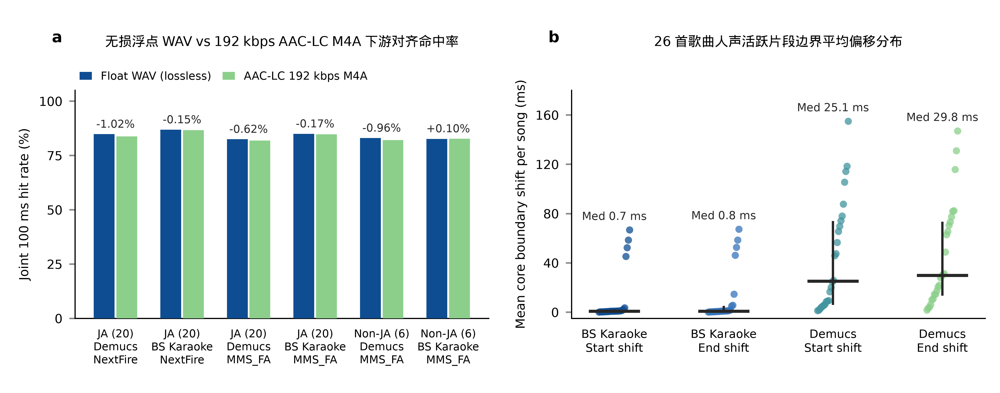

# 十种人声分离配置及 AAC-LC 持久化对下游歌词对齐的影响

在歌词自动打轴流程中，音频前端需要回答两个核心工程问题：第一，选哪种人声分离模型、在送入对齐模型前要不要先把间奏静音段裁掉？第二，分离出的人声轨如果直接存成无损 WAV，每首歌要占 40–100 MiB 磁盘空间；若压缩保存为 192 kbps AAC-LC（`.m4a`，单曲仅 4–10 MiB），会不会破坏活跃人声片段的切分边界或拉低最终打轴准确率？

为回答这两个问题，本报告开展了两项实验（对应 M5 与 M3）：
1. **十种人声分离模型与人声片段裁剪策略对比（M5）**：在 20 首日语主组歌曲（`j01`–`j20`，共 **8,911 个纯假名主评估读音单元**、**9,052 个全量读音单元**与 **7,167 个共同正文区间**）上，固定下游 `NextFire` 对齐模型，对比 [十种人声分离配置](separation-performance.md) 在**人声活跃片段拼接（`core`）**与**整曲不裁剪输入（`global`）**下的下游打轴准确率；
2. **192 kbps AAC-LC M4A 人声轨持久化对比（M3）**：在全部 26 首歌曲（20 首日语 + 6 首非日语，共 **10,886 个主评估读音单元**、**9,124 个共同正文区间**）上，对比分离后的人声轨直接以**无损浮点 WAV（`float`）**送入下游，与先编码保存为 **192 kbps AAC-LC M4A（`aac`）**再解码送入下游时的活跃片段切分边界偏移和最终打轴准确率。

指标与边界定义见 [测试集与评价方法](methods.md)，完整数据保存在 [`results/M5/summary.json`](../results/M5/summary.json)、[`results/M5/metrics.csv`](../results/M5/metrics.csv)、[`results/M3/summary.json`](../results/M3/summary.json)、[`results/M3/cohorts.csv`](../results/M3/cohorts.csv) 及 [`results/M3/core-boundaries.csv`](../results/M3/core-boundaries.csv)。

## 核心发现

1. **人声活跃片段拼接（`core`）是保证下游对齐精度的关键步骤**：
   - 在对比 `core` 与 `global` 的 4 种代表性分离器上，先剔除前奏、间奏、尾奏长静音段再拼接对齐，将双端 100 ms 命中率一致拉升 **2.65 至 9.93 个百分点**：`Demucs` 从整曲直传（`global`）的 **74.84%** 跃升至 `core` 的 **84.77%**（**+9.93%**），`BS Karaoke` 从 **77.25%** 跃升至 **86.83%**（**+9.58%**），`Windowed RoFormer` 从 **76.40%** 跃升至 **85.49%**（**+9.09%**），`MDX-Net Inst HQ 3`（`sug`）也从 **82.39%** 提升至 **85.04%**（**+2.65%**，起点 / 终点 MAE 从 162.99 / 170.66 ms 大幅降至 56.37 / 63.51 ms）。
2. **开启 `core` 片段拼接后，主流分离器的下游命中率高度接近，形成清晰的双档推荐**：
   - 除 `HybridDemucs MUSDB Plus`（`yohane`，**81.87%**）和 `SCNet Small`（**82.21%**）偏低、`DTTNet`（**83.77%**）居中外，其余 7 种分离器的纯假名双端 100 ms 命中率全部集中在 **84.77%–86.83%** 的 2.05 个百分点区间内。
   - **默认高性价比档（`Demucs htdemucs`）**：达到 **84.77%**（7,554/8,911），与耗时高出 2.6–5.2 倍的 `MDX-Net`（**85.04%**）、`MelBand ep_3005`（**85.15%**）、`MelBand Kim`（**85.28%**）差距不足 0.5 个百分点。
   - **高质量主唱分离档（`BS Karaoke`）**：凭借剥离背景和声与伴唱的能力达到全场最高的 **86.83%**（7,737/8,911），双端 200 ms 命中率达 **95.21%**，综合绝对误差 P95 低至 **121.54 ms**，`>1 s` 大误差仅 **58** 个。
3. **将分离后的人声轨保存为 192 kbps AAC-LC M4A 对下游打轴几乎无损**：
   - 在 20 首日语主组（`n=8,911`）上，`BS Karaoke` 保存为 192 kbps AAC-LC 后的双端 100 ms 命中率与无损浮点 WAV 相比，在 `NextFire` 下仅差 **-0.15%**（86.83% vs **86.68%**），在 `MMS_FA + 智能延长` 下仅差 **-0.17%**（84.93% vs **84.76%**）；`Demucs` 在两条对齐模型下也仅相差 **-1.02%**（84.77% vs **83.75%**）与 **-0.62%**（82.43% vs **81.81%**）。
   - 在 6 首非日语歌曲（`n=1,975`）上，`BS Karaoke + MMS_FA + 智能延长` 在 AAC-LC 下甚至微增 **+0.10%**（82.58% vs **82.68%**），`BS Karaoke + NextFire` 提升 **+1.82%**（50.08% vs **51.90%**）。
   - 片段切分边界对比表明，`BS Karaoke` 因静音区底噪极低，26 首歌中有 **24 首**在浮点 WAV 与 AAC-LC 下切出的 `core` 活跃片段数量完全相同（总段数均为 1,009 段），单曲片段起点 / 终点平均偏移的中位数仅为 **0.74 ms / 0.81 ms**。这说明将分离人声轨保存为 192 kbps AAC-LC `.m4a` 既能把缓存体积压缩约 90%，又不会牺牲打轴精度。

---

## 1. 十种人声分离模型的下游对齐准确率（M5，20 首日语主组）

为保持对比公平，20 首日语主组歌曲在完成人声分离后，下游统一接入 Lazulite Studio 的 `NextFire` 对齐流程与人工参考读音。

### 1.1 人声活跃片段拼接（`core`）下 10 种分离器横向对比

下表按主评估纯假名读音单元（`n = 8,911`）的双端 100 ms 命中率降序排列，同时给出含英文全量读音单元（`n = 9,052`）和共同正文边界（`n = 7,167`）的命中率与误差指标：

| 分离模型 | 纯假名 100 ms 命中率 (`n=8,911`) | 纯假名 200 ms 命中率 | 纯假名起点 / 终点 MAE (ms) | 纯假名起点 / 终点 P95 (ms) | 纯假名综合 P95 (ms) | 缺失 | >1 s 大误差 | 全量读音 100 ms (`n=9,052`) | 共同正文 100 ms (`n=7,167`) |
| --- | ---: | ---: | ---: | ---: | ---: | ---: | ---: | ---: | ---: |
| **BS Karaoke** (`bs-core`) | **7,737 (86.83%)** | **8,484 (95.21%)** | **39.98 / 45.89** | **105.62 / 144.40** | **121.54** | 14 | **58** | **7,790 (86.06%)** | **6,138 (85.64%)** |
| BS-RoFormer viperx (`bs_roformer-core`) | 7,653 (85.88%) | 8,383 (94.07%) | 59.82 / 66.20 | 117.74 / 169.54 | 144.00 | **3** | 100 | 7,710 (85.17%) | 6,075 (84.76%) |
| Windowed RoFormer (`windowed-core`) | 7,618 (85.49%) | 8,383 (94.07%) | 49.37 / 57.27 | 121.95 / 169.22 | 145.32 | 6 | 95 | 7,667 (84.70%) | 6,051 (84.43%) |
| MelBand Kim (`mel_roformer-core`) | 7,599 (85.28%) | 8,370 (93.93%) | 99.66 / 106.56 | 126.76 / 179.24 | 152.41 | 4 | 115 | 7,659 (84.61%) | 6,058 (84.53%) |
| MelBand ep_3005 (`milikara-core`) | 7,588 (85.15%) | 8,377 (94.01%) | 83.45 / 92.31 | 122.66 / 178.00 | 150.92 | **3** | 121 | 7,646 (84.47%) | 6,029 (84.12%) |
| MDX-Net Inst HQ 3 (`sug-core`) | 7,578 (85.04%) | 8,363 (93.85%) | 56.37 / 63.51 | 118.58 / 177.97 | 148.88 | 19 | 96 | 7,632 (84.31%) | 6,022 (84.02%) |
| **Demucs htdemucs** (`demucs-core`) | 7,554 (84.77%) | 8,360 (93.82%) | 49.07 / 55.87 | 126.60 / 174.27 | 152.03 | 16 | 80 | 7,607 (84.04%) | 5,998 (83.69%) |
| DTTNet (`dttnet-core`) | 7,465 (83.77%) | 8,309 (93.24%) | 79.43 / 88.98 | 136.55 / 197.31 | 164.75 | 5 | 120 | 7,514 (83.01%) | 5,919 (82.59%) |
| SCNet Small (`scnet-core`) | 7,326 (82.21%) | 8,309 (93.24%) | 75.07 / 83.07 | 146.64 / 193.12 | 168.16 | 12 | 112 | 7,375 (81.47%) | 5,781 (80.66%) |
| HybridDemucs Plus (`yohane-core`) | 7,295 (81.87%) | 8,318 (93.35%) | 58.94 / 69.35 | 133.42 / 189.29 | 160.60 | 17 | 107 | 7,339 (81.08%) | 5,780 (80.65%) |

### 1.2 人声活跃片段拼接（`core`）vs 整曲输入（`global`）对比

在 `Demucs`、`BS Karaoke`、`Windowed RoFormer` 与 `MDX-Net Inst HQ 3` 四种代表性分离器上，对比开启与关闭人声活跃片段裁剪（`core` vs `global`）的打轴表现：

| 分离模型 | 裁剪策略 | 纯假名 100 ms (`n=8,911`) | 纯假名 200 ms | 起点 / 终点 MAE (ms) | 综合 P95 (ms) | >1 s 大误差 | 共同正文 100 ms (`n=7,167`) | `core` 相比 `global` 100 ms 提升 |
| --- | --- | ---: | ---: | ---: | ---: | ---: | ---: | ---: |
| **BS Karaoke** | `core`（片段拼接） | **7,737 (86.83%)** | **8,484 (95.21%)** | **39.98 / 45.89** | **121.54** | **58** | **6,138 (85.64%)** | **+9.58%**（共同正文 **+9.84%**） |
| **BS Karaoke** | `global`（整曲输入） | 6,884 (77.25%) | 8,411 (94.39%) | 66.30 / 75.63 | 160.00 | 58 | 5,433 (75.81%) | — |
| **Windowed RoFormer** | `core`（片段拼接） | **7,618 (85.49%)** | **8,383 (94.07%)** | **49.37 / 57.27** | **145.32** | **95** | **6,051 (84.43%)** | **+9.09%**（共同正文 **+9.68%**） |
| **Windowed RoFormer** | `global`（整曲输入） | 6,808 (76.40%) | 8,269 (92.80%) | 110.75 / 120.38 | 183.00 | 122 | 5,357 (74.75%) | — |
| **MDX-Net Inst HQ 3** (`sug`) | `core`（片段拼接） | **7,578 (85.04%)** | **8,363 (93.85%)** | **56.37 / 63.51** | **148.88** | **96** | **6,022 (84.02%)** | **+2.65%**（共同正文 **+2.96%**） |
| **MDX-Net Inst HQ 3** (`sug`) | `global`（整曲输入） | 7,342 (82.39%) | 8,300 (93.14%) | 162.99 / 170.66 | 173.00 | 146 | 5,810 (81.07%) | — |
| **Demucs htdemucs** | `core`（片段拼接） | **7,554 (84.77%)** | **8,360 (93.82%)** | **49.07 / 55.87** | **152.03** | **80** | **5,998 (83.69%)** | **+9.93%**（共同正文 **+10.37%**） |
| **Demucs htdemucs** | `global`（整曲输入） | 6,669 (74.84%) | 8,239 (92.46%) | 138.48 / 150.48 | 192.00 | 129 | 5,255 (73.32%) | — |

为什么 `MDX-Net Inst HQ 3` 在整曲直传（`global`）下能保持 82.39%，而 `Demucs`、`BS Karaoke` 和 `Windowed RoFormer` 在整曲直传下均跌至 74%–77%？原因在于 `MDX-Net Inst HQ 3` 本质上是伴奏提取模型（通过从原曲减去预测伴奏得到人声），其间奏段保留了微弱的高频混响底噪，使 `NextFire` 在间奏期能持续稳定输出空白帧（blank）；而专职人声与主唱提取模型（尤其是 `BS Karaoke` 和 `Demucs`）会将间奏段压成几乎全零的纯静音，若不通过 `core` 片段拼接切除长间奏，全局 Viterbi 解码很容易把间奏前后的尾音或起音跨静音段拉长。一旦采用 `core` 片段拼接切除静音段，`Demucs`（84.77%）与 `BS Karaoke`（86.83%）立刻反超 `MDX-Net` 的整曲直传（82.39%）。

---

## 2. 192 kbps AAC-LC M4A 人声持久化对下游对齐的影响（M3，26 首全集）

M3 实验在全部 26 首歌（20 首日语 + 6 首非日语）上交叉测试了 `Demucs` 与 `BS Karaoke` 两种分离器、`NextFire` 与 `MMS_FA + 智能延长` 两种对齐模型在**无损浮点 WAV 直传（`float`）**与**192 kbps AAC-LC M4A 保存后重解码（`aac`）**下的表现。

### 2.1 分语种（20 首日语 vs 6 首非日语）对齐指标对比

| 分离器与对齐模型 | 语种分组 | 分母 `n` | 无损 `float` 100 ms 命中率 | `aac` (192 kbps M4A) 100 ms 命中率 | 100 ms 命中率差值 (`aac - float`) | 无损 `float` 200 ms 命中率 | `aac` 200 ms 命中率 | 无损 `float` 起点 / 终点 MAE (ms) | `aac` 起点 / 终点 MAE (ms) | 无损 `float` / `aac` 综合 P95 (ms) |
| --- | --- | ---: | ---: | ---: | ---: | ---: | ---: | ---: | ---: | ---: |
| `BS Karaoke + NextFire` | 日语 20 首 | 8,911 | **7,737 (86.83%)** | **7,724 (86.68%)** | **-0.15%** (-13 单元) | 95.21% | 95.04% | 39.98 / 45.89 | 43.26 / 48.88 | 121.54 / 125.03 |
| `BS Karaoke + MMS_FA + 智能延长` | 日语 20 首 | 8,911 | **7,568 (84.93%)** | **7,553 (84.76%)** | **-0.17%** (-15 单元) | 95.54% | 95.51% | 51.04 / 61.32 | 52.37 / 63.06 | 129.38 / 129.62 |
| `Demucs + NextFire` | 日语 20 首 | 8,911 | 7,554 (84.77%) | 7,463 (83.75%) | **-1.02%** (-91 单元) | 93.82% | 93.87% | 49.07 / 55.87 | 53.34 / 60.03 | 152.03 / 154.22 |
| `Demucs + MMS_FA + 智能延长` | 日语 20 首 | 8,911 | 7,345 (82.43%) | 7,290 (81.81%) | **-0.62%** (-55 单元) | 93.46% | 92.92% | 83.62 / 96.64 | 102.70 / 115.39 | 165.78 / 186.36 |
| `BS Karaoke + MMS_FA + 智能延长` | 非日语 6 首 | 1,975 | 1,631 (82.58%) | **1,633 (82.68%)** | **+0.10%** (+2 单元) | 92.05% | 92.15% | 142.73 / 157.04 | 197.75 / 209.41 | 192.68 / 193.81 |
| `Demucs + MMS_FA + 智能延长` | 非日语 6 首 | 1,975 | **1,639 (82.99%)** | 1,620 (82.03%) | **-0.96%** (-19 单元) | 92.46% | 91.95% | 187.33 / 204.01 | 224.92 / 244.21 | 188.83 / 207.06 |
| `BS Karaoke + NextFire` | 非日语 6 首 | 1,975 | 989 (50.08%) | 1,025 (51.90%) | **+1.82%** (+36 单元) | 70.89% | 71.95% | 181.09 / 200.52 | 183.15 / 200.95 | 774.23 / 770.25 |
| `Demucs + NextFire` | 非日语 6 首 | 1,975 | 925 (46.84%) | 937 (47.44%) | **+0.61%** (+12 单元) | 68.61% | 69.57% | 208.86 / 225.82 | 191.93 / 211.83 | 1,005.38 / 869.42 |

### 2.2 26 首全集汇总表现（主评估读音单元 `n = 10,886` 与共同正文边界 `n = 9,124`）

| 实验组合 | 主评估读音单元 100 ms (`n=10,886`) | 主评估读音单元 200 ms | 读音起点 / 终点 MAE (ms) | 读音综合 P95 (ms) | 共同正文 100 ms (`n=9,124`) | 共同正文 200 ms | 共同正文综合 P95 (ms) |
| --- | ---: | ---: | ---: | ---: | ---: | ---: | ---: |
| `BS Karaoke + 无损 WAV + MMS_FA` | **9,199/10,886 (84.50%)** | **10,332/10,886 (94.91%)** | 67.66 / 78.67 | **139.01** | **7,666/9,124 (84.02%)** | 8,626/9,124 (94.54%) | 144.00 |
| `BS Karaoke + AAC-LC + MMS_FA` | 9,186/10,886 (84.38%) | **10,331/10,886 (94.90%)** | 78.71 / 89.57 | 140.44 | 7,643/9,124 (83.77%) | **8,627/9,124 (94.55%)** | **144.44** |
| `Demucs + 无损 WAV + MMS_FA` | 8,984/10,886 (82.53%) | 10,154/10,886 (93.28%) | 102.41 / 116.10 | 171.05 | 7,476/9,124 (81.94%) | 8,472/9,124 (92.85%) | 178.75 |
| `Demucs + AAC-LC + MMS_FA` | 8,910/10,886 (81.85%) | 10,096/10,886 (92.74%) | 124.84 / 138.73 | 188.11 | 7,413/9,124 (81.25%) | 8,414/9,124 (92.22%) | 198.06 |
| `BS Karaoke + AAC-LC + NextFire` | 8,749/10,886 (80.37%) | 9,890/10,886 (90.85%) | 68.47 / 76.28 | 215.61 | 7,144/9,124 (78.30%) | 8,170/9,124 (89.54%) | 245.56 |
| `BS Karaoke + 无损 WAV + NextFire` | 8,726/10,886 (80.16%) | 9,884/10,886 (90.80%) | **65.42 / 73.77** | 221.81 | 7,111/9,124 (77.94%) | 8,156/9,124 (89.39%) | 253.62 |
| `Demucs + 无损 WAV + NextFire` | 8,479/10,886 (77.89%) | 9,715/10,886 (89.24%) | 77.65 / 86.26 | 274.43 | 6,906/9,124 (75.69%) | 8,025/9,124 (87.95%) | 305.93 |
| `Demucs + AAC-LC + NextFire` | 8,400/10,886 (77.16%) | 9,739/10,886 (89.46%) | 78.25 / 87.32 | 256.16 | 6,854/9,124 (75.12%) | 8,064/9,124 (88.38%) | 285.50 |

### 2.3 人声活跃片段（`core`）切分边界偏移分析

为什么 `BS Karaoke` 在 AAC-LC 压缩下的差异（-0.15% 至 -0.17%）比 `Demucs`（-0.59% 至 -1.03%）更小？对比 26 首歌曲在无损 `float` 与 `aac` 下切出的 `core` 活跃人声片段边界（[`results/M3/core-boundaries.csv`](../results/M3/core-boundaries.csv)，按双向最近端点距离计算）：

| 人声分离器 | 26 首 `float` 总片段数 | 26 首 `aac` 总片段数 | 片段数完全一致的曲数 | 单曲起点平均偏移中位数 (IQR) | 单曲终点平均偏移中位数 (IQR) | 单曲起点平均偏移算术均值 | 单曲终点平均偏移算术均值 |
| --- | ---: | ---: | ---: | ---: | ---: | ---: | ---: |
| **BS Karaoke** (`bs`) | 1,009 | 1,009 | **24 / 26 首 (92.3%)** | **0.74 ms** (0.48–1.05 ms) | **0.81 ms** (0.44–1.47 ms) | **9.24 ms** | **10.06 ms** |
| **Demucs htdemucs** (`demucs`) | 1,081 | 1,080 | 14 / 26 首 (53.8%) | **25.14 ms** (7.39–74.08 ms) | **29.82 ms** (15.42–73.33 ms) | **44.46 ms** | **46.06 ms** |

- **`BS Karaoke` 的静音区十分干净**：其非人声区能量远低于活动检测门限，192 kbps AAC-LC 编码几乎不改变静音切分位置，因此 26 首歌中有 24 首切出的片段数分毫不差，单曲起点与终点偏移中位数不到 **1 ms**（还不到 1/20 个模型帧步长）。
- **`Demucs` 在弱伴奏残留处接近静音门限**：`Demucs` 在部分弱呼吸声或器乐串音处存在接近门限的微弱底噪，AAC-LC 编码偶发使个别微弱间奏片段合并或拆分（12 首歌出现 ±1 至 ±2 段的片段数变化，单曲边界偏移中位数为 25–30 ms），但在映射回原曲时间轴后，对双端 200 ms 命中率的影响依然控制在 **-0.54% 至 +0.06%** 以内。
