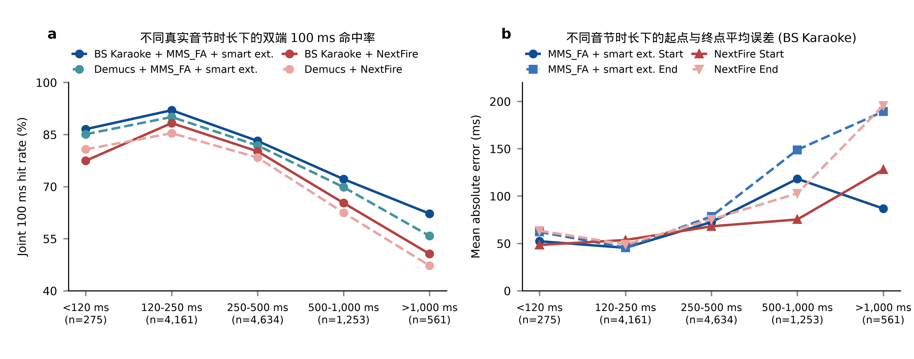

# 语速、音节时长与对齐误差相关性分析

快歌里密集的快口音节和慢歌里动辄拖长一两秒的句尾长音，哪一种更容易让自动打轴失准？为了摸清歌曲快慢与音节长短对打轴精度的实际影响，本报告在全部 26 首歌曲（20 首日语主组 + 6 首非日语跨语种组，共 **10,884 个主评估读音单元**）上，从**单个音节的真实持音时长分档**与**整首歌的语速统计相关性**两个角度，分析 `NextFire` 与 `MMS_FA + 智能延长` 两条对齐路线的表现。

指标定义见 [测试集与评价方法](methods.md)，完整统计表与检验结果保存在 [`results/M4/summary.json`](../results/M4/summary.json)、[`results/M4/duration-bins.csv`](../results/M4/duration-bins.csv) 和 [`results/M4/correlations.csv`](../results/M4/correlations.csv)。

## 核心发现

1. **音节对齐准确率呈“中间高、两头低”的分布，在 120–250 ms 的常规音节上最高**：
   - 全部 10,884 个参考读音单元中，时长位于 `120–250 ms`（`n=4,161`）和 `250–500 ms`（`n=4,634`）的常规音节占比达 **80.81%**。在 `120–250 ms` 区间内，`BS Karaoke + MMS_FA + 智能延长` 的双端 100 ms 命中率高达 **92.00%**（双端 200 ms 达 **97.81%**，起点 / 终点 MAE 仅为 **45.39 / 45.52 ms**，综合 P95 仅 **98.05 ms**），`Demucs + MMS_FA + 智能延长` 达 **90.05%**，`BS Karaoke + NextFire` 达 **88.30%**。
2. **极短音节（`<120 ms`）受限于模型帧长，而超长拖音（`>1,000 ms`）的误差主要出在尾音提前收束**：
   - 在 `<120 ms` 的极短快口音节（`n=275`，仅跨越 2–5 个 20 ms 声学帧）上，`MMS_FA + 智能延长` 保持 **86.55%**（BS Karaoke）与 **85.09%**（Demucs）的双端 100 ms 命中率，明显高于 `NextFire` 的 **77.45%** 与 **80.73%**。
   - 在 `>1,000 ms` 的超长拖音（`n=561`，多为句尾长音、颤音或高音延音）上，四条配置的双端 100 ms 命中率回落至 **47.24%–62.21%**。对比起点与终点 MAE 可以看到：超长音节的**起点定位依然很准**（`BS + MMS_FA + 智能延长` 起点 MAE 仅 **86.80 ms**，甚至低于 `500–1,000 ms` 档的 118.22 ms），但**终点 MAE 升至 189.31–298.02 ms**。这是因为句尾长拖音在气息减弱与伴奏涌入阶段音量逐渐衰减，模型和能量门限对渐弱尾音何时结束的判断比清晰的起音更难拿捏。
3. **从整首歌来看：语速越快（每秒音节数越多、音节中位时长越短），全曲双端 100 ms 命中率反而越高**：
   - 在 26 首歌曲（`n=26`）的曲目级相关分析中，有效每秒音节数（`syllables_per_second`，剔除行间大空白后的有效发声语速）与双端 100 ms 命中率呈**正相关**，而音节中位时长（`median_duration_ms`）与双端 100 ms 命中率呈**显著负相关**（在 `BS + MMS_FA + 智能延长` 下 Spearman $r = -0.4459, p = 0.0224$；在 `BS + NextFire` 下 Spearman $r = -0.6210, p = 0.0007$）。
   - 这一看似反直觉的现象由两方面原因造成：第一，快歌的绝大多数音节恰好落在 `120–250 ms` 的最佳命中区间，密集的辅音起音给前后音节提供了紧密的时间锚点，前一个字很难往后拖长；第二，慢速抒情歌包含大量 `>500 ms` 乃至 `>1,000 ms` 的慢速长音（且测试集中部分慢歌恰好为非日语歌曲，进一步拉大了 `NextFire` 在慢歌上的差距）。在各语种表现均衡的 `MMS_FA + 智能延长` 上，整曲语速与起点 / 终点 MAE 的相关性很弱（$|r| \le 0.33, p > 0.10$），说明它在不同快慢的歌曲上都很稳定。

---

## 1. 真实音节时长五档表现（`n = 10,884`）

按人工参考标注的真实音节时长（`end - start`），将 26 首歌曲的全部 10,884 个读音单元划分为 5 个时长区间：

| 对齐路线 | 时长区间 (ms) | 单元数 `n` (占比) | 有效预测 | 双端 100 ms 命中率 | 双端 200 ms 命中率 | 起点 MAE (ms) | 终点 MAE (ms) | 起点 / 终点 P95 (ms) | 综合 P95 (ms) | >1 s 大误差 |
| --- | --- | ---: | ---: | ---: | ---: | ---: | ---: | ---: | ---: | ---: |
| `BS Karaoke + MMS_FA + 智能延长` | `<120` | 275 (2.5%) | 275 | **238 (86.55%)** | 261 (94.91%) | 52.30 | 62.15 | 127.52 / 152.89 | **149.48** | 4 |
| `BS Karaoke + MMS_FA + 智能延长` | `120-250` | 4,161 (38.2%) | 4,158 | **3,828 (92.00%)** | **4,070 (97.81%)** | **45.39** | **45.52** | **98.19 / 97.68** | **98.05** | **32** |
| `BS Karaoke + MMS_FA + 智能延长` | `250-500` | 4,634 (42.6%) | 4,632 | **3,853 (83.15%)** | **4,416 (95.30%)** | 72.51 | 78.55 | 126.31 / 153.00 | **138.68** | **49** |
| `BS Karaoke + MMS_FA + 智能延长` | `500-1000` | 1,253 (11.5%) | 1,253 | **904 (72.15%)** | **1,097 (87.55%)** | 118.22 | 148.83 | 154.40 / 322.40 | **264.20** | **14** |
| `BS Karaoke + MMS_FA + 智能延长` | `>1000` | 561 (5.2%) | 560 | **349 (62.21%)** | **462 (82.35%)** | **86.80** | **189.31** | **131.49 / 782.60** | **451.50** | **21** |
| `Demucs + MMS_FA + 智能延长` | `<120` | 275 (2.5%) | 275 | 234 (85.09%) | 257 (93.45%) | 97.45 | 96.49 | 194.78 / 160.34 | 163.79 | 8 |
| `Demucs + MMS_FA + 智能延长` | `120-250` | 4,161 (38.2%) | 4,157 | 3,747 (90.05%) | 4,000 (96.13%) | 86.94 | 87.24 | 113.20 / 113.08 | 113.12 | 62 |
| `Demucs + MMS_FA + 智能延长` | `250-500` | 4,634 (42.6%) | 4,630 | 3,792 (81.83%) | 4,376 (94.43%) | 94.37 | 104.71 | 135.67 / 174.43 | 152.70 | 62 |
| `Demucs + MMS_FA + 智能延长` | `500-1000` | 1,253 (11.5%) | 1,252 | 875 (69.83%) | 1,077 (85.95%) | 150.33 | 181.41 | 157.32 / 336.74 | 290.60 | 19 |
| `Demucs + MMS_FA + 智能延长` | `>1000` | 561 (5.2%) | 560 | 313 (55.79%) | 424 (75.58%) | 177.36 | 298.02 | 247.95 / 1,158.28 | 833.25 | 40 |
| `BS Karaoke + NextFire` | `<120` | 275 (2.5%) | 275 | 213 (77.45%) | **262 (95.27%)** | **48.42** | 63.43 | 140.74 / 161.67 | 151.94 | 2 |
| `BS Karaoke + NextFire` | `120-250` | 4,161 (38.2%) | 4,149 | 3,674 (88.30%) | 3,970 (95.41%) | 53.58 | 49.03 | 127.48 / 127.69 | 127.58 | 41 |
| `BS Karaoke + NextFire` | `250-500` | 4,634 (42.6%) | 4,620 | 3,714 (80.15%) | 4,213 (90.91%) | **68.05** | **75.35** | 181.39 / 242.82 | 216.26 | 56 |
| `BS Karaoke + NextFire` | `500-1000` | 1,253 (11.5%) | 1,250 | 818 (65.28%) | 1,054 (84.12%) | **75.28** | **102.85** | 299.76 / 381.61 | 360.27 | 19 |
| `BS Karaoke + NextFire` | `>1000` | 561 (5.2%) | 558 | 284 (50.62%) | 385 (68.63%) | 127.92 | 195.65 | 753.13 / 944.74 | 831.22 | 42 |
| `Demucs + NextFire` | `<120` | 275 (2.5%) | 273 | 222 (80.73%) | 255 (92.73%) | 48.48 | **60.50** | 172.76 / 204.73 | 184.77 | **0** |
| `Demucs + NextFire` | `120-250` | 4,161 (38.2%) | 4,138 | 3,553 (85.39%) | 3,884 (93.34%) | 64.48 | 61.97 | 173.39 / 172.95 | 173.44 | 71 |
| `Demucs + NextFire` | `250-500` | 4,634 (42.6%) | 4,616 | 3,631 (78.36%) | 4,195 (90.53%) | 78.63 | 84.71 | 232.92 / 260.20 | 244.55 | 67 |
| `Demucs + NextFire` | `500-1000` | 1,253 (11.5%) | 1,249 | 783 (62.49%) | 1,028 (82.04%) | 81.63 | 111.39 | 363.45 / 383.72 | 381.81 | 21 |
| `Demucs + NextFire` | `>1000` | 561 (5.2%) | 554 | 265 (47.24%) | 357 (63.64%) | 180.20 | 244.14 | 889.23 / 1,087.33 | 1,057.73 | 51 |

---

## 2. 曲目级语速与音节时长相关性检验（`n = 26`）

下表列出 26 首歌曲的曲目级时间特征（有效每秒音节数 `syllables_per_second`、音节中位时长 `median_duration_ms`、平均时长 `mean_duration_ms`、第 90 百分位长音时长 `p90_duration_ms`）与下游打轴指标之间的 Pearson 线性相关系数与 Spearman 秩相关系数：

| 对齐路线 | 曲目特征 | 目标指标 | Pearson $r$ | Pearson $p$ | Spearman $r$ | Spearman $p$ | 趋势解读 |
| --- | --- | --- | ---: | ---: | ---: | ---: | --- |
| `BS + MMS_FA + 智能延长` | 每秒音节数 (`syllables_per_second`) | 双端 100 ms 命中率 | +0.2989 | 0.1379 | +0.3538 | 0.0762 | 语速越快，命中率呈温和上升趋势 |
| `BS + MMS_FA + 智能延长` | 音节中位时长 (`median_duration_ms`) | 双端 100 ms 命中率 | -0.3265 | 0.1035 | **-0.4459** | **0.0224** | 中位音节越长（慢歌），100 ms 命中率显著降低 |
| `BS + MMS_FA + 智能延长` | 音节平均时长 (`mean_duration_ms`) | 双端 100 ms 命中率 | -0.3286 | 0.1012 | -0.3538 | 0.0762 | 平均音节越长，100 ms 命中率呈降低趋势 |
| `BS + MMS_FA + 智能延长` | P90 长音时长 (`p90_duration_ms`) | 双端 100 ms 命中率 | -0.2714 | 0.1799 | -0.3552 | 0.0750 | 长拖音越长，命中率呈降低趋势 |
| `BS + MMS_FA + 智能延长` | 每秒音节数 (`syllables_per_second`) | 起点 / 终点 MAE | +0.0057 / -0.0365 | 0.9779 / 0.8597 | -0.1104 / -0.1227 | 0.5912 / 0.5503 | 全曲平均绝对误差对语速变化不敏感 |
| `Demucs + MMS_FA + 智能延长` | 每秒音节数 (`syllables_per_second`) | 双端 100 ms 命中率 | +0.2125 | 0.2973 | +0.2903 | 0.1503 | 语速与命中率呈弱正相关，跨语速表现稳定 |
| `Demucs + MMS_FA + 智能延长` | 音节中位时长 (`median_duration_ms`) | 双端 100 ms 命中率 | -0.1676 | 0.4132 | -0.3125 | 0.1201 | 中位时长与命中率呈温和负相关 |
| `BS + NextFire` | 每秒音节数 (`syllables_per_second`) | 双端 100 ms 命中率 | **+0.5465** | **0.0039** | **+0.6089** | **0.0010** | 快节奏日语歌集中在高命中区间，慢歌含非日语与长拖音 |
| `BS + NextFire` | 音节中位时长 (`median_duration_ms`) | 双端 100 ms 命中率 | **-0.6217** | **0.0007** | **-0.6210** | **0.0007** | 中位音节越长，100 ms 命中率明显越低 |
| `BS + NextFire` | 音节中位时长 (`median_duration_ms`) | 起点 / 终点 MAE | **+0.5545 / +0.5826** | **0.0033 / 0.0018** | **+0.6121 / +0.6654** | **0.0009 / 0.0002** | 慢歌尾音与跨语种滑移推高 MAE |
| `Demucs + NextFire` | 每秒音节数 (`syllables_per_second`) | 双端 100 ms 命中率 | **+0.5102** | **0.0077** | **+0.5720** | **0.0023** | 与 `BS + NextFire` 规律一致 |
| `Demucs + NextFire` | 音节中位时长 (`median_duration_ms`) | 双端 100 ms 命中率 | **-0.5503** | **0.0036** | **-0.5557** | **0.0032** | 与 `BS + NextFire` 规律一致 |

---

## 3. 同曲双编曲对照：`j14 - Spica` vs `j15 - Spica (new arrange)`

测试集包含同一首歌曲《Spica》的原版编曲（`j14`，总时长 309.014 s，无背景轨）与新编曲版本（`j15`，总时长 326.507 s，含 1 段背景人声轨），两者的正文行数（35 行）与参考读音单元数（351 个）完全一致：
- **唱腔节奏高度吻合**：`j14` 与 `j15` 的音节中位时长完全相同（均为 **440.00 ms**），第 10 百分位时长分别为 **200.00 ms** 与 **202.00 ms**，第 90 百分位长音时长分别为 **1,302.00 ms** 与 **1,311.00 ms**，有效发声语速分别为 **1.560 音节/秒** 与 **1.537 音节/秒**（因属于慢速长拖音曲目，两版本的 `>1,000 ms` 音节占比均超过 10%）。
- **不同分离器下的打轴表现**：在 `Demucs` 分离下，原版 `j14` 的双端 100 ms 命中率比混响与配器更厚重的新编曲 `j15` 高出 2.00–2.85 个百分点（`Demucs + NextFire` 为 **75.21%** vs **72.36%**；`Demucs + MMS_FA + 智能延长` 为 **75.50%** vs **73.50%**）；而在换用 `BS Karaoke` 剥离新编曲的伴奏与背景声部后，两版本的差距大幅缩小（`BS + NextFire` 为 **74.07%** vs **73.50%**，仅差 0.57%；`BS + MMS_FA + 智能延长` 在 `j15` 上更从 73.50% 提升至 **74.93%**，双端 200 ms 命中率达 **92.02%**，终点 MAE 从 90.41 ms 降至 **61.54 ms**）。这说明慢速长音歌曲的主要误差来自尾音与伴奏混响的交叠，使用 `BS Karaoke` 可有效减少复杂配器带来的尾音漂移。
